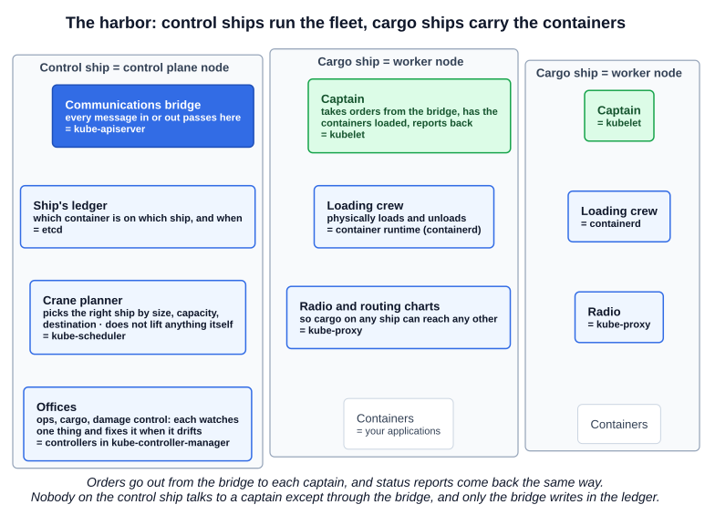
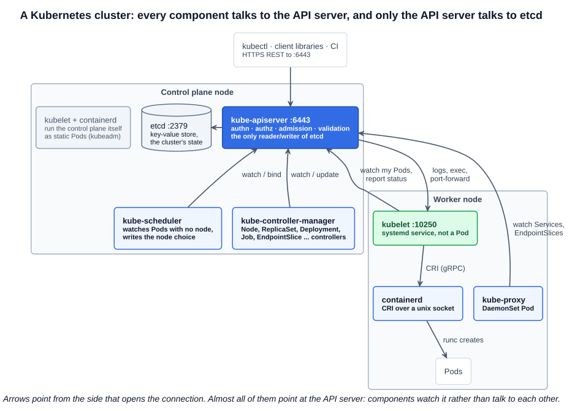
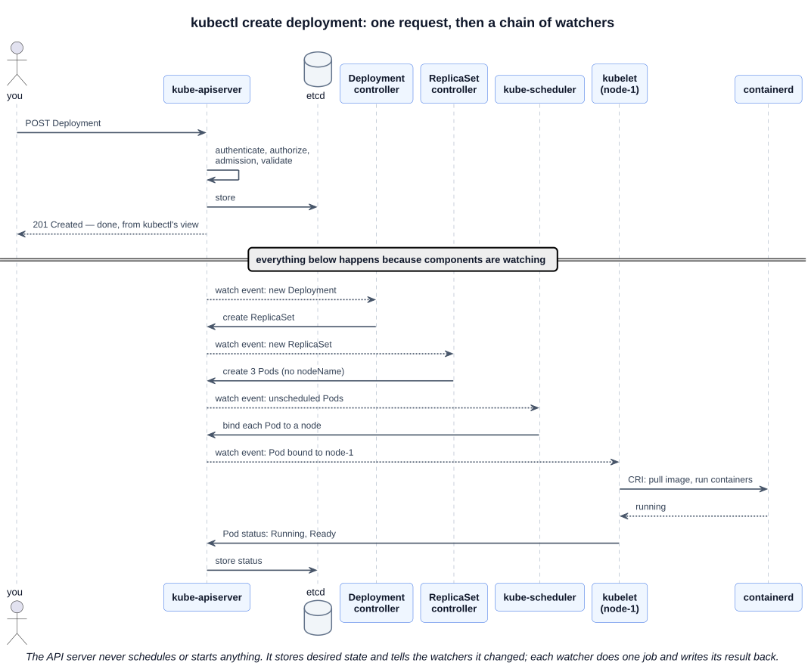
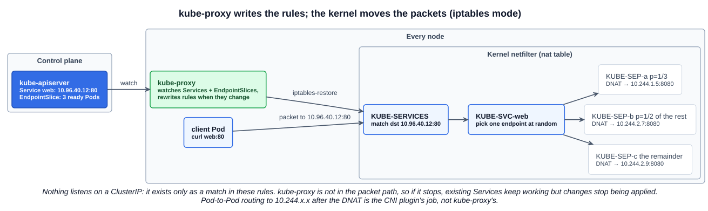

# 01 — Cluster Architecture

Kubernetes runs applications packaged as containers across a group of machines and keeps them running in the state you asked for. That group of machines is a **cluster**. Every machine in it is a **node**, and nodes have one of two jobs:

| Role | Job | Runs |
|---|---|---|
| **Control plane node** | Manage, plan, schedule and monitor the cluster | kube-apiserver, etcd, kube-scheduler, kube-controller-manager |
| **Worker node** | Host the applications as containers | kubelet, kube-proxy, a container runtime (containerd) |

The course calls the control plane node the **master**. Kubernetes has retired that word: the docs say *control plane*, and kubeadm marks those nodes with the `node-role.kubernetes.io/control-plane` label and taint (it no longer sets the old `node-role.kubernetes.io/master` ones). Expect *control plane* in exam tasks.

---

## 1. The analogy: control ships and cargo ships

Picture a harbor. **Cargo ships** carry the containers. **Control ships** carry no cargo at all — they run the fleet: they decide which container goes on which ship, keep the records, watch for problems and send out orders. Every part of a cluster has a place in that picture.



| In the harbor | In the cluster | What it does |
|---|---|---|
| Cargo ship | **Worker node** | Carries containers — runs your applications |
| Control ship | **Control plane node** | Manages the fleet; carries no cargo of its own |
| Ship's ledger | **etcd** | Records which container is on which ship, when it was loaded, and everything else about the fleet |
| Crane planner | **kube-scheduler** | Chooses the right ship for each container by size, capacity, destination and what is already on board. It only *chooses* — it never lifts a container |
| Offices (operations, cargo, damage control) | **Controllers** in **kube-controller-manager** | Each office watches one thing. Lose a ship, and damage control reassigns its containers; the cargo office makes sure the number of containers matches the order |
| Communications bridge | **kube-apiserver** | Every order, report and record update passes through it. The offices do not talk to each other or to the captains directly |
| Captain of each cargo ship | **kubelet** | Takes orders from the bridge, has the containers loaded and unloaded, and keeps reporting the ship's status back |
| Loading crew | **Container runtime (containerd)** | Physically loads and unloads the containers when the captain says so |
| Radio and routing charts | **kube-proxy** | Lets cargo on one ship reach cargo on any other ship, wherever it ends up |

The loading-crew and radio mappings extend the course's picture; the rest follow it.

### Explaining it to someone non-technical

> An application is split into containers, like freight. Kubernetes is the harbor that runs the fleet. Some ships just carry freight. A control ship decides where each container goes, keeps the master record of everything, and has teams watching for trouble. If a ship sinks, those teams notice and put its containers on other ships without anyone being paged. You never tell a ship what to do — you tell the control ship what you want ("three copies of this app, always"), and the fleet keeps making it true.

That last sentence is the idea behind the whole system: **you declare the desired state; Kubernetes continuously works to make the actual state match it.**

---

## 2. The real components



### 2.1 etcd — the ledger

A distributed, consistent **key-value store** holding the entire state of the cluster: every node, Pod, Service, Secret, ConfigMap, and role binding. If it is not in etcd, the cluster does not know about it.

- Listens on **2379** (clients) and **2380** (peer traffic between etcd members).
- **Only the kube-apiserver talks to etcd.** No other component reads or writes it directly.
- Losing etcd means losing the cluster's state, which is why backup and restore is a core CKA task (Section 6).

### 2.2 kube-apiserver — the bridge

Most people first meet the API server as "what kubectl talks to": every `kubectl` command is an HTTPS request to the REST API on port **6443**. See it with verbose output:

```bash
kubectl get pods -v=6
# ... GET https://<control-plane>:6443/api/v1/namespaces/default/pods?limit=500 200 OK
```

But kubectl is one client among many. The API server's full job:

| Responsibility | What it means |
|---|---|
| **Single front door** | Every client — kubectl, client libraries, CI pipelines, dashboards, *and every other Kubernetes component* — goes through the REST API. Nothing talks to anything else directly |
| **Request pipeline** | Every request is **authenticated** (who are you?), **authorized** (are you allowed? — RBAC), passed through **admission control** (mutating, then validating — may change or reject it), and **schema-validated** before anything is stored |
| **Sole gatekeeper of etcd** | The only component that reads or writes etcd. That keeps one consistent view of state and one place to enforce access control |
| **Watch hub** | Components do not poll. They open long-lived **watch** streams, and the API server pushes change events to them. This is how the cluster "orchestrates" without a central brain: see the chain below |
| **Conflict control** | Every object carries a `resourceVersion`. An update based on a stale copy is rejected with `409 Conflict`, so two writers cannot silently overwrite each other |
| **Outbound connections** | It calls the **kubelet** (port 10250) for `kubectl logs`, `exec`, `attach` and `port-forward`; calls admission **webhooks**; and proxies **aggregated APIs** such as metrics-server's `metrics.k8s.io` |
| **Stateless, scalable** | All state lives in etcd, so you can run several API servers behind a load balancer for high availability |

What the API server does **not** do: it does not schedule Pods, create containers, or fix anything. It stores the desired state and tells the watchers that something changed. Each watcher does one job and writes its result back through the API server:



Read that diagram as the harbor: you hand one order to the bridge, the bridge files it in the ledger and replies "accepted". From then on each office sees the new entry, does its part, and files its own update — and the captain of the chosen ship gets the final order.

Notice that `kubectl` returns `201 Created` before any container exists. "Created" means *stored*, not *running*. Always verify with `kubectl get` afterwards.

### 2.3 kube-scheduler — the crane planner

Watches for Pods that have no node assigned (`spec.nodeName` empty) and picks the best node for each:

1. **Filter** — drop nodes that cannot run the Pod (not enough CPU/memory, taints it does not tolerate, `nodeSelector`/affinity mismatch, ports in use).
2. **Score** — rank the remaining nodes (spread, resource balance, affinity preferences).
3. **Bind** — write the chosen node into the Pod through the API server.

It only decides. The kubelet on the chosen node does the actual work of starting the containers. If the scheduler is down, new Pods stay `Pending` with no node, and nothing else breaks. Section 3 covers scheduling in depth.

### 2.4 kube-controller-manager — the offices

A **controller** is a control loop: watch the desired state, compare it with the actual state, act to close the gap, repeat forever. kube-controller-manager is one process that runs dozens of them. The ones the course names:

| Controller | Watches | Acts |
|---|---|---|
| **Node controller** | Node heartbeats | Marks a node `NotReady`/`Unknown` when its heartbeats stop, and evicts its Pods so they are recreated elsewhere |
| **Replication controller** (today: the **ReplicaSet controller**) | ReplicaSets and their Pods | Creates or deletes Pods until the count matches `replicas` |

Others run in the same process: Deployment, Job, CronJob, DaemonSet, StatefulSet, EndpointSlice, Namespace, ServiceAccount and garbage-collector controllers, among others.

In a cloud cluster a separate **cloud-controller-manager** runs the cloud-specific loops: provisioning load balancers for `type: LoadBalancer` Services, and noticing when the cloud deletes a VM. kubeadm clusters on bare VMs (like the exam's) usually have none.

---

## 3. Worker node components

### 3.1 Container runtime — the loading crew

The software that actually runs containers. **Every node needs one, control plane nodes included** — in a kubeadm cluster the control plane components themselves run as containers.

The course mentions Docker as the popular runtime. That was true historically, but **in a current cluster the runtime is almost always containerd** (or CRI-O):

- **containerd** started as the core of Docker Engine. Docker extracted it as a separate project and donated it to the CNCF in 2017; it graduated in 2019. Docker Engine itself still uses containerd underneath.
- The **kubelet talks to containerd** through the **Container Runtime Interface (CRI)**, a gRPC API over a unix socket (`/run/containerd/containerd.sock`).
- containerd pulls images and manages containers, but does not create the isolated process itself. It hands that to a **low-level OCI runtime, `runc`**, which sets up the Linux namespaces and cgroups and starts the process.
- Kubernetes removed its built-in Docker adapter (**dockershim**) in **v1.24**. Images built with Docker still run unchanged, because they are standard OCI images.
- **rkt**, shown on the course slide, was archived by the CNCF in 2019. You will not meet it.

The chain is `kubelet → (CRI) → containerd → (OCI) → runc → kernel`. The next chapter covers Docker versus containerd and the CLI tools (`ctr`, `nerdctl`, `crictl`) in detail.

### 3.2 kubelet — the captain

The agent on every node, and the component that turns API objects into running containers. Its responsibilities:

| Responsibility | Detail |
|---|---|
| **Registers the node** | Creates the node's `Node` object in the API server when it joins the cluster |
| **Watches for its Pods** | Watches the API server for Pods bound to *this* node (`spec.nodeName`) |
| **Runs static Pods** | Also reads Pod manifests from a local directory (`staticPodPath`, `/etc/kubernetes/manifests` on kubeadm). This is how the control plane starts before an API server exists |
| **Drives the runtime** | Tells containerd over CRI to pull images and start or stop containers; sets up volumes; asks the CNI plugin (through the runtime) to wire up Pod networking |
| **Runs probes** | Executes liveness, readiness and startup probes and restarts containers that fail them |
| **Reports status** | Sends Pod status and node status back to the API server, plus a heartbeat: a `Lease` object in the `kube-node-lease` namespace, renewed about every 10 s. Missed heartbeats are what the node controller reacts to |
| **Protects the node** | Evicts Pods when the node runs short of memory or disk |
| **Serves its own API** | Port **10250**, which the API server calls for `logs`, `exec` and `port-forward` |

**The kubelet is not a Pod.** It runs as a **systemd service** on the host, and kubeadm does **not** install it: you install the kubelet package on every node yourself. When a node is `NotReady`, the kubelet is the first suspect:

```bash
ssh node01
systemctl status kubelet
journalctl -u kubelet --no-pager | tail -50
cat /var/lib/kubelet/config.yaml
```

### 3.3 kube-proxy — the radio and routing charts

A **Service** gives a group of Pods one stable virtual IP (the ClusterIP) and DNS name. But **nothing listens on a ClusterIP.** There is no process and no network interface with that address. It exists only as a match in packet-rewriting rules on every node, and **kube-proxy is the component that writes those rules.**



How it works, in the default **iptables mode**:

1. kube-proxy runs on **every node** (a DaemonSet in kubeadm clusters) and **watches** the API server for Services and their **EndpointSlices**, the lists of ready Pod IPs behind each Service.
2. For each Service it writes rules into the kernel's netfilter **nat table**:
   - `KUBE-SERVICES` — one entry per Service: "traffic to `10.96.40.12:80` jumps to `KUBE-SVC-<hash>`".
   - `KUBE-SVC-<hash>` — one chain per Service port that picks an endpoint **at random**. With three endpoints the first rule matches with probability 1/3, the second with 1/2 of what is left, the third takes the rest — an even split.
   - `KUBE-SEP-<hash>` — one chain per endpoint, which **DNATs** (rewrites the destination) to that Pod's `IP:targetPort`.
   - `KUBE-NODEPORTS` — the same idea for NodePort Services, matched on the node's own port.
3. The **kernel** applies the rules to every packet; connection tracking (conntrack) rewrites the replies on the way back so the client sees the Service IP answer.
4. When a Pod is added, deleted or fails its readiness probe, the EndpointSlice changes, kube-proxy sees the watch event, and rewrites the rules.

Consequences worth knowing:

- **kube-proxy is not in the data path** (in iptables or nftables mode). It only writes rules; the kernel moves the packets. If kube-proxy crashes, existing Services keep working, but new Services and endpoint changes are not applied until it comes back.
- **kube-proxy does not route Pod-to-Pod traffic.** After the DNAT, getting the packet to `10.244.2.7` on another node is the job of the **CNI plugin** (Calico, Flannel, Cilium, ...). Section 9 covers this.
- **Other modes:** `nftables` (the newer replacement for both iptables and ipvs modes, with better performance than either) and `ipvs` (the kernel's load balancer, originally for very large clusters — the docs now recommend nftables instead). Some CNI plugins, Cilium for example, replace kube-proxy entirely with eBPF.

Seeing it on a node:

```bash
kubectl -n kube-system get daemonset kube-proxy
kubectl -n kube-system get configmap kube-proxy -o yaml | grep mode   # empty = iptables on Linux
curl -s http://localhost:10249/proxyMode                               # on a node: iptables / ipvs / nftables
iptables -t nat -L KUBE-SERVICES -n | grep <service-name>
iptables-save -t nat | grep <service-name>                             # the full chain walk
```

---

## 4. How each component runs in a kubeadm cluster

This is the table to have in your head when something is broken: it tells you **where to look**.

| Component | Runs as | Where | Inspect / restart |
|---|---|---|---|
| kube-apiserver, etcd, kube-scheduler, kube-controller-manager | **Static Pods** | Control plane nodes; manifests in `/etc/kubernetes/manifests/` | `kubectl -n kube-system get pods`; fix by **editing the manifest file** — the kubelet restarts the Pod |
| kubelet | **systemd service** | Every node | `systemctl status/restart kubelet`, `journalctl -u kubelet` |
| containerd | **systemd service** | Every node | `systemctl status containerd`, `crictl ps`, `crictl pods` |
| kube-proxy | **DaemonSet** | Every node | `kubectl -n kube-system get ds kube-proxy`, `kubectl -n kube-system logs ds/kube-proxy` |
| CoreDNS | **Deployment** | Usually control plane | `kubectl -n kube-system get deploy coredns` |

```bash
kubectl get nodes -o wide                       # roles, versions, internal IPs, runtime
kubectl -n kube-system get pods -o wide         # control plane Pods are named <component>-<node-name>
ls /etc/kubernetes/manifests/                   # on a control plane node
kubectl get --raw='/readyz?verbose'             # API server's own health checks, including etcd
kubectl -n kube-node-lease get leases           # one heartbeat Lease per node
```

---

## Exam angle

- **"Where does this component run?" decides the fix.** Control plane components are static Pods: fix them by editing `/etc/kubernetes/manifests/<component>.yaml`, not with `kubectl edit` (the mirror Pod is read-only). The kubelet and containerd are systemd services: `systemctl` and `journalctl`. kube-proxy and CoreDNS are ordinary workloads: `kubectl`.
- **Node `NotReady` → kubelet first.** `ssh` to the node, `systemctl status kubelet`, read `journalctl -u kubelet`. Common breaks: stopped service, wrong path or typo in `/var/lib/kubelet/config.yaml`, bad certificate path, container runtime down.
- **API server down → `kubectl` fails with "connection refused" on 6443.** You cannot use kubectl to debug it. Go to the node and use `crictl ps -a | grep kube-apiserver`, `crictl logs <id>`, and the manifest.
- **Pods stuck `Pending` with no node** → scheduler. **Deployment exists but no Pods are created** → controller manager. Match the symptom to the one component whose job was skipped.
- **Service has endpoints but is not reachable** → kube-proxy (rules) or CNI (routing). **Service has no endpoints** → its selector does not match the Pod labels, or the Pods are not Ready. That one is not a kube-proxy problem.
- **Distractor:** "kube-proxy load-balances traffic itself" or "the scheduler starts containers". Neither does — one writes rules, the other writes a node name.

## References

- [Cluster Architecture](https://kubernetes.io/docs/concepts/architecture/) — the component diagram and node/control-plane communication
- [Kubernetes Components](https://kubernetes.io/docs/concepts/overview/components/) — one paragraph per component, including cloud-controller-manager
- [Virtual IPs and Service Proxies](https://kubernetes.io/docs/reference/networking/virtual-ips/) — kube-proxy's iptables, ipvs and nftables modes in detail
- [Container Runtimes](https://kubernetes.io/docs/setup/production-environment/container-runtimes/) — containerd and CRI-O setup, cgroup drivers, CRI sockets

## Related notes

- CKAD: [Architecture](https://github.com/caseythecoder90/ckad-exam-prep/blob/main/notes/01-core-concepts/01-architecture.md) — the same components from the application developer's view
- CKAD: [Container runtimes](https://github.com/caseythecoder90/ckad-exam-prep/blob/main/notes/01-core-concepts/02-container-runtimes.md) — the Docker, dockershim, CRI and OCI history
- KCNA: [Container orchestration and architecture](https://github.com/caseythecoder90/kcna-study-guide/blob/main/notes/04-kubernetes-fundamentals/01-container-orchestration-and-architecture.md) — the conceptual view, with static Pod bootstrap and HA control plane diagrams
