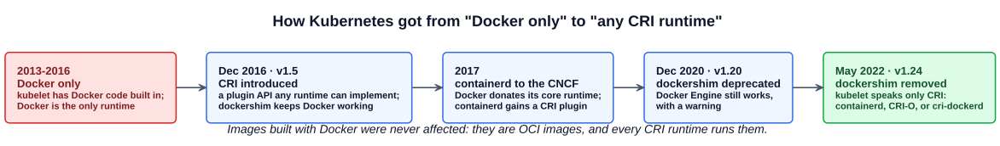
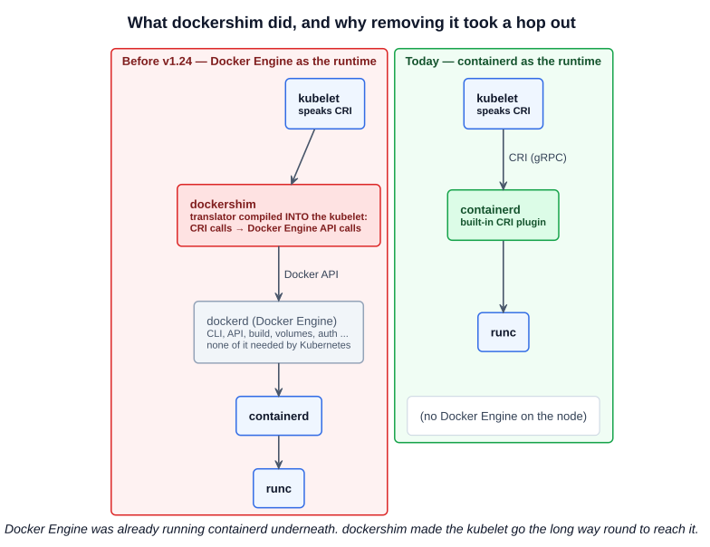
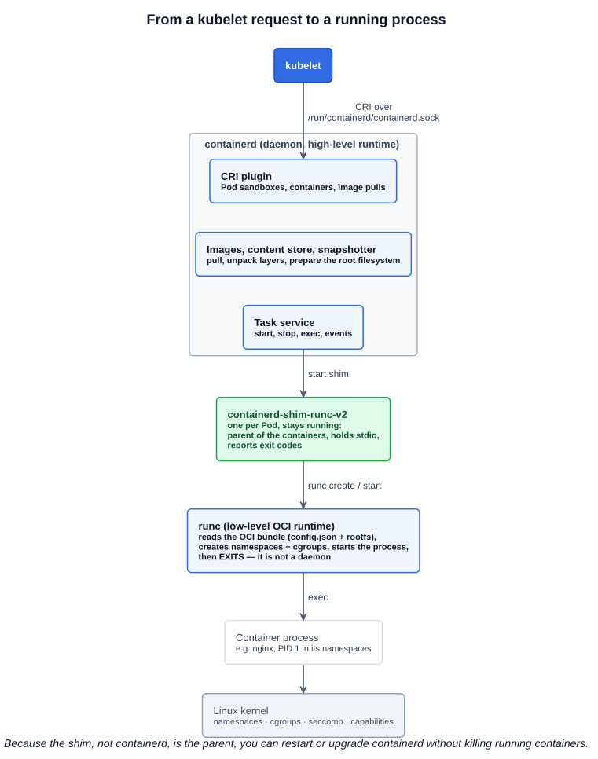
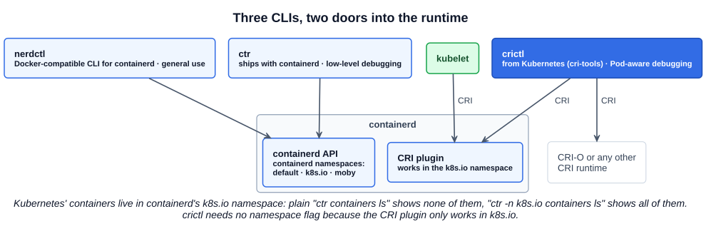

# 02 — Docker vs containerd

The previous chapter said the container runtime on a node is "almost always containerd". This chapter explains how Kubernetes got there from Docker, what each layer of the runtime stack actually does, and which command-line tool to use against it. On the exam the practical outcome is simple: **there is no `docker` command on the nodes; you debug containers with `crictl`.**

---

## 1. How we got here

Containers were not invented by Docker. The kernel features they rely on — `chroot`, namespaces, cgroups — existed for years, and LXC combined them in 2008. What Docker (2013) added was **ease of use**: a simple CLI, a `Dockerfile` to build images, and registries to share them. That made containers mainstream, and when Kubernetes launched in 2014, Docker was the only runtime it supported. The kubelet had Docker-specific code built in.

Other runtimes appeared, such as CoreOS's **rkt**, and wanted to work with Kubernetes too. Hard-coding each one into the kubelet was not sustainable, so Kubernetes introduced two levels of standard:

| Standard | Owner | What it defines |
|---|---|---|
| **CRI** — Container Runtime Interface | Kubernetes | The gRPC API the **kubelet** uses to talk to a runtime: create a Pod sandbox, pull an image, create/start/stop a container. Any runtime that implements CRI works with Kubernetes, with no kubelet code changes |
| **OCI** — Open Container Initiative | Linux Foundation project, founded 2015 | **image-spec**: how an image is built and laid out (layers, manifest, config). **runtime-spec**: how a runtime runs a container from an unpacked image. (A third, distribution-spec, standardizes the registry API) |

CRI is about *how Kubernetes talks to a runtime*. OCI is about *what an image is and how a container is run*. A runtime that implements CRI and runs OCI images works with Kubernetes.



---

## 2. dockershim: what it was and why it went

Docker Engine predates CRI and **never implemented it**. To keep Docker working after CRI arrived, Kubernetes added **dockershim**: an adapter **compiled into the kubelet** that took the kubelet's CRI calls and translated them into Docker Engine API calls.

So yes — dockershim was a translation proxy between the kubelet and Docker. The awkward part is what Docker Engine did next: it passed the work on to **containerd**, which already sat underneath it. Every container start went `kubelet → dockershim → dockerd → containerd → runc`, when containerd could do the job directly.



Problems with keeping it:

- The Kubernetes project had to **maintain Docker-specific code** inside the kubelet, the one thing CRI was meant to avoid.
- Docker Engine carries a lot Kubernetes never uses — CLI, build, volumes, auth, its own networking — all running on every node.
- An extra daemon in the path means one more thing to break and one more hop for every operation.

Kubernetes **deprecated dockershim in v1.20** and **removed it in v1.24** (May 2022). After that, Kubernetes no longer supports Docker Engine as a runtime out of the box. The alternatives:

| Runtime | Notes |
|---|---|
| **containerd** | The default for kubeadm and most managed clusters. CRI support is a plugin built into containerd |
| **CRI-O** | A CRI runtime built specifically for Kubernetes, used by Red Hat OpenShift |
| **cri-dockerd** | An external adapter, maintained outside Kubernetes by Mirantis and Docker, for anyone who must keep Docker Engine as the runtime. Socket: `/var/run/cri-dockerd.sock` |

**What did not change:** images. Anything built with `docker build` is an OCI-compatible image and runs on containerd or CRI-O unchanged. You can keep building with Docker on your laptop; the cluster just does not need Docker to run the result.

---

## 3. containerd, the shim, and runc

**containerd** began as the core runtime inside Docker Engine. **Docker donated it to the CNCF in 2017**, and it graduated in 2019. It is now an independent project that Docker Engine, Kubernetes, and many cloud platforms all use.

A good first answer to "what does containerd do?" is *"containerd is the container runtime; it uses runc to actually create the container."* That is correct, with one piece missing — the shim — and one detail worth stressing: runc does not stay running.



| Layer | Kind | Job |
|---|---|---|
| **containerd** | **High-level runtime**, a long-running daemon (systemd service) | Serves the CRI API to the kubelet; **pulls and stores images** and unpacks their layers (snapshotters); prepares the container's root filesystem and an **OCI bundle** (a `config.json` plus the rootfs); manages the container lifecycle; emits events |
| **containerd-shim-runc-v2** | A small process per Pod | Launched by containerd. Calls runc, then **stays as the parent** of the container processes: keeps their stdin/stdout open for logs, collects the exit code, and lets containerd restart without killing containers |
| **runc** | **Low-level OCI runtime**, a CLI binary | Reads the OCI bundle and asks the kernel to create the **namespaces** (what the process can see) and **cgroups** (what it can use), applies seccomp and capabilities, starts the process — **then exits**. It is the reference implementation of the OCI runtime-spec, donated by Docker to the OCI in 2015 |

In the ship analogy from chapter 01, containerd is the loading crew's foreman — it gets the cargo from the dock and decides what goes where — and runc is the crane operator who sets one container in place and moves on.

You can see this on any node:

```bash
ps -ef | grep -E 'containerd|runc' | grep -v grep
# containerd                                        ← the daemon
# containerd-shim-runc-v2 -namespace k8s.io -id ... ← one per Pod
# (no runc process — it already exited)
```

---

## 4. The three CLIs

There are three command-line tools that work with containerd, and they are easy to mix up.



| | `ctr` | `nerdctl` | `crictl` |
|---|---|---|---|
| **Purpose** | Low-level debugging of containerd | General-purpose, Docker-style use | Debugging Kubernetes nodes |
| **Made by** | containerd project (ships with it) | containerd project | Kubernetes (`kubernetes-sigs/cri-tools`) |
| **Works with** | containerd only | containerd only | **Any CRI runtime** (containerd, CRI-O) |
| **Talks through** | containerd API | containerd API | CRI — the same API the kubelet uses |
| **Knows about Pods** | No | No | **Yes** |
| **On the exam** | Rarely | No | **Yes — this is the one** |

### 4.1 ctr

Installed with containerd. Few features, not user-friendly, and it requires fully qualified image names:

```bash
ctr images pull docker.io/library/redis:alpine
ctr run docker.io/library/redis:alpine redis
ctr namespaces ls                          # default, k8s.io, moby ...
ctr -n k8s.io containers ls                # the containers Kubernetes created
```

**containerd namespaces** are not Kubernetes namespaces and not Linux namespaces. They partition containerd's own data. Kubernetes uses `k8s.io`, Docker Engine uses `moby`, and `ctr` defaults to `default` — so a bare `ctr containers ls` on a Kubernetes node shows nothing.

### 4.2 nerdctl

A Docker-compatible CLI for containerd. If you know `docker`, you know `nerdctl`:

```bash
nerdctl run --name redis redis:alpine
nerdctl run --name webserver -p 80:80 -d nginx
nerdctl compose up                         # Docker Compose files work too
nerdctl --namespace k8s.io ps              # see Kubernetes' containers
```

It also exposes newer containerd features that Docker does not: encrypted images, lazy pulling (start a container before the whole image has downloaded), peer-to-peer image distribution, and image signing and verification. Use it as a Docker replacement on a machine that runs containerd without Kubernetes.

### 4.3 crictl

Built by the Kubernetes community to inspect and debug **any CRI runtime** from a node. It talks to the runtime exactly as the kubelet does, so what you see is what the kubelet sees — including **Pods**, which `ctr` and `nerdctl` know nothing about. It is installed separately from the runtime (kubeadm setups usually include it).

```bash
crictl pods                                # Pod sandboxes on this node
crictl ps                                  # running containers
crictl ps -a                               # include exited ones — crash-looping control plane Pods show up here
crictl images
crictl pull busybox
crictl logs <container-id>                 # container IDs can be shortened
crictl exec -it <container-id> sh
crictl inspect <container-id>              # container detail as JSON
crictl inspectp <pod-id>                   # Pod sandbox detail
crictl stats
crictl info                                # runtime status and config
```

**Use crictl to look, not to create.** `crictl` can create Pods and containers, but the kubelet owns the containers on its node: it compares what is running against the Pods the API server assigned to it, and treats anything else as an orphan to clean up. A container you start with `crictl` can simply disappear. To run something, create it through the API server (`kubectl`) or as a static Pod.

#### Pointing crictl at the runtime

crictl has to know which CRI socket to use. Set it once in `/etc/crictl.yaml` (the usual setup on exam and lab nodes), or per command:

```bash
crictl --runtime-endpoint unix:///run/containerd/containerd.sock ps
export CONTAINER_RUNTIME_ENDPOINT=unix:///run/containerd/containerd.sock
```

```yaml
# /etc/crictl.yaml
runtime-endpoint: unix:///run/containerd/containerd.sock
image-endpoint: unix:///run/containerd/containerd.sock
```

| Runtime | CRI socket |
|---|---|
| containerd | `unix:///run/containerd/containerd.sock` |
| CRI-O | `unix:///var/run/crio/crio.sock` |
| cri-dockerd | `unix:///var/run/cri-dockerd.sock` |
| dockershim (removed in v1.24) | `unix:///var/run/dockershim.sock` |

If crictl prints connection errors or warnings about default endpoints, the endpoint is not configured. Check which socket the kubelet uses: the `containerRuntimeEndpoint` field in `/var/lib/kubelet/config.yaml`, or the `--container-runtime-endpoint` flag on older setups.

### 4.4 docker → crictl

Most everyday `docker` commands have a `crictl` equivalent with the same name:

| Task | docker | crictl |
|---|---|---|
| List running / all containers | `docker ps` / `docker ps -a` | `crictl ps` / `crictl ps -a` |
| List Pods | — | `crictl pods` |
| Logs | `docker logs` | `crictl logs` |
| Run a command in a container | `docker exec -it` | `crictl exec -it` |
| Inspect a container / image / Pod | `docker inspect` | `crictl inspect` / `crictl inspecti` / `crictl inspectp` |
| Images, pull, remove image | `docker images`, `pull`, `rmi` | `crictl images`, `pull`, `rmi` |
| Stop, start, remove a container | `docker stop`, `start`, `rm` | `crictl stop`, `start`, `rm` |
| Resource usage | `docker stats` | `crictl stats` |
| Runtime info / version | `docker info`, `docker version` | `crictl info`, `crictl version` |

Gaps worth knowing: `crictl` has no `build`, `push`, `tag`, network or volume commands, because none of that is the runtime's job in Kubernetes. The docker-to-crictl mapping table that Kubernetes used to publish (and that the course shows) also noted that `docker kill` becomes `crictl stop --timeout 0` and that `crictl exec` has no `--privileged` or `--user`. That page has since been removed from the docs; `crictl <command> --help` is the current source.

---

## Exam angle

- **No Docker on the nodes.** Exam clusters run containerd. When `kubectl` cannot help — the API server is down, or you need to see what a node is really running — `ssh` to the node and use **`crictl`**.
- **API server or etcd crash-looping:** `crictl ps -a | grep kube-apiserver` to find the exited container, then `crictl logs <id>` for the error. This is often the fastest route in a control-plane troubleshooting task.
- **`crictl ps` shows nothing or errors** → the runtime endpoint is not set (`/etc/crictl.yaml`) or containerd is down (`systemctl status containerd`).
- **Do not create workloads with crictl.** The kubelet removes containers it did not ask for. Create Pods with `kubectl`, or as static Pods in `/etc/kubernetes/manifests/`.
- **Know the stack in one line:** kubelet → CRI → containerd → shim → runc → kernel. "dockershim was removed in v1.24" and "Docker-built images still work" are both true.
- **Distractor:** "Kubernetes no longer supports Docker images." False — only Docker Engine as the *runtime* was dropped. The images are OCI.

## References

- [Container Runtimes](https://kubernetes.io/docs/setup/production-environment/container-runtimes/) — containerd and CRI-O installation, CRI socket paths, cgroup drivers
- [Debugging Kubernetes nodes with crictl](https://kubernetes.io/docs/tasks/debug/debug-cluster/crictl/) — installing crictl, `/etc/crictl.yaml`, and example commands for Pods, containers and images
- [Migrating from dockershim](https://kubernetes.io/docs/tasks/administer-cluster/migrating-from-dockershim/) — checking which runtime a node uses, and moving nodes to containerd
- [Dockershim removal FAQ](https://kubernetes.io/blog/2022/02/17/dockershim-faq/) — why it was removed and what it does and does not affect

## Related notes

- CKAD: [Container runtimes](https://github.com/caseythecoder90/ckad-exam-prep/blob/main/notes/01-core-concepts/02-container-runtimes.md) — the same history from the developer's view
- KCNA: [Introduction to containers](https://github.com/caseythecoder90/kcna-study-guide/blob/main/notes/03-containers-with-docker/01-introduction-to-containers.md) — namespaces, cgroups, and containers versus VMs
- KCNA: [Open standards](https://github.com/caseythecoder90/kcna-study-guide/blob/main/notes/02-cloud-native-architecture/07-open-standards.md) — OCI, CRI, CNI and CSI side by side
