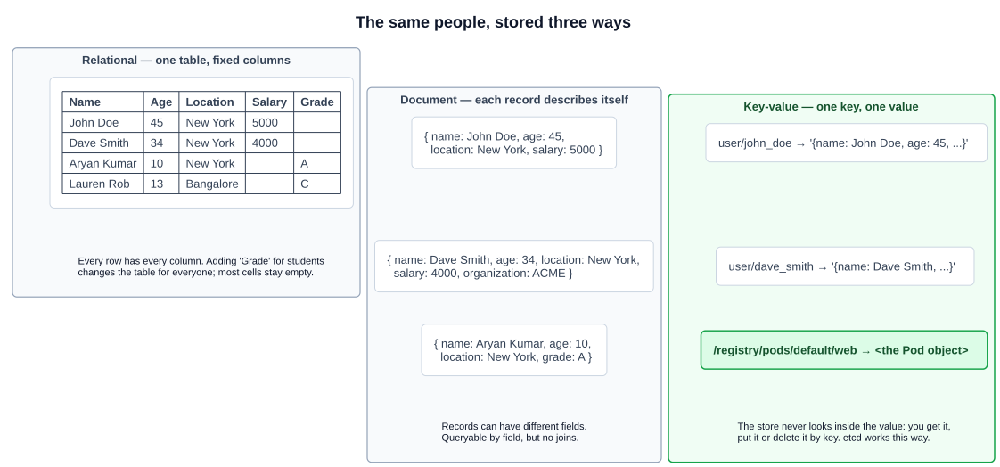
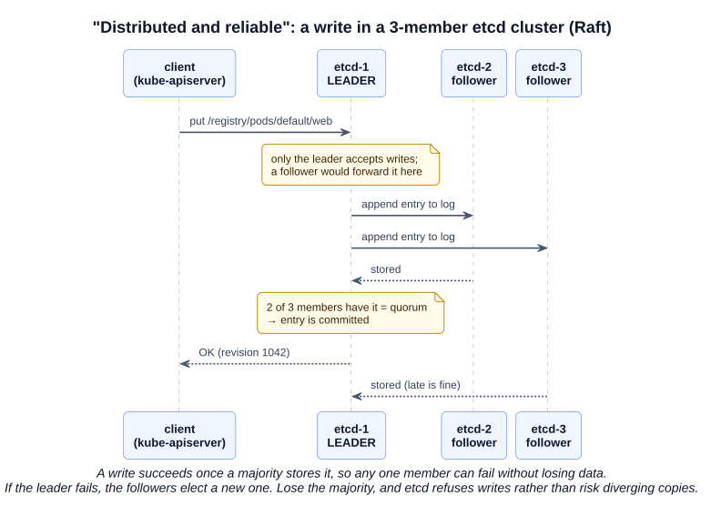
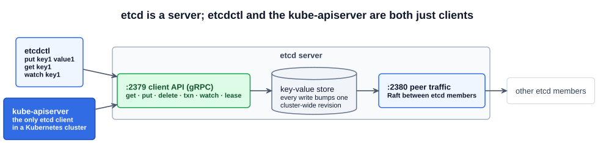
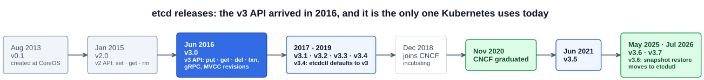

# 03 — etcd for Beginners

etcd is the cluster's ledger from chapter 01: every object Kubernetes knows about lives in it. Before looking at how Kubernetes uses it (next chapter), this one covers etcd on its own — what a key-value store is, what "distributed and reliable" actually means, and how to talk to etcd with `etcdctl`.

> **etcd** is a distributed, reliable key-value store for the most critical data of a distributed system.

The project describes itself as:

| Property | Meaning |
|---|---|
| **Simple** | A small, well-defined API (gRPC) |
| **Secure** | Automatic TLS, with optional client certificate authentication |
| **Fast** | Benchmarked at about 10,000 writes per second |
| **Reliable** | Properly distributed, using the **Raft** consensus algorithm |

etcd is written in Go. It was created at CoreOS in 2013, joined the CNCF as an incubating project in December 2018, and graduated in November 2020.

---

## 1. What a key-value store is

The lecture compares three ways to store the same records:



| | Relational database | Document store | Key-value store |
|---|---|---|---|
| **Shape** | Tables with fixed columns | Self-describing records (JSON-like) | A key and an opaque value |
| **Schema** | Yes, enforced | No | No |
| **Queries** | Complex (SQL, joins) | By field, limited — no joins | By key (or key prefix) only |
| **Flexibility** | Rigid: a new column changes every row | Flexible: records can differ | Very flexible: the value can be anything |
| **Speed** | Good | Good | Fastest — a lookup by key |
| **Best for** | Structured data | Semi-structured data | Simple, fast lookups |
| **Examples** | PostgreSQL, MySQL | MongoDB | **etcd**, Redis |

In a key-value store the database **never looks inside the value**. You `put` a value under a key, `get` it back by key, or `delete` it. To store a whole record, you serialize it (JSON, YAML, protobuf) into one value under one key, such as `user/john_doe`.

That fits Kubernetes exactly. The API server never needs a join or a SQL query: it needs "give me this object" and "give me every object of this type", and it keeps keys hierarchical so that the second is a **prefix** lookup:

```
/registry/pods/default/web          → the Pod "web" in namespace "default"
/registry/pods/default/...          → every Pod in "default"   (prefix)
/registry/deployments/kube-system/coredns
```

The next chapter looks at this layout inside a real cluster.

---

## 2. "Distributed and reliable": Raft

A single etcd process is a single point of failure — lose it, and the cluster loses its state. So in production etcd runs as a **cluster** of members, usually 3 or 5, each holding a full copy of the data. Keeping those copies identical while members fail and recover is the job of the **Raft** consensus algorithm:

- One member is the **leader**; the rest are **followers**. Only the leader accepts writes. A write sent to a follower is forwarded to the leader.
- The leader appends the write to its log and sends it to the followers. The write is **committed** — and the client gets its answer — once a **majority** of members (a **quorum**) has stored it.
- If the leader stops sending heartbeats, the followers **elect a new leader**.
- If a majority cannot be reached, etcd **stops accepting writes** rather than let copies diverge. Reads of committed data stay correct.



Quorum is `floor(n / 2) + 1`, which is why etcd clusters have an **odd** number of members:

| Members | Quorum | Failures tolerated |
|---|---|---|
| 1 | 1 | 0 |
| 2 | 2 | 0 |
| **3** | 2 | **1** |
| 4 | 3 | 1 |
| **5** | 3 | **2** |
| 6 | 4 | 2 |
| 7 | 4 | 3 |

Adding a fourth member raises the quorum without letting you lose any more members, so an even count buys nothing but extra replication traffic. Section 10 (Design and Install a Kubernetes Cluster) builds on this for HA control planes.

---

## 3. Installing etcd and talking to it

The course installs etcd from the release binaries:

```bash
ETCD_VER=v3.x.y        # pick a current release from github.com/etcd-io/etcd/releases
curl -L https://github.com/etcd-io/etcd/releases/download/${ETCD_VER}/etcd-${ETCD_VER}-linux-amd64.tar.gz \
  -o etcd-${ETCD_VER}-linux-amd64.tar.gz
tar xzvf etcd-${ETCD_VER}-linux-amd64.tar.gz
cd etcd-${ETCD_VER}-linux-amd64
./etcd                 # starts a single-member etcd on localhost
```

The tarball contains three binaries:

| Binary | What it is |
|---|---|
| `etcd` | The server |
| `etcdctl` | The **client** CLI: talks to a running etcd over the network (reads, writes, watches, cluster membership, taking snapshots) |
| `etcdutl` | The **offline** utility: works directly on an etcd data directory or snapshot file (restore, status, defragment) without a running server |

By default the server listens on **2379** for client requests and **2380** for traffic between etcd members.



In a Kubernetes cluster you will not install etcd this way — kubeadm runs it as a static Pod (next chapter). But the same `etcdctl` commands work against it.

### 3.1 Basic etcdctl

```bash
./etcdctl put key1 value1          # OK
./etcdctl get key1                 # key1
                                   # value1
./etcdctl del key1                 # 1  (number of keys deleted)

./etcdctl put /app/config/mode prod
./etcdctl put /app/config/level debug
./etcdctl get /app/config --prefix              # every key under the prefix
./etcdctl get "" --prefix --keys-only           # list every key in the store
./etcdctl version                               # etcdctl and API versions
./etcdctl endpoint health                       # is the server answering?
./etcdctl member list                           # cluster members
```

### 3.2 Revisions and watch — where Kubernetes' watch comes from

Two etcd features explain behavior you saw in chapter 01:

- **Revisions.** Every write increments a single, cluster-wide **revision** number, and etcd keeps older versions of each key (multi-version concurrency control, MVCC) until they are **compacted** away. A Kubernetes object's `metadata.resourceVersion` comes from the etcd revision of its last change (clients should treat it as an opaque string) — that is how the API server detects a stale update and answers `409 Conflict`.
- **Watch.** A client can ask etcd to stream every change to a key or prefix, starting from a given revision. The kube-apiserver's watch — which the scheduler, controllers, kubelets and kube-proxy all depend on — is built on etcd's watch.

```bash
./etcdctl watch key1                    # terminal 1: blocks, prints every change
./etcdctl put key1 value2               # terminal 2: terminal 1 prints PUT key1 value2
./etcdctl get key1 -w json              # shows create_revision, mod_revision, version
./etcdctl watch key1 --rev=1            # replay history from revision 1 (if not compacted)
```

The kube-apiserver compacts old revisions automatically (every 5 minutes by default), so etcd's history does not grow forever.

---

## 4. API versions: v2 and v3

etcd has had two client APIs, and old tutorials mix them up.

| Operation | v2 `etcdctl` | v3 `etcdctl` |
|---|---|---|
| Write a value | `set` | `put` |
| Read a value | `get` | `get` |
| Delete | `rm` | `del` |
| Transactions | — | `txn` |
| Show version | `etcdctl --version` | `etcdctl version` |

- **v3**, introduced in etcd v3.0 (2016), is a different API, not an upgrade of v2: gRPC instead of JSON over HTTP, a flat key space with prefixes instead of directories, MVCC revisions, leases, and transactions. **Kubernetes uses only the v3 API.**
- `etcdctl` chose its API with the `ETCDCTL_API` environment variable. Before etcd v3.4 it defaulted to **v2**, which is why every older guide (and many exam-prep scripts) starts with `export ETCDCTL_API=3`. **From v3.4 the default is v3.** Setting it is harmless on newer versions, and still useful habit on an unfamiliar node.

### Version history



| Release | Date | Note |
|---|---|---|
| v0.1 | Aug 2013 | Created at CoreOS |
| v2.0 | Jan 2015 | The v2 API |
| **v3.0** | **Jun 2016** | **The v3 API** |
| v3.1 - v3.3 | Jan 2017 - Feb 2018 | |
| v3.4 | Aug 2019 | `etcdctl` defaults to the v3 API |
| — | Dec 2018 | Joined the CNCF (incubating) |
| — | Nov 2020 | CNCF graduated |
| v3.5 | Jun 2021 | `etcdctl snapshot restore` deprecated in favour of `etcdutl` |
| v3.6 | May 2025 | `etcdctl snapshot restore`/`status` **removed** — use `etcdutl` |
| v3.7 | Jul 2026 | The version kubeadm deploys for Kubernetes v1.35 and later |

The course's version slide places v3.4 in November 2020 and starts the v3 line at v3.1; the dates above come from the etcd GitHub releases. The slide's "v0.5 (Dec 2014)" was the pre-release that shipped as v2.0.

---

## Exam angle

- **You will not install etcd on the exam**, but you will use `etcdctl` against the cluster's etcd, most often to take a **snapshot backup** (Section 6). Know which tool does what: `etcdctl` talks to a running server; `etcdutl` works on files.
- **Restore uses `etcdutl` on current clusters.** `etcdctl snapshot restore` was deprecated in etcd v3.5 and removed in v3.6, and kubeadm now deploys etcd 3.7. Run `etcdctl version` first; if `etcdctl snapshot restore` reports an unknown command, that is why.
- **`ETCDCTL_API=3`** is the default from etcd v3.4. If commands like `put` or `snapshot` are "unknown", you are on the v2 API — export it.
- **Ports:** 2379 client, 2380 peer. A task giving `--endpoints=https://127.0.0.1:2379` is pointing at the client port.
- **Quorum arithmetic:** a 3-member cluster tolerates 1 failure, 5 tolerates 2. Even numbers add no tolerance. Losing quorum makes etcd refuse writes, which makes the API server fail writes too.

## References

- [etcd documentation](https://etcd.io/docs/) — quickstart, `etcdctl` and `etcdutl` reference, clustering, and the data model
- [Operating etcd clusters for Kubernetes](https://kubernetes.io/docs/tasks/administer-cluster/configure-upgrade-etcd/) — the Kubernetes view: cluster sizing, TLS, backup and restore commands
- [The Raft consensus algorithm](https://raft.github.io/) — the paper and an interactive visualization of leader election and log replication
- [etcd releases](https://github.com/etcd-io/etcd/releases) — downloads and release notes for every version

## Related notes

- CKAD: [Architecture](https://github.com/caseythecoder90/ckad-exam-prep/blob/main/notes/01-core-concepts/01-architecture.md) — where etcd sits among the control plane components
- KCNA: [Container orchestration and architecture](https://github.com/caseythecoder90/kcna-study-guide/blob/main/notes/04-kubernetes-fundamentals/01-container-orchestration-and-architecture.md) — etcd in the kubeadm control plane and in HA topologies
