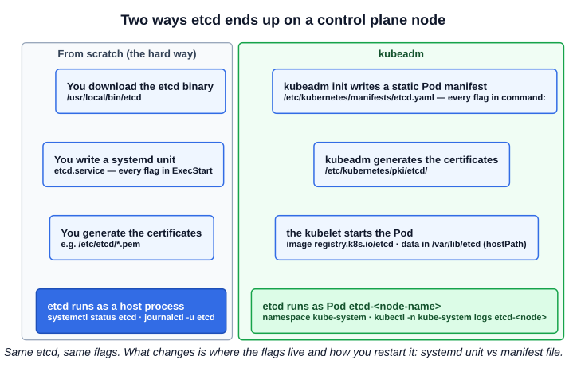
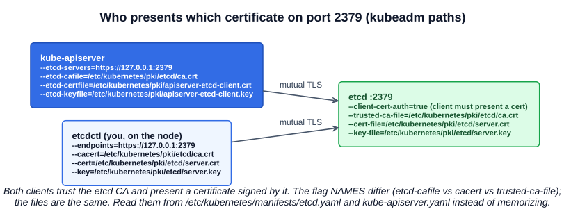
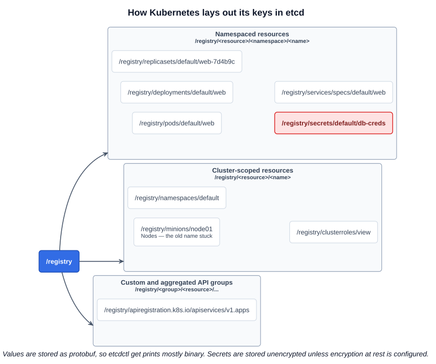
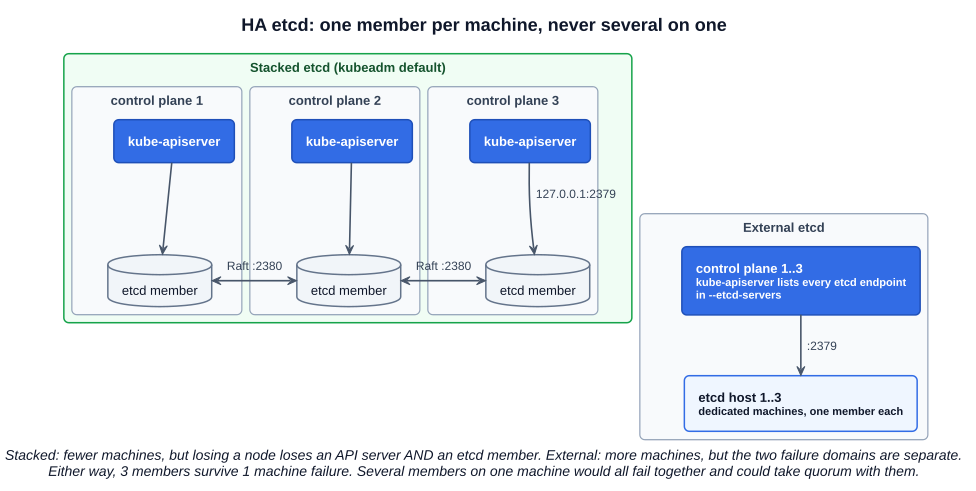

# 04 — etcd in Kubernetes

Chapter 03 covered etcd on its own. This one is about etcd as the cluster's ledger: what Kubernetes stores in it, how it gets deployed, how the API server connects to it, and how to look inside it.

**Everything you see with `kubectl get` comes from etcd**, through the API server: nodes, Pods, ConfigMaps, Secrets, ServiceAccounts, Roles, RoleBindings, every Deployment and every custom resource. **Every change you make** — `kubectl apply`, a Helm install, `kubectl apply -k` on a Kustomize overlay, a controller scaling a ReplicaSet — is stored in etcd once it has passed authentication, authorization, admission (mutating, then validating) and schema validation. **A change is only complete once etcd has it**: that is the moment `kubectl` gets its `201 Created` or `200 OK`.

Things that are *not* in etcd: container logs (on the node), metrics (metrics-server keeps them in memory), application data in volumes, and the container images themselves.

---

## 1. Two ways etcd gets deployed

How etcd runs depends on how the cluster was built. There are many ways to build one — from scratch, kubeadm, k3s, kind, managed services such as EKS/GKE/AKS. The course looks at the two that matter for the exam:



| | From scratch | kubeadm |
|---|---|---|
| How it runs | `etcd` binary as a **systemd service** on the control plane node | **Static Pod** `etcd-<node-name>` in `kube-system` |
| Where the flags live | `ExecStart=` in `/etc/systemd/system/etcd.service` | `command:` in `/etc/kubernetes/manifests/etcd.yaml` |
| Certificates | Wherever you put them (the course uses `/etc/etcd/*.pem`) | `/etc/kubernetes/pki/etcd/` |
| Data directory | `--data-dir`, usually `/var/lib/etcd` | `/var/lib/etcd`, mounted into the Pod as a `hostPath` volume |
| Logs | `journalctl -u etcd` | `kubectl -n kube-system logs etcd-<node>` or `crictl logs` |
| Change a flag | Edit the unit, `systemctl daemon-reload`, `systemctl restart etcd` | Edit the manifest; the kubelet recreates the Pod |

In k3s, etcd is replaced by an embedded SQLite database by default (with an optional embedded etcd). Managed services run etcd for you and you never see it.

### 1.1 The flags that matter

These appear in both the systemd unit and the kubeadm manifest:

| Flag | Meaning |
|---|---|
| `--name` | This member's name, e.g. `controlplane` or `controller-0` |
| `--data-dir` | Where the database lives on disk. **The restore task points etcd at a new one** |
| `--listen-client-urls` | Addresses etcd **binds** to for clients, e.g. `https://127.0.0.1:2379,https://10.0.0.10:2379` |
| `--advertise-client-urls` | The address etcd **tells clients to use**, e.g. `https://10.0.0.10:2379`. The course flags this one: it is the URL the kube-apiserver must be configured with |
| `--listen-peer-urls` / `--initial-advertise-peer-urls` | The same pair for member-to-member traffic on **2380** |
| `--initial-cluster` | Every member at bootstrap, as `name=peerURL` pairs: `controller-0=https://10.0.0.10:2380,controller-1=https://10.0.0.11:2380` |
| `--initial-cluster-state` | `new` to form a cluster, `existing` to join one |
| `--initial-cluster-token` | A unique token so members of different clusters cannot join each other by mistake |
| `--cert-file`, `--key-file`, `--trusted-ca-file` | etcd's server certificate, its key, and the CA it trusts for clients |
| `--client-cert-auth` | Require clients to present a certificate signed by that CA |
| `--peer-cert-file`, `--peer-key-file`, `--peer-trusted-ca-file`, `--peer-client-cert-auth` | The same for member-to-member TLS |

*Listen* versus *advertise*: listen is what the process binds to; advertise is the address published to others. They differ when etcd listens on several interfaces (including localhost) but should be reached on one.

---

## 2. How the API server connects to etcd

The kube-apiserver is etcd's client, and it authenticates with a client certificate (**mutual TLS**). On a kubeadm cluster:



```bash
grep etcd /etc/kubernetes/manifests/kube-apiserver.yaml
#   --etcd-servers=https://127.0.0.1:2379
#   --etcd-cafile=/etc/kubernetes/pki/etcd/ca.crt
#   --etcd-certfile=/etc/kubernetes/pki/apiserver-etcd-client.crt
#   --etcd-keyfile=/etc/kubernetes/pki/apiserver-etcd-client.key
```

If any of these is wrong — a typo in a path, the wrong port, an expired client certificate — the API server cannot reach etcd and crash-loops, and `kubectl` stops working. That is a classic control-plane troubleshooting task: check the API server's container logs with `crictl logs` and compare these flags with the files that exist on disk.

---

## 3. Looking inside etcd

On a kubeadm cluster, `etcdctl` is already inside the etcd Pod, and the certificates are mounted there. Run it with `kubectl exec`, passing the endpoint and certificates:

```bash
kubectl -n kube-system get pods                 # etcd-controlplane, kube-apiserver-controlplane, ...

kubectl -n kube-system exec etcd-controlplane -- etcdctl \
  --endpoints=https://127.0.0.1:2379 \
  --cacert=/etc/kubernetes/pki/etcd/ca.crt \
  --cert=/etc/kubernetes/pki/etcd/server.crt \
  --key=/etc/kubernetes/pki/etcd/server.key \
  get / --prefix --keys-only --limit=10
```

Notes on the course version of this command:

- The course wraps it in `sh -c "ETCDCTL_API=3 etcdctl ..."`. Current etcd images are built on a minimal (distroless) base and may have **no shell**, so `sh -c` fails. Passing `etcdctl` and its flags directly after `--` works either way.
- `ETCDCTL_API=3` has been the default since etcd v3.4 (chapter 03). The course's note that the default is v2 is outdated.
- Without the certificate flags, etcd rejects the connection: kubeadm sets `--client-cert-auth=true`.
- The slide's `-keys-only` is a typo for `--keys-only`.

### 3.1 The key layout

Kubernetes keeps everything under one root, **`/registry`**, with a predictable path per object:



| Kind of resource | Key | Example |
|---|---|---|
| Namespaced | `/registry/<resource>/<namespace>/<name>` | `/registry/pods/default/web` |
| Cluster-scoped | `/registry/<resource>/<name>` | `/registry/namespaces/kube-system` |
| Nodes | `/registry/minions/<name>` | `/registry/minions/node01` — nodes were called *minions* in early Kubernetes, and the storage key never changed |
| Services | `/registry/services/specs/<namespace>/<name>` | `/registry/services/specs/default/kubernetes` |
| Non-core API groups (aggregated APIs, custom resources) | `/registry/<group>/<resource>/...` | `/registry/apiregistration.k8s.io/apiservices/v1.apps` |

```bash
E="kubectl -n kube-system exec etcd-controlplane -- etcdctl --endpoints=https://127.0.0.1:2379 \
   --cacert=/etc/kubernetes/pki/etcd/ca.crt --cert=/etc/kubernetes/pki/etcd/server.crt \
   --key=/etc/kubernetes/pki/etcd/server.key"

$E get /registry/pods --prefix --keys-only           # every Pod, in every namespace
$E get /registry/pods/kube-system --prefix --keys-only
$E get /registry/minions --prefix --keys-only        # the nodes
$E get /registry/pods/default/web                    # one object: mostly binary output
```

Values are stored as **protobuf**, not YAML or JSON, so a `get` prints a readable key and a mostly binary value. That is also why the value of a Secret is readable in it: **Secrets are stored unencrypted in etcd** unless encryption at rest is configured (Section 5). Anyone who can read etcd, or a copy of a snapshot, can read every Secret — the reason etcd access is locked down with client certificates and backups must be protected.

---

## 4. etcd in a highly available cluster

An HA cluster has several control plane nodes — usually three — so that losing one machine does not take the cluster down. Each control plane node runs its own API server, and etcd runs as a cluster of **members** spread across machines.

**One member per machine.** The benefit comes from the members being on *different* machines: each has a full copy of the data, and Raft keeps the copies identical (chapter 03). If one machine dies, the other two still form a quorum (2 of 3), keep accepting writes, and nothing is lost. Running several members on the *same* machine would add no protection — one hardware failure would take all of them down at once, and possibly the quorum with them.



| Topology | Where etcd runs | Trade-off |
|---|---|---|
| **Stacked** (kubeadm default) | One member on each control plane node, next to that node's API server, which talks to its local member | Fewer machines and simpler setup. But losing a node loses both an API server and an etcd member |
| **External** | Members on dedicated hosts; each API server lists all of them in `--etcd-servers` | More machines to run. Control plane and etcd failures are independent |

`--initial-cluster` is what tells each member who the others are. In the course's two-controller example it lists `controller-0` and `controller-1`, but remember the quorum table from chapter 03: **two members tolerate zero failures**, so real clusters use three or five. Section 10 covers designing HA control planes.

---

## Exam angle

- **Find etcd's settings in the manifest, not from memory.** `cat /etc/kubernetes/manifests/etcd.yaml` gives you `--data-dir`, `--listen-client-urls`, `--advertise-client-urls` and the three certificate paths that every `etcdctl` command needs.
- **etcdctl against the cluster needs four flags:** `--endpoints`, `--cacert`, `--cert`, `--key`. Missing them gives a TLS or "context deadline exceeded" error, not a helpful message.
- **From scratch vs kubeadm** decides how you restart etcd: `systemctl restart etcd` for a systemd unit, or edit `/etc/kubernetes/manifests/etcd.yaml` and let the kubelet recreate the Pod. Check which you have with `kubectl -n kube-system get pods` and `systemctl status etcd`.
- **API server down after an etcd change?** Compare `--etcd-servers` and the `--etcd-*file` paths in `kube-apiserver.yaml` with what etcd actually listens on and the files on disk.
- **Key paths:** `/registry/<resource>/<namespace>/<name>`; nodes are under `/registry/minions`.
- **HA:** one etcd member per machine, odd member counts, stacked (kubeadm default) versus external.

## References

- [Operating etcd clusters for Kubernetes](https://kubernetes.io/docs/tasks/administer-cluster/configure-upgrade-etcd/) — securing etcd, multi-member clusters, backup and restore
- [Options for Highly Available Topology](https://kubernetes.io/docs/setup/production-environment/tools/kubeadm/ha-topology/) — stacked versus external etcd, with diagrams
- [PKI certificates and requirements](https://kubernetes.io/docs/setup/best-practices/certificates/) — every certificate kubeadm creates, including the etcd and `apiserver-etcd-client` ones
- [etcd configuration flags](https://etcd.io/docs/latest/op-guide/configuration/) — every flag in section 1.1, including listen versus advertise URLs

## Related notes

- CKAD: [Architecture](https://github.com/caseythecoder90/ckad-exam-prep/blob/main/notes/01-core-concepts/01-architecture.md) — etcd's place among the control plane components
- KCNA: [Container orchestration and architecture](https://github.com/caseythecoder90/kcna-study-guide/blob/main/notes/04-kubernetes-fundamentals/01-container-orchestration-and-architecture.md) — static Pod bootstrap and the HA control plane
