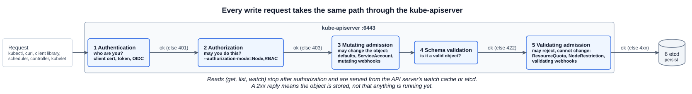
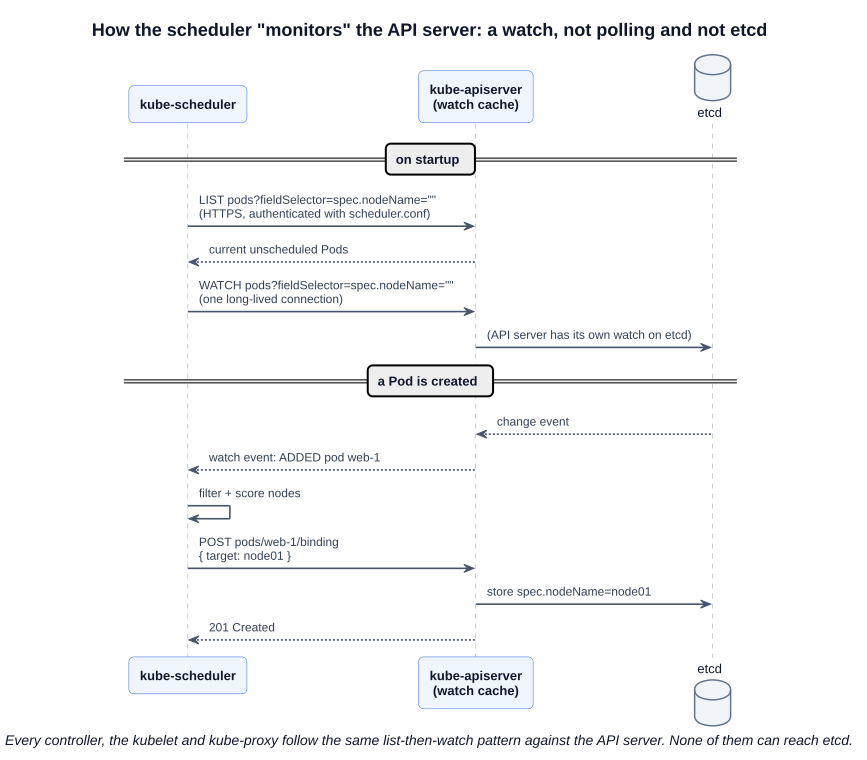
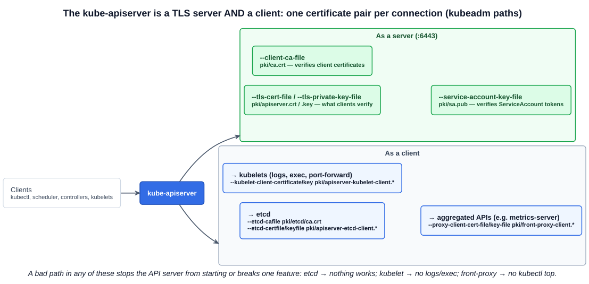

# 05 — kube-apiserver

The kube-apiserver is the primary management component of Kubernetes: every request to read or change the cluster goes through it, and it is the only component that talks to etcd. Chapter 01 listed its responsibilities; this chapter follows a request through it step by step, answers how the other components "monitor" it, and covers the part the exam actually tests: **how it is configured and where to find that configuration.**

---

## 1. What happens to a request

When you run `kubectl get nodes`, kubectl sends an HTTPS request to the API server on port 6443. The API server authenticates you, checks you are allowed to list nodes, reads the data (from its cache of etcd), and returns it. kubectl just formats the reply. You can skip kubectl entirely and send the same request yourself:

```bash
kubectl get nodes -v=6                          # shows: GET https://<ip>:6443/api/v1/nodes 200 OK
kubectl get --raw /api/v1/nodes | head -c 300   # the raw JSON kubectl would format
```

A **write** — creating a Pod, say — goes through more steps. The course lists six:

| Course step | What actually happens |
|---|---|
| 1. Authenticate user | **Authentication**: client certificate, bearer token, or OIDC. Unknown → `401 Unauthorized` |
| 2. Validate request | Three separate stages: **authorization** (RBAC, Node) → `403 Forbidden`; **admission control** (mutating, then validating) → can change or reject the object; **schema validation** → `422 Unprocessable` |
| 3. Retrieve data | Read existing state it needs |
| 4. Update etcd | **Persist** the Pod — still without a node — and return `201 Created` to the user |
| 5. Scheduler | The scheduler sees the unscheduled Pod, picks a node, and writes the choice back through the API server, which updates etcd |
| 6. Kubelet | The kubelet on that node sees a Pod bound to it, has the container runtime start the containers, and reports status back through the API server, which updates etcd again |



Steps 5 and 6 happen *after* you get your `201`, which is why a Pod can be "created" but still `Pending`. Chapter 01's [Deployment watch chain](./01-cluster-architecture.md#22-kube-apiserver--the-bridge) shows the same sequence for a Deployment, with the controllers in between. The pattern is the same for every change: the API server is at the centre of every step, and every component reports back through it.

### 1.1 Admission control in one paragraph

Admission controllers run after authorization and can **mutate** (fill in defaults, inject the ServiceAccount token volume, run mutating webhooks) or **validate** (enforce ResourceQuota and LimitRange, restrict what kubelets may change with NodeRestriction, run validating webhooks). A set is enabled by default; `--enable-admission-plugins` adds more and `--disable-admission-plugins` removes some. kubeadm adds `NodeRestriction`. Section 7 covers admission controllers in depth.

---

## 2. How the other components "monitor" the API server

The course says the scheduler is "continuously monitoring the API server". That means the scheduler **calls the API server's HTTPS API** like any other client. It never reads etcd — it has no credentials or network path to it.

It is also not polling. It does one **list** to get the current state, then opens a **watch**: a long-lived HTTPS request on which the API server pushes an event every time a matching object changes. The scheduler asks only for Pods that have no node yet (`spec.nodeName` is empty). When it has chosen a node, it does not edit the Pod; it **POSTs a `Binding`** to the Pod's `binding` subresource, and the API server records `spec.nodeName`.



Every other component works the same way:

| Component | Watches | Writes back |
|---|---|---|
| kube-scheduler | Pods with no node | `pods/<name>/binding` |
| Controllers (kube-controller-manager) | The objects they own: Deployments, ReplicaSets, Nodes, ... | Child objects, status |
| kubelet | Pods bound to its own node | Pod status, Node status, its heartbeat Lease |
| kube-proxy | Services and EndpointSlices | Nothing — it writes iptables rules on the node |

Each authenticates with its own kubeconfig: `/etc/kubernetes/scheduler.conf`, `controller-manager.conf` and `kubelet.conf` on a kubeadm control plane node. The API server itself serves most reads and watches from an in-memory **watch cache**, fed by a single watch it keeps on etcd, so thousands of watchers do not each hit etcd.

---

## 3. Running the API server

### 3.1 From scratch: a systemd service

Download the binary from the Kubernetes release site and run it as a service with all of its options:

```bash
wget https://dl.k8s.io/release/v1.xx.y/bin/linux/amd64/kube-apiserver
# (the course uses the older storage.googleapis.com/kubernetes-release URL; dl.k8s.io is current)
```

```ini
# /etc/systemd/system/kube-apiserver.service
[Service]
ExecStart=/usr/local/bin/kube-apiserver \
  --advertise-address=${INTERNAL_IP} \
  --authorization-mode=Node,RBAC \
  --client-ca-file=/var/lib/kubernetes/ca.pem \
  --etcd-servers=https://10.240.0.10:2379,https://10.240.0.11:2379,https://10.240.0.12:2379 \
  --etcd-cafile=/var/lib/kubernetes/ca.pem \
  --etcd-certfile=/var/lib/kubernetes/kubernetes.pem \
  --etcd-keyfile=/var/lib/kubernetes/kubernetes-key.pem \
  --kubelet-certificate-authority=/var/lib/kubernetes/ca.pem \
  --kubelet-client-certificate=/var/lib/kubernetes/kubernetes.pem \
  --kubelet-client-key=/var/lib/kubernetes/kubernetes-key.pem \
  --service-account-key-file=/var/lib/kubernetes/service-account.pem \
  --service-cluster-ip-range=10.32.0.0/24 \
  --service-node-port-range=30000-32767 \
  --tls-cert-file=/var/lib/kubernetes/kubernetes.pem \
  --tls-private-key-file=/var/lib/kubernetes/kubernetes-key.pem \
  ...
```

Most of the options are certificates (Section 7 explains each one). The one the course highlights is **`--etcd-servers`**: the address of etcd — a single local member, or every member of an HA etcd cluster.

### 3.2 kubeadm: a static Pod

kubeadm deploys the API server as the static Pod `kube-apiserver-<node-name>` in `kube-system`, with every option in the manifest:

```bash
kubectl -n kube-system get pods                       # kube-apiserver-controlplane
cat /etc/kubernetes/manifests/kube-apiserver.yaml
```

### 3.3 Three ways to see the options

| Setup | Where the options are |
|---|---|
| kubeadm | `/etc/kubernetes/manifests/kube-apiserver.yaml` (`spec.containers[0].command`) |
| From scratch | `/etc/systemd/system/kube-apiserver.service` (`ExecStart`) |
| **Either** | The running process: `ps -aux \| grep kube-apiserver` on the control plane node |

`ps` shows what the process was *actually* started with, which is the reliable answer when you do not know how a cluster was built. Split the long line to read it:

```bash
ps -aux | grep [k]ube-apiserver | tr ' ' '\n' | grep -- '^--'
```

### 3.4 The options kubeadm sets

| Option | kubeadm value | Purpose |
|---|---|---|
| `--advertise-address` | Node IP | The address published to the rest of the cluster |
| `--secure-port` | `6443` (default) | HTTPS port |
| `--authorization-mode` | `Node,RBAC` | Node authorizer for kubelets, RBAC for everyone else |
| `--enable-admission-plugins` | `NodeRestriction` | Added on top of the defaults |
| `--client-ca-file` | `pki/ca.crt` | CA that signs client certificates (users, components) |
| `--tls-cert-file`, `--tls-private-key-file` | `pki/apiserver.crt/.key` | The API server's own serving certificate |
| `--etcd-servers` | `https://127.0.0.1:2379` | Where etcd is |
| `--etcd-cafile`, `--etcd-certfile`, `--etcd-keyfile` | `pki/etcd/ca.crt`, `pki/apiserver-etcd-client.crt/.key` | Mutual TLS to etcd (chapter 04) |
| `--kubelet-client-certificate`, `--kubelet-client-key` | `pki/apiserver-kubelet-client.crt/.key` | Calling kubelets for logs, exec, port-forward |
| `--proxy-client-cert-file`, `--proxy-client-key-file`, `--requestheader-*` | `pki/front-proxy-*` | Forwarding to aggregated APIs such as metrics-server |
| `--service-account-key-file`, `--service-account-signing-key-file`, `--service-account-issuer` | `pki/sa.pub`, `pki/sa.key`, `https://kubernetes.default.svc.cluster.local` | Signing and verifying ServiceAccount tokens |
| `--service-cluster-ip-range` | `10.96.0.0/12` | The range ClusterIPs are allocated from |
| `--allow-privileged` | `true` | Allow privileged containers |
| `--enable-bootstrap-token-auth` | `true` | Lets new nodes join with `kubeadm join` tokens |

All `pki/` paths are under `/etc/kubernetes/`.



### 3.5 Flags on the course slides that no longer exist

The slides come from older Kubernetes versions. Do not copy these into a manifest — the API server will refuse to start on an unknown flag:

| On the slide | Status today |
|---|---|
| `--insecure-port=0` | Removed. There is no insecure port |
| `--experimental-encryption-provider-config` | Removed. Use `--encryption-provider-config` |
| `--enable-swagger-ui` | Removed |
| `--kubelet-https` | Removed. Kubelet connections are always HTTPS |
| `--apiserver-count` | Removed |
| `Initializers` in `--enable-admission-plugins` | Removed — the plugin no longer exists |

---

## Exam angle

- **`kubectl` fails with "connection refused" on 6443 → the API server is down.** You cannot use kubectl to fix it. On the control plane node: `crictl ps -a | grep kube-apiserver`, `crictl logs <id>`, then fix `/etc/kubernetes/manifests/kube-apiserver.yaml`. The kubelet recreates the Pod; allow it a minute.
- **Typical breakages to fix:** a wrong certificate path, a wrong `--etcd-servers` port, a misspelled or removed flag (see 3.5), invalid YAML in the manifest. The container log names the problem.
- **Asked "what is the service CIDR / which admission plugins / which authorization modes?"** Read the manifest or `ps -aux | grep kube-apiserver`; do not guess the default.
- **Editing the manifest** is how you change any API server setting on kubeadm — enabling an admission plugin, changing the authorization mode. Keep a backup copy *outside* `/etc/kubernetes/manifests/`: the kubelet reads every file in that directory, so a `.bak` copy left there is treated as another static Pod manifest.
- **Distractor:** "the scheduler reads unscheduled Pods from etcd". No component except the API server can reach etcd; the scheduler lists and watches through the API.

## References

- [kube-apiserver command line reference](https://kubernetes.io/docs/reference/command-line-tools-reference/kube-apiserver/) — every flag and its default
- [Controlling Access to the Kubernetes API](https://kubernetes.io/docs/concepts/security/controlling-access/) — the authentication, authorization and admission stages
- [Admission Control in Kubernetes](https://kubernetes.io/docs/reference/access-authn-authz/admission-controllers/) — what each plugin does and which are on by default
- [Kubernetes API Concepts](https://kubernetes.io/docs/reference/using-api/api-concepts/) — list and watch, resource versions, and the watch cache

## Related notes

- CKAD: [Authentication](https://github.com/caseythecoder90/ckad-exam-prep/blob/main/notes/09-security/02-authentication.md) and [Admission controllers](https://github.com/caseythecoder90/ckad-exam-prep/blob/main/notes/09-security/08-admission-controllers.md) — the request stages from the application side
- KCNA: [The Kubernetes API](https://github.com/caseythecoder90/kcna-study-guide/blob/main/notes/05-kubernetes-deep-dive/01-kubernetes-api.md) — REST paths, API groups and the authentication/authorization/admission stages
