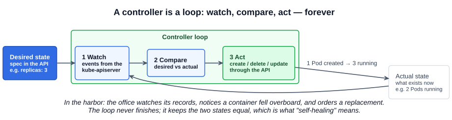
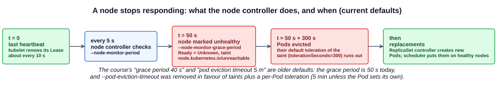
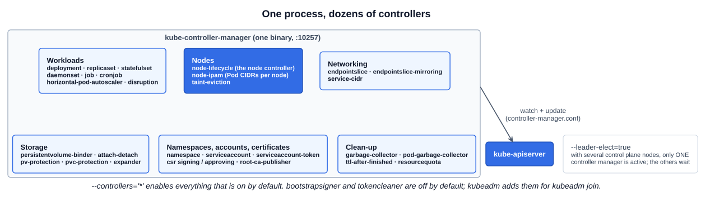

# 06 — kube-controller-manager

In the harbor analogy from chapter 01, the controllers are the **offices** on the control ship. Each office has one area of responsibility — one watches the ships, one manages the containers on them — and each does two things: **continuously watches the status** of what it owns, and **takes action to fix it** when it drifts. In Kubernetes those offices are **controllers**, and the **kube-controller-manager** is the single process that runs them all.

> A **controller** is a process that continuously monitors the state of components in the system and works to bring the whole system to the desired state.

---

## 1. The controller pattern

Every controller runs the same loop: **watch** the objects it is responsible for, **compare** the desired state (the `spec` you declared) with the actual state, and **act** to close the gap — then go back to watching. The loop never ends; there is no "done".



Controllers do all of this **through the kube-apiserver** — they list and watch objects and write changes back, exactly like the scheduler in chapter 05. None of them touch etcd or the nodes directly.

Whatever intelligence a Kubernetes object seems to have is a controller. A Deployment rolls out new versions because the Deployment controller does it; a Service gets endpoints because the EndpointSlice controller adds them; a deleted Namespace empties itself because the Namespace controller deletes its contents. The object is just a record; the controller is the behavior.

### 1.1 The node controller

Monitors the health of nodes and keeps applications running when a node fails. It reads node heartbeats through the API server. The kubelet on each node renews a heartbeat `Lease` (chapter 01) about every 10 seconds:

| Setting | Flag | Default today | Course slide |
|---|---|---|---|
| How often the node controller checks nodes | `--node-monitor-period` | **5s** | 5s |
| How long a node may go silent before it is marked unhealthy (`Ready=Unknown`) | `--node-monitor-grace-period` | **50s** | 40s (the older default) |
| How long before Pods on an unhealthy node are evicted | `tolerationSeconds` on each Pod | **300s (5 min)** | `--pod-eviction-timeout=5m` (**flag removed**) |



What happens when a node goes silent:

1. **After 50s** without a heartbeat, the node controller sets the node's `Ready` condition to `Unknown` and adds the taint `node.kubernetes.io/unreachable` (or `node.kubernetes.io/not-ready` if the kubelet reports `Ready=False`).
2. **Eviction is driven by the taint.** Every Pod automatically gets a toleration for those two taints with `tolerationSeconds: 300`, added by the `DefaultTolerationSeconds` admission plugin. When it runs out, the Pod is evicted. This replaced the old cluster-wide `--pod-eviction-timeout`: the 5-minute default is the same, but a Pod can now set its own toleration to be evicted sooner or later.
3. If the Pods belong to a ReplicaSet (via a Deployment), the **ReplicaSet controller** sees fewer Pods than `replicas` and creates replacements, which the scheduler places on healthy nodes. Bare Pods with no controller are simply gone.

If the node comes back, the taint is removed and the node rejoins.

### 1.2 The replication controller

Monitors sets of Pods and makes sure the desired number is always running: if a Pod dies, it creates another. The course names the *replication controller*; in current clusters this job is done for Deployments by the **ReplicaSet controller**. The `ReplicationController` object and its controller still exist but are legacy — use Deployments.

---

## 2. One process, many controllers

All the built-in controllers are packaged into one binary, **kube-controller-manager**. Install it and every controller comes with it.



The course's slide shows a dozen: Deployment, ReplicaSet, Replication, StatefulSet, Job, CronJob, Namespace, Endpoint, ServiceAccount, Node, PV-Binder and PV-Protection controllers. Current versions run about 45, and their names have grown a `-controller` suffix (`deployment-controller`, `node-lifecycle-controller`, ...). The older short names (`deployment`, `nodelifecycle`, `bootstrapsigner`) are still accepted.

### 2.1 Choosing controllers: `--controllers`

| Value | Meaning |
|---|---|
| `*` (default) | Every controller that is on by default |
| `foo` | Also enable controller `foo` |
| `-foo` | Disable controller `foo` |

**Disabled by default:** `bootstrap-signer-controller`, `token-cleaner-controller` and `selinux-warning-controller`. kubeadm sets `--controllers=*,bootstrapsigner,tokencleaner` because `kubeadm join` relies on bootstrap tokens: the bootstrap signer signs the `cluster-info` ConfigMap new nodes read, and the token cleaner deletes expired tokens.

### 2.2 Leader election

With several control plane nodes, each runs a kube-controller-manager, but **only one is active**. With `--leader-elect=true` (the default) they compete for a lock — a `Lease` named `kube-controller-manager` in `kube-system` — and the winner runs the controllers while the others wait to take over. Two active copies would fight each other: both would create the "missing" Pod. The scheduler uses the same mechanism.

```bash
kubectl -n kube-system get lease kube-controller-manager -o jsonpath='{.spec.holderIdentity}{"\n"}'
```

---

## 3. Installing and viewing it

### 3.1 From scratch: a systemd service

```bash
wget https://dl.k8s.io/release/v1.xx.y/bin/linux/amd64/kube-controller-manager
# (the course slide reuses the kube-apiserver URL by mistake, and the older storage.googleapis.com host)
```

```ini
# /etc/systemd/system/kube-controller-manager.service
[Service]
ExecStart=/usr/local/bin/kube-controller-manager \
  --bind-address=0.0.0.0 \
  --cluster-cidr=10.200.0.0/16 \
  --cluster-name=kubernetes \
  --cluster-signing-cert-file=/var/lib/kubernetes/ca.pem \
  --cluster-signing-key-file=/var/lib/kubernetes/ca-key.pem \
  --kubeconfig=/var/lib/kubernetes/kube-controller-manager.kubeconfig \
  --leader-elect=true \
  --root-ca-file=/var/lib/kubernetes/ca.pem \
  --service-account-private-key-file=/var/lib/kubernetes/service-account-key.pem \
  --service-cluster-ip-range=10.32.0.0/24 \
  --use-service-account-credentials=true \
  --node-monitor-period=5s \
  --node-monitor-grace-period=50s \
  --v=2
Restart=on-failure
RestartSec=5
```

The course slide uses `--address`, which has been removed — it is `--bind-address` now. It also sets `--pod-eviction-timeout`, which no longer exists. Either would stop the process from starting.

### 3.2 kubeadm: a static Pod

```bash
kubectl -n kube-system get pods                     # kube-controller-manager-controlplane
cat /etc/kubernetes/manifests/kube-controller-manager.yaml
```

### 3.3 Viewing the options

Same three places as the API server (chapter 05):

```bash
cat /etc/kubernetes/manifests/kube-controller-manager.yaml     # kubeadm
cat /etc/systemd/system/kube-controller-manager.service        # from scratch
ps -aux | grep [k]ube-controller-manager | tr ' ' '\n' | grep -- '^--'   # either
```

### 3.4 The options kubeadm sets

| Option | kubeadm value | Purpose |
|---|---|---|
| `--bind-address` | `127.0.0.1` | Serve its health and metrics endpoint (port **10257**) on localhost only |
| `--kubeconfig`, `--authentication-kubeconfig`, `--authorization-kubeconfig` | `/etc/kubernetes/controller-manager.conf` | How it authenticates to the API server |
| `--controllers` | `*,bootstrapsigner,tokencleaner` | All defaults plus the two kubeadm needs |
| `--leader-elect` | `true` | One active instance per cluster |
| `--use-service-account-credentials` | `true` | Each controller acts as its own ServiceAccount (`system:serviceaccount:kube-system:deployment-controller`, ...) so RBAC can limit each one separately |
| `--cluster-signing-cert-file`, `--cluster-signing-key-file` | `pki/ca.crt`, `pki/ca.key` | The CA it uses to sign approved CertificateSigningRequests (Section 7) |
| `--root-ca-file` | `pki/ca.crt` | CA bundle put into every ServiceAccount token volume |
| `--service-account-private-key-file` | `pki/sa.key` | Signs ServiceAccount tokens |
| `--allocate-node-cidrs`, `--cluster-cidr` | `true`, the Pod network CIDR | Set when `kubeadm init --pod-network-cidr` is used: gives each node a slice of the Pod network |
| `--service-cluster-ip-range` | `10.96.0.0/12` | Must match the API server's |

---

## Exam angle

- **Symptom → controller manager.** A Deployment exists but no ReplicaSet or Pods appear; a scaled Deployment never changes its Pod count; deleted Pods are not replaced; a Namespace stays `Terminating`; PVCs never bind. The objects are stored but nobody is acting on them. Check `kubectl -n kube-system get pods` for the controller manager, then `crictl logs` / `kubectl logs` and its manifest.
- **Typical breakages:** a typo in the binary name or a flag in `/etc/kubernetes/manifests/kube-controller-manager.yaml`, a wrong `--kubeconfig` path, a wrong certificate path. The kubelet recreates the Pod after you fix the file.
- **Node failure timing:** `NotReady`/`Unknown` after about **50s**, Pods evicted after a further **300s** by default. `--pod-eviction-timeout` is not a valid flag on current versions.
- **Do not confuse the jobs:** the controller manager decides *that* a Pod should exist; the scheduler decides *where*; the kubelet *runs* it.
- **Distractor:** "the replication controller" in a question about Deployments means the ReplicaSet controller in a current cluster.

## References

- [Controllers](https://kubernetes.io/docs/concepts/architecture/controller/) — the control loop, desired versus current state, and built-in versus custom controllers
- [kube-controller-manager command line reference](https://kubernetes.io/docs/reference/command-line-tools-reference/kube-controller-manager/) — every flag, the `--controllers` list and defaults
- [Taints and Tolerations: taint-based evictions](https://kubernetes.io/docs/concepts/scheduling-eviction/taint-and-toleration/#taint-based-evictions) — `not-ready` / `unreachable` taints and the 300-second default toleration
- [Nodes: node controller](https://kubernetes.io/docs/concepts/architecture/nodes/#node-controller) — heartbeats, Leases and what the node controller does on failure

## Related notes

- CKAD: [ReplicaSets](https://github.com/caseythecoder90/ckad-exam-prep/blob/main/notes/01-core-concepts/05-replicasets.md) and [Custom controllers](https://github.com/caseythecoder90/ckad-exam-prep/blob/main/notes/09-security/13-custom-controllers.md) — the controller pattern from the application side
- KCNA: [Container orchestration and architecture](https://github.com/caseythecoder90/kcna-study-guide/blob/main/notes/04-kubernetes-fundamentals/01-container-orchestration-and-architecture.md) — controllers among the control plane components
