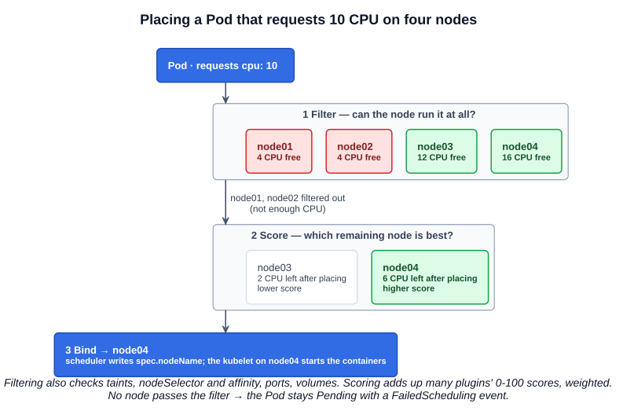
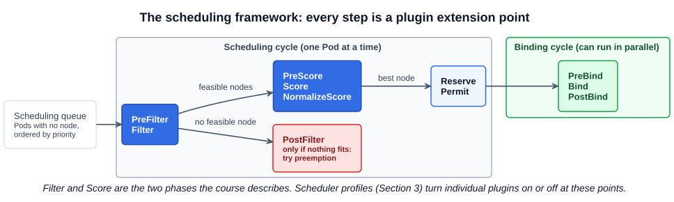

# 07 — kube-scheduler

The kube-scheduler decides **which node each Pod runs on**. That is all it does. It does not start the Pod: in the harbor analogy it is the crane planner, not the crane. The **kubelet** — the ship's captain — is the one that creates the Pod on the node once the scheduler has chosen.

This chapter introduces how the scheduler makes that choice and where it runs. Section 3 (Scheduling) covers each of the inputs in depth: resource requests and limits, taints and tolerations, node selectors and affinity, manual scheduling, DaemonSets, multiple schedulers, scheduler events, and configuring the scheduler.

---

## 1. Why a scheduler

With many nodes and many Pods, something has to make sure the right Pod ends up on the right node. Ships come in different sizes and sail to different places; containers come in different sizes and need to reach the right destination. In a cluster:

- Pods request different amounts of CPU and memory, and nodes have different capacity left.
- Some nodes are dedicated to certain workloads (GPUs, a team, a security zone).
- Some Pods must, or must not, run next to others, or in a particular zone.

The scheduler looks at each Pod that has no node yet and finds the best node for it.

---

## 2. Filter, then score

The scheduler picks a node in two phases. Take the course's example: a Pod that requests **10 CPU**, and four nodes.



**1. Filter.** Remove every node that cannot run the Pod. The two nodes with only 4 CPU free are filtered out. Filters also check, among others:

| Filter | Removes nodes that... |
|---|---|
| Resource fit | Do not have enough **requested** CPU/memory free (requests, not actual usage) |
| Taints and tolerations | Carry a taint the Pod does not tolerate |
| Node selector / node affinity | Do not have the labels the Pod requires |
| Node ports | Already have the Pod's `hostPort` in use |
| Unschedulable | Are cordoned (`kubectl cordon`) |
| Volumes | Cannot attach the Pod's volumes (wrong zone, too many volumes) |

**2. Score.** Rank the nodes that are left. In the example, placing the Pod leaves **2 CPU** free on one node and **6 CPU** on the other, so the second scores higher and wins. The default resource-scoring strategy, `LeastAllocated`, does exactly this: it prefers the node with the most resources left after placement, which spreads load across the cluster. Other scoring plugins look at spreading replicas across nodes, preferred affinity, whether the image is already on the node, and so on.

The course describes scores on a 0-10 scale; that was the original "priority functions" design. In the current scheduling framework **each scoring plugin returns 0-100**, and the scheduler adds them up using configurable weights. If several nodes tie, it picks one **at random**.

**3. Bind.** The scheduler writes its choice back to the API server (a `Binding`, which sets the Pod's `spec.nodeName` — see chapter 05). The kubelet on that node sees the Pod and starts it.

### 2.1 When nothing fits

If every node is filtered out, the Pod stays **`Pending`** with no node, and the scheduler records why:

```bash
kubectl describe pod big-pod | tail -5
# Events:
#   Warning  FailedScheduling  ...  0/4 nodes are available: 2 Insufficient cpu,
#   2 node(s) had untolerated taint {node-role.kubernetes.io/control-plane: }.
```

The message counts how many nodes each filter rejected — read it to know which input to fix. The scheduler keeps retrying as the cluster changes. If the Pod has a higher **priority** than Pods already running, the scheduler may **preempt** (evict) lower-priority Pods to make room (Section 3).

### 2.2 The scheduling framework

Filter and score are the two phases that matter for the exam. Underneath, the scheduler is a pipeline of plugins at named extension points:



Each filter and score rule from section 2 is one plugin (`NodeResourcesFit`, `TaintToleration`, `NodeAffinity`, ...). **Scheduler profiles** in the scheduler's configuration file turn plugins on or off and change their weights; Section 3 covers configuring them.

---

## 3. Installing and viewing it

### 3.1 From scratch: a systemd service

```bash
wget https://dl.k8s.io/release/v1.xx.y/bin/linux/amd64/kube-scheduler
```

```ini
# /etc/systemd/system/kube-scheduler.service
[Service]
ExecStart=/usr/local/bin/kube-scheduler \
  --config=/etc/kubernetes/config/kube-scheduler.yaml \
  --v=2
```

Most of the scheduler's settings live in a **configuration file** (`--config`, a `KubeSchedulerConfiguration` object) rather than in flags: which kubeconfig to use, leader election, and the scheduling profiles.

### 3.2 kubeadm: a static Pod

```bash
kubectl -n kube-system get pods                     # kube-scheduler-controlplane
cat /etc/kubernetes/manifests/kube-scheduler.yaml
ps -aux | grep [k]ube-scheduler | tr ' ' '\n' | grep -- '^--'
```

| Option | kubeadm value | Purpose |
|---|---|---|
| `--kubeconfig`, `--authentication-kubeconfig`, `--authorization-kubeconfig` | `/etc/kubernetes/scheduler.conf` | How it authenticates to the API server |
| `--bind-address` | `127.0.0.1` | Serve its health and metrics endpoint (port **10259**) on localhost only |
| `--leader-elect` | `true` | With several control plane nodes, only one scheduler is active (a `Lease` named `kube-scheduler` in `kube-system`), as with the controller manager |

The course slides show `--address=127.0.0.1`. That flag has been removed; it is `--bind-address` now, and a manifest with `--address` will not start.

---

## Exam angle

- **Pods stuck `Pending` with no node assigned.** First check that the scheduler is running: `kubectl -n kube-system get pods | grep scheduler`. If it is down or crash-looping, fix `/etc/kubernetes/manifests/kube-scheduler.yaml` (typo in the binary name or a flag, wrong kubeconfig path); `crictl logs` shows the error.
- **Scheduler running but the Pod is still `Pending`** → `kubectl describe pod` and read the `FailedScheduling` event. It names the failing filter: insufficient CPU/memory, untolerated taint, node affinity mismatch.
- **The scheduler decides, the kubelet runs.** A Pod with a node assigned but stuck in `ContainerCreating` is a kubelet, runtime, image or volume problem, not a scheduler problem.
- **Filtering uses requests, not live usage.** A node at 10% CPU can still reject a Pod if the requests already scheduled there add up.
- **Manual scheduling** — setting `spec.nodeName` yourself — bypasses the scheduler entirely. It is how you place a Pod when the scheduler is down (Section 3).

## References

- [Kubernetes Scheduler](https://kubernetes.io/docs/concepts/scheduling-eviction/kube-scheduler/) — filtering and scoring, and how a node is selected
- [Scheduling Framework](https://kubernetes.io/docs/concepts/scheduling-eviction/scheduling-framework/) — every extension point in the scheduling and binding cycles
- [Scheduler Configuration](https://kubernetes.io/docs/reference/scheduling/config/) — `KubeSchedulerConfiguration`, profiles, plugins and scoring strategies
- [kube-scheduler command line reference](https://kubernetes.io/docs/reference/command-line-tools-reference/kube-scheduler/) — flags and defaults

## Related notes

- CKAD: [Resource requirements](https://github.com/caseythecoder90/ckad-exam-prep/blob/main/notes/02-configuration/08-resource-requirements.md), [Taints and tolerations](https://github.com/caseythecoder90/ckad-exam-prep/blob/main/notes/02-configuration/10-taints-and-tolerations.md) and [Node affinity](https://github.com/caseythecoder90/ckad-exam-prep/blob/main/notes/02-configuration/12-node-affinity.md) — the scheduling inputs from the application side
- KCNA: [The kube-scheduler](https://github.com/caseythecoder90/kcna-study-guide/blob/main/notes/05-kubernetes-deep-dive/05-kube-scheduler.md) — filtering, scoring and binding, custom schedulers, `nodeName` and `nodeSelector`
