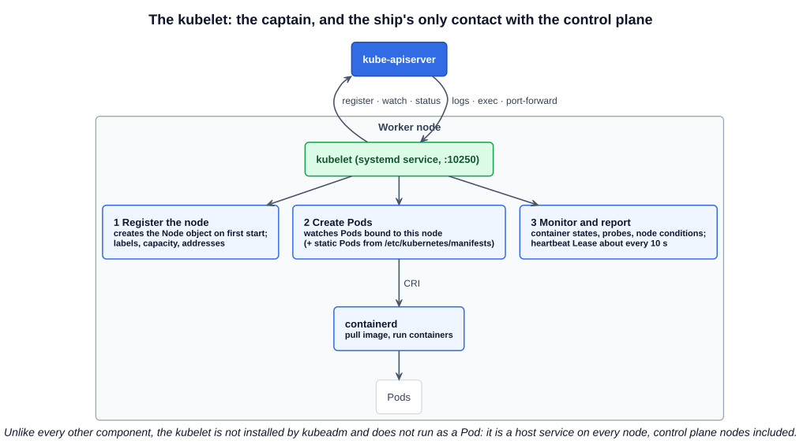
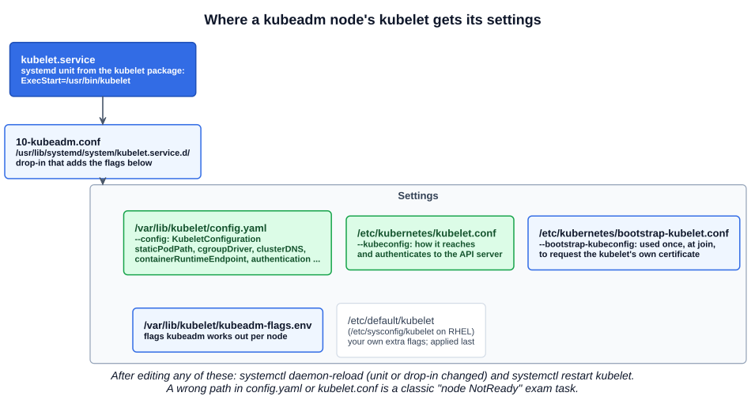

# 08 — kubelet

The kubelet is the **captain of the ship**. It leads all activity on its node, does the paperwork to join the node to the cluster, is the node's **sole point of contact** with the control plane, loads and unloads containers as instructed, and sends back regular reports on the state of the ship and its containers.

Chapter 01 introduced the kubelet's responsibilities; this chapter adds how it is installed and configured — which is what you need when a node goes `NotReady` on the exam.

---

## 1. What the kubelet does



| Job | How |
|---|---|
| **Register the node** | On first start, creates the node's `Node` object in the API server with its name, labels, capacity and addresses (`--register-node=true`, the default) |
| **Create Pods** | Watches the API server for Pods the scheduler has bound to *this* node. For each one, asks the container runtime (containerd, over CRI) to pull the image and start the containers. Also runs **static Pods** from `/etc/kubernetes/manifests` |
| **Monitor and report** | Keeps checking the Pod's containers (states, restarts, liveness/readiness/startup probes) and the node itself (memory, disk and PID pressure). Reports Pod status and node status to the API server, and renews a heartbeat `Lease` about every 10 seconds |

The **scheduler** decides where a Pod goes; the **kubelet** is what makes it exist. The course's slide puts it as "load or unload containers on the ship as instructed by the scheduler on the master" — but the instruction always arrives via the API server, never from the scheduler directly.

The course also says the runtime "may be Docker". On current clusters it is containerd or CRI-O; Docker Engine has not been a supported runtime since v1.24 (chapter 02).

---

## 2. kubeadm does not deploy the kubelet

This is the one difference from every other component:

| Component | Deployed by kubeadm? | Runs as |
|---|---|---|
| kube-apiserver, kube-controller-manager, kube-scheduler, etcd | Yes | Static Pods |
| kube-proxy, CoreDNS | Yes | DaemonSet, Deployment |
| **kubelet** | **No — you install it on every node yourself** | **systemd service** |

It cannot be otherwise: static Pods are *started by* the kubelet, so the kubelet has to exist first. kubeadm needs the `kubelet` package already installed and running on every node — **control plane nodes included** — and then writes its configuration.

### 2.1 From scratch

```bash
wget https://dl.k8s.io/release/v1.xx.y/bin/linux/amd64/kubelet
```

```ini
# /etc/systemd/system/kubelet.service
[Service]
ExecStart=/usr/local/bin/kubelet \
  --config=/var/lib/kubelet/kubelet-config.yaml \
  --kubeconfig=/var/lib/kubelet/kubeconfig \
  --register-node=true \
  --v=2
```

Almost every setting belongs in the **config file** (`--config`, a `KubeletConfiguration`) rather than in flags. The container runtime socket, for example, is the `containerRuntimeEndpoint` field (default `unix:///run/containerd/containerd.sock`).

### 2.2 With kubeadm

The node gets the kubelet from the `kubelet` package (deb/rpm, binary at `/usr/bin/kubelet`), and kubeadm adds its settings through a set of files:



| File | What it holds |
|---|---|
| `/usr/lib/systemd/system/kubelet.service.d/10-kubeadm.conf` | systemd drop-in that adds kubeadm's flags to the kubelet unit |
| `/var/lib/kubelet/config.yaml` | The `KubeletConfiguration`: `staticPodPath`, `cgroupDriver`, `clusterDNS`, `clusterDomain`, `containerRuntimeEndpoint`, authentication and authorization |
| `/etc/kubernetes/kubelet.conf` | kubeconfig: the API server address and the kubelet's own client certificate |
| `/etc/kubernetes/bootstrap-kubelet.conf` | kubeconfig with a bootstrap token, used once when a node joins to request its certificate (TLS bootstrapping, Section 7) |
| `/var/lib/kubelet/kubeadm-flags.env` | Flags kubeadm works out per node at `init`/`join` |
| `/etc/default/kubelet` (`/etc/sysconfig/kubelet` on RHEL) | Your own extra flags; applied last |

### 2.3 Viewing the options

The kubelet is not a Pod, so there is no manifest to `cat`. Look at the process or the files:

```bash
ps -aux | grep [k]ubelet | tr ' ' '\n' | grep -- '^--'
# --bootstrap-kubeconfig=/etc/kubernetes/bootstrap-kubelet.conf
# --kubeconfig=/etc/kubernetes/kubelet.conf
# --config=/var/lib/kubelet/config.yaml
# ...
systemctl cat kubelet                         # unit + every drop-in, merged
cat /var/lib/kubelet/config.yaml
```

### 2.4 Flags on the course slides that no longer exist

The slides show a Kubernetes v1.13-era kubelet. These flags were removed with dockershim in v1.24 or later, and a kubelet started with them will not run:

| On the slide | Today |
|---|---|
| `--container-runtime=remote` | Removed — the kubelet only speaks CRI |
| `--image-pull-progress-deadline` | Removed (it was dockershim-only) |
| `--network-plugin=cni` | Removed — CNI is handled by the container runtime |
| `--cni-bin-dir`, `--cni-conf-dir` | Removed — configured in containerd; defaults `/opt/cni/bin` and `/etc/cni/net.d` |
| `--container-runtime-endpoint` | Still accepted, but belongs in `config.yaml` as `containerRuntimeEndpoint` |
| `--cgroup-driver=cgroupfs` | Deprecated as a flag — use `cgroupDriver` in `config.yaml`. kubeadm defaults to `systemd`, and it must match the runtime's cgroup driver |

---

## Exam angle

- **Node `NotReady` → the kubelet first.** `ssh` to the node, then `systemctl status kubelet`. If it is stopped: `systemctl enable --now kubelet`. If it is crash-looping: `journalctl -u kubelet --no-pager | tail -50` names the problem.
- **Common breakages:** a wrong path in `/var/lib/kubelet/config.yaml` (CA file, `staticPodPath`), a wrong API server address or port in `/etc/kubernetes/kubelet.conf`, a wrong binary path in the systemd drop-in, a removed flag added by hand, or containerd itself stopped. After fixing: `systemctl daemon-reload` (if a unit file changed) and `systemctl restart kubelet`.
- **Static Pods depend on the kubelet.** If the kubelet on the control plane node is down, the API server, scheduler and controller manager are not restarted when they fail — fix the kubelet before anything else.
- **`kubectl` cannot fix a kubelet.** Everything about it lives on the node, as files and a systemd service.
- **Distractor:** "kubeadm installs the kubelet" — it configures it; the package is installed separately on every node.

## References

- [kubelet command line reference](https://kubernetes.io/docs/reference/command-line-tools-reference/kubelet/) — flags, and which ones have moved to the config file
- [Configuring each kubelet in your cluster using kubeadm](https://kubernetes.io/docs/setup/production-environment/tools/kubeadm/kubelet-integration/) — the drop-in, `kubeadm-flags.env`, `config.yaml` and the bootstrap kubeconfig
- [Set Kubelet Parameters Via A Configuration File](https://kubernetes.io/docs/tasks/administer-cluster/kubelet-config-file/) — `KubeletConfiguration` and how flags and the file interact
- [Nodes](https://kubernetes.io/docs/concepts/architecture/nodes/) — self-registration, node status, heartbeats

## Related notes

- CKAD: [Architecture](https://github.com/caseythecoder90/ckad-exam-prep/blob/main/notes/01-core-concepts/01-architecture.md) — the kubelet among the worker node components
- KCNA: [Probes and the kubelet](https://github.com/caseythecoder90/kcna-study-guide/blob/main/notes/05-kubernetes-deep-dive/20-probes-and-the-kubelet.md) — how the kubelet runs probes and reports readiness
