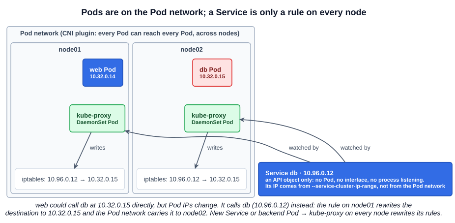
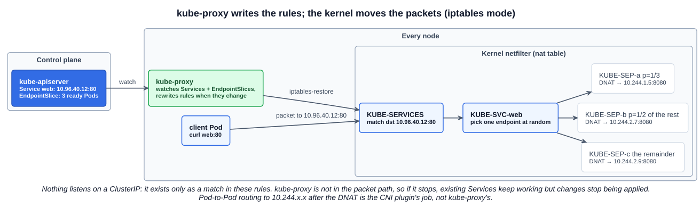

# 09 — kube-proxy

In a Kubernetes cluster **every Pod can reach every other Pod**. kube-proxy is the component that makes **Services** reachable on top of that. This chapter covers the problem it solves, how it is deployed, and how to check what it is doing. Chapter 01 ([section 3.3](./01-cluster-architecture.md#33-kube-proxy--the-radio-and-routing-charts)) has the full walk through the iptables chains it writes.

---

## 1. The Pod network, and why it is not enough

Pod-to-Pod connectivity comes from a **Pod network**: an internal virtual network that spans every node, which every Pod is connected to. It is provided by a **CNI plugin** (Calico, Flannel, Cilium, Weave and others; Section 9 covers them).

In the course's example, a web application runs on node01 and a database on node02. The web Pod *can* reach the database at its Pod IP, `10.32.0.15`. But **there is no guarantee the database Pod keeps that IP** — if it is recreated, it gets a new one. The right way to reach it is through a **Service**: create a Service `db`, and the web app connects to `db` (resolved by cluster DNS) or the Service's IP, `10.96.0.12`. The Service forwards the traffic to whichever database Pod is behind it.

### 1.1 What a Service actually is

Does the Service join the Pod network? **No — a Service is not a real thing on the network.** It is not a container, so it has no network interface and no process listening on its IP. It exists only as an object in the API (stored in etcd), and its IP comes from a separate range, `--service-cluster-ip-range` (kubeadm default `10.96.0.0/12`), not from the Pod network.

Yet the Service has to be reachable from every node. That is kube-proxy's job.



---

## 2. What kube-proxy does

kube-proxy is a process that **runs on every node**. It watches the API server for **Services** and their **EndpointSlices** (the list of ready Pod IPs behind each Service). Every time a Service is created, or a backend Pod is added or removed, it **writes rules on its node** that forward traffic for the Service's IP to a backend Pod.

One way it does this is with **iptables** rules — the default mode on Linux. In the example, kube-proxy on each node writes a rule: traffic to `10.96.0.12` → rewrite the destination to `10.32.0.15`. The kernel applies the rule to every packet; kube-proxy itself is not in the path.



| Mode | How it works |
|---|---|
| `iptables` (default on Linux) | NAT rules in the kernel's netfilter tables; backends picked at random |
| `ipvs` | The kernel's IPVS load balancer; more balancing algorithms. The docs now recommend `nftables` instead |
| `nftables` | The newer replacement for both, with better performance |

Some CNI plugins (Cilium, for example) can replace kube-proxy entirely.

---

## 3. Installing and viewing it

### 3.1 From scratch: a systemd service

```bash
wget https://dl.k8s.io/release/v1.xx.y/bin/linux/amd64/kube-proxy
```

```ini
# /etc/systemd/system/kube-proxy.service
[Service]
ExecStart=/usr/local/bin/kube-proxy \
  --config=/var/lib/kube-proxy/kube-proxy-config.yaml
Restart=on-failure
RestartSec=5
```

The config file is a `KubeProxyConfiguration`: the mode, the Pod network CIDR (`clusterCIDR`), the kubeconfig to reach the API server, and so on.

### 3.2 kubeadm: a DaemonSet

kubeadm deploys kube-proxy as a **DaemonSet** in `kube-system`. A DaemonSet runs exactly one Pod on every node — exactly what kube-proxy needs, since every node needs its own rules. New nodes get a kube-proxy Pod automatically when they join.

```bash
kubectl -n kube-system get pods -o wide | grep kube-proxy     # one per node: kube-proxy-<random>
kubectl -n kube-system get daemonset kube-proxy
# NAME         DESIRED   CURRENT   READY   UP-TO-DATE   AVAILABLE   NODE SELECTOR            AGE
# kube-proxy   3         3         3       3            3           kubernetes.io/os=linux   1h
```

How kubeadm sets it up:

| Detail | Value |
|---|---|
| Configuration | ConfigMap `kube-proxy` in `kube-system`, key `config.conf` (the `KubeProxyConfiguration`) and `kubeconfig.conf`; mounted at `/var/lib/kube-proxy` |
| Command | `kube-proxy --config=/var/lib/kube-proxy/config.conf --hostname-override=$(NODE_NAME)` |
| Node selector | `kubernetes.io/os: linux` (the course slide shows the older `beta.kubernetes.io/arch=amd64` label) |
| Tolerations | `operator: Exists` — tolerates every taint, so it also runs on control plane nodes |
| Networking | `hostNetwork: true` and `privileged: true`: it must change the node's own network rules |
| Priority | `system-node-critical` |

Because the settings live in a ConfigMap, changing them means editing the ConfigMap and **restarting the DaemonSet's Pods** — they only read the file at start:

```bash
kubectl -n kube-system edit configmap kube-proxy               # e.g. mode: "ipvs"
kubectl -n kube-system rollout restart daemonset kube-proxy
```

### 3.3 Checking it works

```bash
kubectl -n kube-system get configmap kube-proxy -o yaml | grep mode   # "" = iptables on Linux
kubectl -n kube-system logs ds/kube-proxy | head               # one Pod's log: which proxier it uses
curl -s http://localhost:10249/proxyMode                       # on a node
iptables -t nat -L KUBE-SERVICES -n | grep db                  # the rule for Service db
kubectl get endpointslices -l kubernetes.io/service-name=db    # backends it is forwarding to
```

---

## Exam angle

- **A Service that has endpoints but cannot be reached** from Pods points at kube-proxy (no rules) or the CNI plugin (rules exist but Pod-to-Pod routing fails). Check `kubectl -n kube-system get pods -o wide | grep kube-proxy` for a Pod on the affected node, then its logs.
- **A Service with no endpoints** is not a kube-proxy problem: its selector does not match the Pods' labels, or the Pods are not Ready.
- **kube-proxy runs on every node** as a DaemonSet (kubeadm) — `DESIRED` should equal the node count. A broken ConfigMap (bad YAML, a wrong kubeconfig path) makes every kube-proxy Pod crash-loop at once.
- **Changing the mode** is a ConfigMap edit plus `rollout restart daemonset kube-proxy`.
- **Distractor:** "the Service IP belongs to the Pod network" or "kube-proxy load-balances traffic itself". A Service IP comes from the service range and exists only in rules; the kernel does the forwarding.

## References

- [Virtual IPs and Service Proxies](https://kubernetes.io/docs/reference/networking/virtual-ips/) — how kube-proxy implements Services, and each proxy mode
- [kube-proxy command line reference](https://kubernetes.io/docs/reference/command-line-tools-reference/kube-proxy/) — flags and defaults (`--proxy-mode`, metrics on `127.0.0.1:10249`, health on `:10256`)
- [Service](https://kubernetes.io/docs/concepts/services-networking/service/) — Services, selectors and EndpointSlices
- [DaemonSet](https://kubernetes.io/docs/concepts/workloads/controllers/daemonset/) — one Pod per node, and how new nodes get one

## Related notes

- CKAD: [Services — ClusterIP](https://github.com/caseythecoder90/ckad-exam-prep/blob/main/notes/01-core-concepts/09-services-clusterip.md) — creating and using Services from the application side
- KCNA: [Services](https://github.com/caseythecoder90/kcna-study-guide/blob/main/notes/04-kubernetes-fundamentals/08-services.md) — the four Service types, EndpointSlices, headless Services and cluster DNS
