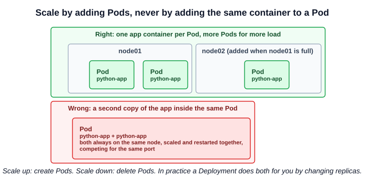
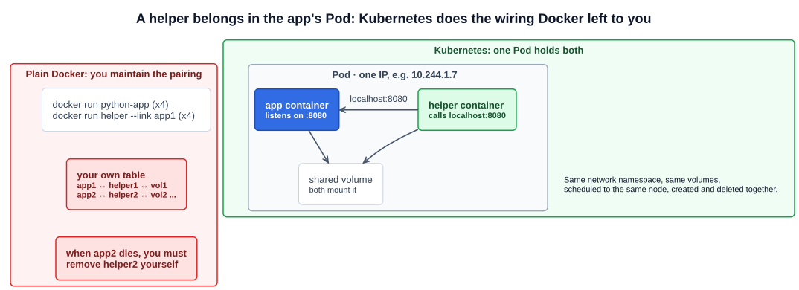

# 10 — Pods

The goal of a cluster is to run applications as containers on worker nodes. But Kubernetes does not run containers on nodes directly: **it wraps them in a Kubernetes object called a Pod.**

> A **Pod** is a single instance of an application, and the **smallest object you can create** in Kubernetes.

This chapter assumes two things are already in place, as the course does: the application is **built into a container image** and pushed to a registry such as Docker Hub (or a private registry) that the cluster can pull from, and a **working cluster** exists — single node or many, it does not matter.

---

## 1. One Pod, one instance

In the simplest case: a single-node cluster, one instance of the application, in one container, in one Pod.

When more users arrive and you need more instances, **you do not add containers to the existing Pod — you create more Pods**, each with its own copy of the application. When the node runs out of capacity, you add a node to the cluster and place new Pods there.



So Pods usually have a **one-to-one** relationship with the containers that run your application:

- **Scale up** — create new Pods.
- **Scale down** — delete Pods.

A second copy of the app container inside the same Pod would not help: both copies would always land on the same node, be scaled and restarted together, and fight over the same port. In practice you rarely create these Pods one by one — a Deployment's `replicas` field does it for you (later in this section). Load-balancing across them is the job of a Service (chapter 09).

---

## 2. Multi-container Pods

One-to-one is usual, not a rule. A Pod can hold several containers — just not several copies of the *same* application. The case for a second container is a **helper** that supports the main one: processing data users enter, handling uploaded files, shipping logs, refreshing configuration.

Containers in the same Pod:

| They share | Meaning |
|---|---|
| **Lifecycle** | Created together when the Pod is created, deleted together when it is deleted |
| **Node** | Always scheduled to the same node |
| **Network namespace** | One Pod IP; the containers reach each other on **`localhost`** and must use different ports |
| **Storage** | Can mount the same volumes and share files |



### 2.1 Why Pods exist: the Docker comparison

Take Kubernetes away for a moment. With plain Docker you would deploy the app with `docker run python-app`, and run it again for each extra instance. Then the app grows a helper that has to talk to it directly and read its data, one helper per app instance. Now you must:

- Run each helper and connect it to its app container yourself (the course uses `docker run helper --link app1`; `--link` is a legacy Docker feature — user-defined networks replaced it — but the burden is the same).
- Create volumes and share them between each pair.
- Keep a table of which app goes with which helper and which volume.
- Watch the app containers, and when one dies, kill its helper too.

With Pods, you declare which containers belong together and Kubernetes handles the rest: shared network and storage come with the Pod, and so does the cleanup. That is why, **even for a single-container application, Kubernetes makes you create a Pod**: it keeps the model the same if a helper is ever added.

### 2.2 Sidecars today

Multi-container Pods are less common than single-container ones, and the course treats them as a later topic. One development since the lecture: Kubernetes now has **native sidecar containers** (stable since v1.33). A sidecar is declared under `initContainers` with `restartPolicy: Always`; it starts *before* the app containers, keeps running alongside them, and stops after them. Use it for helpers — log shippers, proxies — that must be up for the app's whole life. Section 5 covers multi-container Pods and init containers in detail.

---

## 3. Creating and viewing Pods

```bash
kubectl run nginx --image=nginx          # create a Pod named nginx from the nginx image
kubectl get pods
# NAME    READY   STATUS              RESTARTS   AGE
# nginx   0/1     ContainerCreating   0          3s
# nginx   1/1     Running             0          8s
```

`kubectl run` creates a Pod and pulls the image named by `--image` — from Docker Hub when no registry is given (`nginx` means `docker.io/library/nginx:latest`), or from any registry you name in the image reference (`registry.example.com/team/app:1.4`).

The course's screenshot shows the Pod named `nginx-8586cf59-whssr`. That output is from before Kubernetes v1.18, when `kubectl run` created a **Deployment** (hence the generated suffix). Today `kubectl run` creates **exactly one Pod with exactly the name you give**.

| Status you see | Meaning |
|---|---|
| `ContainerCreating` | Scheduled to a node; the kubelet is pulling the image and starting the container |
| `Running` | The container is up (`READY 1/1`) |

The Pod is not yet reachable from outside the cluster. You can reach it from inside — from a node, or another Pod — at its Pod IP. Exposing it is what Services are for.

```bash
kubectl get pods -o wide                 # + Pod IP and node
kubectl describe pod nginx               # full detail + Events at the bottom
kubectl get pod nginx -o yaml            # the full object the API server stored
kubectl delete pod nginx
```

### 3.1 Generating Pod YAML

Writing Pod YAML from scratch is slow; on the exam, generate it:

```bash
kubectl run nginx --image=nginx --dry-run=client -o yaml > pod.yaml   # $do in commands/setup.md
kubectl run nginx --image=nginx --port=80 --labels=app=web,tier=front
kubectl run busybox --image=busybox --restart=Never -- sleep 3600     # args after --
kubectl run tmp --image=busybox --rm -it --restart=Never -- sh        # throwaway shell, deleted on exit
```

The Pod YAML structure itself is the next chapter.

---

## Exam angle

- **Pods are the unit of scheduling and scaling.** "Scale the application" means more Pods (via a Deployment's `replicas`), never more containers in one Pod.
- **`kubectl run` creates a Pod named exactly as given.** Generate YAML with `--dry-run=client -o yaml` for anything the flags cannot express (volumes, resources, a second container, probes), then `kubectl apply -f`.
- **Multi-container questions** test the shared network namespace (`localhost`, distinct ports) and shared volumes. Use `kubectl logs <pod> -c <container>` and `kubectl exec -it <pod> -c <container> -- sh` to target one container.
- **Stuck in `ContainerCreating`** means the Pod is scheduled; look at `kubectl describe pod` events for image pull, volume or network (CNI) errors.
- **Distractor:** "a Pod is a container". A Pod wraps one or more containers that share a network namespace and volumes.

## References

- [Pods](https://kubernetes.io/docs/concepts/workloads/pods/) — what a Pod is, single and multi-container Pods, and Pod templates
- [Sidecar Containers](https://kubernetes.io/docs/concepts/workloads/pods/sidecar-containers/) — native sidecars with `restartPolicy: Always` in `initContainers`
- [kubectl run](https://kubernetes.io/docs/reference/kubectl/generated/kubectl_run/) — every flag, with examples
- [Images](https://kubernetes.io/docs/concepts/containers/images/) — image names, registries, tags and pull policy

## Related notes

- CKAD: [Pods](https://github.com/caseythecoder90/ckad-exam-prep/blob/main/notes/01-core-concepts/03-pods.md) and [Multi-container Pods](https://github.com/caseythecoder90/ckad-exam-prep/blob/main/notes/03-multi-container-pods/01-multi-container-pods-intro.md) — the developer's view, with the sidecar, ambassador and adapter patterns
- KCNA: [Pods](https://github.com/caseythecoder90/kcna-study-guide/blob/main/notes/04-kubernetes-fundamentals/02-pods.md) — the shared network namespace, one Pod IP, sidecars and init containers
