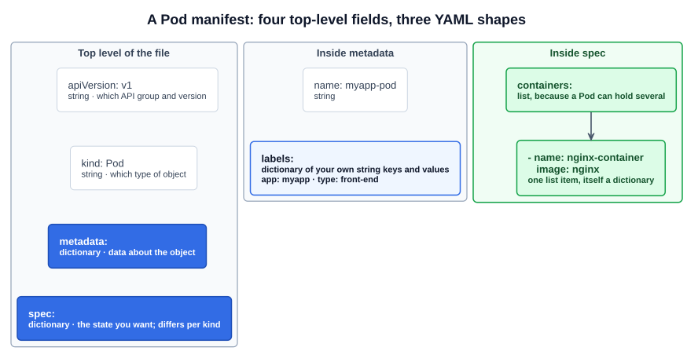
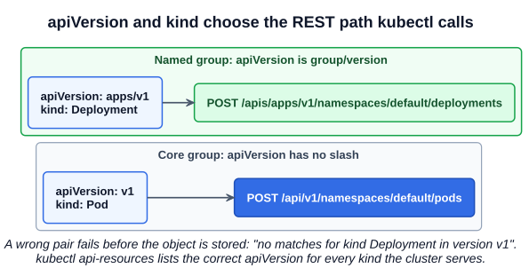

# 11 — Pods with YAML

`kubectl run` covers simple Pods. For everything else, Kubernetes objects are described in a **manifest**: a YAML file that states what you want, which you hand to the API server. Every object in this guide uses the same structure, so learning it once for a Pod carries over to Deployments, Services and the rest.

---

## 1. Just enough YAML

YAML has three shapes, and a manifest is built entirely from them.

| Shape | Looks like | Notes |
|---|---|---|
| **Scalar** | `image: nginx` | One value: a string, number or boolean |
| **Dictionary** (map) | `labels:` with indented `key: value` lines | Unordered: key order does not matter |
| **List** (array) | Items that each start with `- ` | Ordered: item order is meaningful |

The space after the colon and after the dash is required. A list can contain dictionaries, which is the most common pattern in Kubernetes:

```yaml
containers:              # a list...
  - name: web            # ...whose first item is a dictionary with two keys
    image: nginx
  - name: helper         # the second item
    image: busybox
```

`- ` starts a new list item. Keys without a dash belong to the current item, so `image` above is in the same dictionary as `name`.

### 1.1 Indentation rules

Indentation is what defines the structure:

- **Use spaces, never tabs.** A tab is a parse error.
- **Siblings need the same indent.** Children need more than their parent.
- **The number of spaces does not matter**, as long as it is consistent within a block. Two spaces is the convention.
- A list may be indented under its key or sit level with it. `kubectl` output uses the second form:

```yaml
containers:      # both forms parse identically
- name: web
  image: nginx
```

### 1.2 Indentation mistakes and what they do

```yaml
# 1. labels indented under name
metadata:
  name: myapp-pod
    labels:
      app: myapp
```

`name` already holds a string, so it cannot also have children. This is a **parse error** (`mapping values are not allowed in this context`), not a nested field.

```yaml
# 2. name and labels not indented under metadata
metadata:
name: myapp-pod
labels:
  app: myapp
```

This is valid YAML with the wrong meaning: `metadata` is empty, and `name` and `labels` become top-level fields. YAML parsing cannot catch it. The API server's field validation (on by default in `kubectl`) rejects it.

```yaml
# 3. containers as a dictionary instead of a list (no dash)
spec:
  containers:
    name: web
    image: nginx
```

Also valid YAML. The API server rejects it, because `containers` must be a list.

### 1.3 Values that are not the type you think

YAML guesses types from how a value looks. Kubernetes label values and environment variable values must be strings, so these fail until quoted:

| Written | YAML reads it as | Fix |
|---|---|---|
| `version: 1` | Number | `version: "1"` |
| `enabled: yes` (also `no`, `on`, `off`, `true`, `false`) | Boolean | `enabled: "yes"` |

The error looks like `cannot unmarshal number into Go struct field ... of type string`.

### 1.4 Other syntax you will meet

```yaml
# A comment runs to the end of the line
---                        # separates objects in one file
script: |                  # literal block: newlines kept
  echo one
  echo two
args: ["sleep", "3600"]    # flow style: a list on one line, same meaning as dashes
```

---

## 2. The structure of a manifest

The Kubernetes docs list four fields to set in a manifest:

| Field | Type | Purpose |
|---|---|---|
| `apiVersion` | String | Which API group and version defines this object |
| `kind` | String | Which type of object to create. Case-sensitive: `Pod`, not `pod` |
| `metadata` | Dictionary | Data that identifies the object: `name`, `namespace`, `labels`, `annotations` |
| `spec` | Dictionary | The state you want. Its contents differ for every kind |



### 2.1 Not every object has `spec`

`apiVersion`, `kind` and `metadata` are universal. `spec` is only the most common shape. Objects that are not describing a desired running state put their content in other top-level fields:

| Kind | Instead of `spec` |
|---|---|
| ConfigMap | `data`, `binaryData` |
| Secret | `data`, `stringData`, `type` |
| ServiceAccount | Nothing required; optional fields such as `automountServiceAccountToken` |
| Role, ClusterRole | `rules` |
| RoleBinding, ClusterRoleBinding | `subjects`, `roleRef` |
| StorageClass | `provisioner`, `parameters`, `reclaimPolicy` |
| PriorityClass | `value`, `globalDefault` |

### 2.2 `apiVersion` values

| Kind | `apiVersion` |
|---|---|
| Pod, Service, ConfigMap, Secret, Namespace, ServiceAccount, Node, PersistentVolume, PersistentVolumeClaim | `v1` |
| Deployment, ReplicaSet, DaemonSet, StatefulSet | `apps/v1` |
| Job, CronJob | `batch/v1` |
| HorizontalPodAutoscaler | `autoscaling/v2` |
| Ingress, NetworkPolicy | `networking.k8s.io/v1` |
| Role, ClusterRole, RoleBinding, ClusterRoleBinding | `rbac.authorization.k8s.io/v1` |
| StorageClass | `storage.k8s.io/v1` |
| PriorityClass | `scheduling.k8s.io/v1` |

The value decides the REST path `kubectl` calls (chapter 05): no slash means the original **core** group under `/api`; `group/version` is a named group under `/apis`.



The lecture mentions `extensions/v1beta1`. Do not use it: the API versions it provided stopped being served between v1.16 and v1.22. Find the current value on any cluster instead of memorizing:

```bash
kubectl api-resources                     # NAME, SHORTNAMES, APIVERSION, NAMESPACED, KIND
kubectl api-resources | grep -i deployment
kubectl explain deployment | head -3      # GROUP, KIND and VERSION
```

---

## 3. A Pod, field by field

```yaml
# pod-definition.yaml
apiVersion: v1
kind: Pod
metadata:
  name: myapp-pod
  labels:
    app: myapp
    type: front-end
spec:
  containers:
    - name: nginx-container
      image: nginx
```

- `metadata.name` is a string. `labels` is a dictionary of your own key-value pairs, used later to select groups of objects.
- `spec.containers` is a list because a Pod can hold several containers (chapter 10). This one has a single item, with the two fields every container needs: `name` and `image`.

The file is in [`examples/pods/pod-definition.yaml`](../../examples/pods/pod-definition.yaml).

```bash
kubectl create -f pod-definition.yaml       # or: kubectl apply -f pod-definition.yaml
kubectl get pods
kubectl describe pod myapp-pod
```

### 3.1 `create` or `apply`

| Command | Object does not exist | Object exists |
|---|---|---|
| `kubectl create -f` | Creates it | **Error**: `AlreadyExists` |
| `kubectl apply -f` | Creates it | Updates it to match the file |
| `kubectl replace -f` | **Error**: `NotFound` | Replaces it |
| `kubectl replace --force -f` | Creates it | Deletes and recreates it (needed for fields a running Pod cannot change) |

The course uses `create`. On the exam, `apply` is the safer default because rerunning it after an edit works.

### 3.2 Do not write it from memory

Generate the file and look up fields as you need them. These two are faster than typing from scratch and do not depend on remembering indentation:

```bash
kubectl run myapp-pod --image=nginx --labels=app=myapp,type=front-end \
  --dry-run=client -o yaml > pod.yaml

kubectl explain pod.spec.containers             # fields, types, and which are required
kubectl explain pod.spec.containers.env         # any depth
kubectl explain pod --recursive | less          # the whole tree
```

Check an edited file before applying it:

```bash
kubectl apply -f pod.yaml --dry-run=server      # full validation by the API server; stores nothing
```

In Vim, `:set expandtab tabstop=2 shiftwidth=2` makes the Tab key insert spaces ([`commands/setup.md`](../commands/setup.md)).

---

## Exam angle

- **Typical task:** create a Pod with a given name, image, labels and namespace, often plus something `kubectl run` has no flag for. Generate with `--dry-run=client -o yaml`, edit, `kubectl apply -f`, then verify with `kubectl get` or `kubectl describe`.
- **Reading the error tells you the layer.** `error converting YAML to JSON` is broken YAML: check the line it names for tabs and indentation. `unknown field` means a misplaced or misspelled key: check its indent. `no matches for kind` is a wrong `apiVersion` or `kind`. `cannot unmarshal number` needs quotes.
- **Lists are where indentation goes wrong.** When adding a second container, volume or env entry, copy the first item's indent and start with `- `.
- **Trap:** `kubectl create -f` fails on a rerun with `AlreadyExists`. Use `apply`, or `replace --force` for changes a running Pod does not allow.
- **`kubectl explain` works in the exam terminal** and needs no browser. It marks required fields with `-required-`.

## References

- [Objects In Kubernetes](https://kubernetes.io/docs/concepts/overview/working-with-objects/) — "Required fields" for the four manifest fields and "Server side field validation" for `--validate`
- [Pods](https://kubernetes.io/docs/concepts/workloads/pods/) — "Using Pods" has a minimal Pod manifest to copy
- [Deprecated API Migration Guide](https://kubernetes.io/docs/reference/using-api/deprecation-guide/) — which API versions were removed, per release
- [kubectl explain](https://kubernetes.io/docs/reference/kubectl/generated/kubectl_explain/) — flags, including `--recursive`

## Related notes

- CKAD: [Pod YAML](https://github.com/caseythecoder90/ckad-exam-prep/blob/main/notes/01-core-concepts/04-pod-yaml.md) — the same manifest from the developer's view
- CKAD: [API resources and explain](https://github.com/caseythecoder90/ckad-exam-prep/blob/main/notes/01-core-concepts/10-api-resources-explain.md) — discovering fields and API versions
- KCNA: [Pods](https://github.com/caseythecoder90/kcna-study-guide/blob/main/notes/04-kubernetes-fundamentals/02-pods.md) — imperative versus declarative Pod creation
