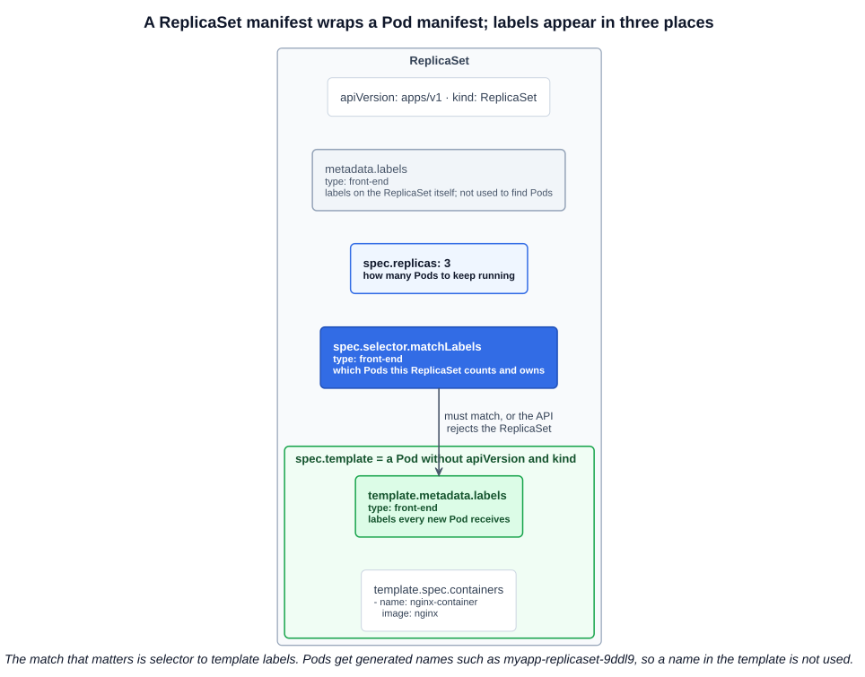
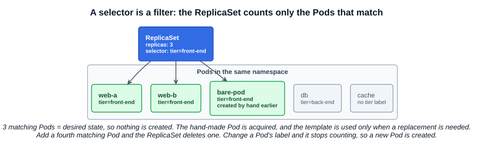

# 12 — ReplicaSets

A **controller** (chapter 06) watches objects and keeps the actual state equal to the desired state. The **ReplicaSet** controller applies that to Pods: it keeps a specified number of identical Pods running. Its older predecessor, the ReplicationController, does the same job with a less capable selector.

In practice you rarely create either one directly. A Deployment creates and manages ReplicaSets for you (next chapter), but troubleshooting a Deployment often means reading its ReplicaSet.

---

## 1. Why replicate

| Need | How replication helps |
|---|---|
| **High availability** | If a Pod fails, or its node does, a replacement is created. This is useful even with `replicas: 1` |
| **Scaling and load sharing** | Several Pods share the traffic through a Service, and they can run across several nodes |

Replication works across nodes. A ReplicaSet is not tied to one machine; the scheduler places each Pod it creates (chapter 07).

---

## 2. ReplicationController and ReplicaSet

| | ReplicationController | ReplicaSet |
|---|---|---|
| Status | Legacy, superseded | Current, used by Deployments |
| `apiVersion` | `v1` | `apps/v1` |
| `spec.selector` | Optional; defaults to the template's labels | **Required** |
| Selector types | Equality only (a plain map) | `matchLabels` and set-based `matchExpressions` |
| `kubectl` short name | `rc` | `rs` |

The `template` and `replicas` fields work the same way in both.

### 2.1 ReplicationController manifest

```yaml
# rc-definition.yaml
apiVersion: v1
kind: ReplicationController
metadata:
  name: myapp-rc
  labels:
    app: myapp
    type: front-end
spec:
  replicas: 3
  template:
    metadata:
      labels:
        app: myapp
        type: front-end
    spec:
      containers:
        - name: nginx-container
          image: nginx
```

### 2.2 ReplicaSet manifest

```yaml
# replicaset-definition.yaml
apiVersion: apps/v1
kind: ReplicaSet
metadata:
  name: myapp-replicaset
  labels:
    app: myapp
    type: front-end
spec:
  replicas: 3
  selector:
    matchLabels:
      type: front-end
  template:
    metadata:
      labels:
        app: myapp
        type: front-end
    spec:
      containers:
        - name: nginx-container
          image: nginx
```

Both files are in [`examples/replicasets/`](../../examples/replicasets/). `spec.template` is the Pod manifest from chapter 11 without its `apiVersion` and `kind`, indented one level:



```bash
kubectl create -f replicaset-definition.yaml
kubectl get replicaset                    # DESIRED, CURRENT, READY
kubectl get pods                          # myapp-replicaset-9ddl9, ...
```

`kubectl apply -f replicaset-definition.yaml` works here too, and is the better habit: unlike `create`, it can be rerun after you edit the file. See [chapter 11](./11-pods-with-yaml.md#31-create-or-apply). If the object was first made with `create`, `apply` prints a warning about a missing annotation once and still works.

---

## 3. Labels and selectors

A ReplicaSet monitors Pods, and the **selector** is how it knows which ones. It is a filter: any Pod in the same namespace whose labels match counts toward `replicas`.



| Selector form | Example | Matches when |
|---|---|---|
| `matchLabels` | `type: front-end` | The label has exactly this value. Several entries are ANDed |
| `matchExpressions` | `{key: tier, operator: In, values: [front-end, api]}` | Operators: `In`, `NotIn`, `Exists`, `DoesNotExist` |

Four consequences of the selector being only a filter:

- **The template's labels must match the selector**, or the API rejects the ReplicaSet with `selector does not match template labels`.
- **Existing Pods are adopted.** If three matching Pods already exist, a new `replicas: 3` ReplicaSet creates nothing. The docs warn against giving bare Pods labels that match a ReplicaSet's selector for this reason.
- **The template is still required**, even if every Pod already exists, because it is what replacements are built from.
- **Labels decide membership.** Remove the label from a Pod and it stops counting: it keeps running on its own and the ReplicaSet creates a replacement.

```bash
kubectl get pods --show-labels
kubectl get pods -l type=front-end
kubectl describe rs myapp-replicaset | grep -i selector
kubectl get pod <pod> -o jsonpath='{.metadata.ownerReferences[0].name}{"\n"}'   # who owns this Pod
```

### 3.1 Changing the template does not change running Pods

The ReplicaSet only compares the **count** of matching Pods. Editing the image in its template does not touch existing Pods, because the count is still correct. Only Pods created afterwards use the new template:

```bash
kubectl edit rs myapp-replicaset          # fix the image
kubectl delete pod -l type=front-end      # the replacements use the new template
```

Rolling out a new version without doing this by hand is what Deployments add.

---

## 4. Scaling

| Method | Command | Changes the file? |
|---|---|---|
| Edit the file | Set `replicas: 6`, then `kubectl apply -f replicaset-definition.yaml` | Yes |
| Scale by file | `kubectl scale --replicas=6 -f replicaset-definition.yaml` | **No** |
| Scale by name | `kubectl scale --replicas=6 replicaset myapp-replicaset` (or `rs/myapp-replicaset`) | **No** |
| Edit live | `kubectl edit rs myapp-replicaset` | **No** |

**Caveat:** after `kubectl scale`, the file still says `replicas: 3`. The next `kubectl apply -f` of that file scales back to 3.

---

## 5. Other commands

```bash
kubectl get rs -o wide                     # includes IMAGES and SELECTOR
kubectl describe rs myapp-replicaset       # Pod counts, and events for creates and failures
kubectl replace -f replicaset-definition.yaml
kubectl delete rs myapp-replicaset         # also deletes its Pods
kubectl delete rs myapp-replicaset --cascade=orphan   # keeps the Pods running
```

There is no `kubectl create replicaset`. Generate a Deployment and convert it:

```bash
kubectl create deployment myapp --image=nginx --replicas=3 --dry-run=client -o yaml > rs.yaml
# In rs.yaml: change kind to ReplicaSet and delete the strategy line.
```

---

## Exam angle

- **Typical tasks:** create or fix a ReplicaSet, scale it, or find out why its Pods are failing. Verify with `kubectl get rs` and compare `DESIRED`, `CURRENT` and `READY`.
- **Common broken-manifest errors:** `no matches for kind "ReplicaSet" in version "v1"` means `apiVersion` must be `apps/v1`. `selector does not match template labels` means the selector and template labels differ. Fix the file, then apply it.
- **Fixed the image but the Pods are still failing?** The running Pods came from the old template. Delete them so they are recreated.
- **Pods keep coming back after `kubectl delete pod`.** That is the ReplicaSet working. Scale it or delete the ReplicaSet instead.
- **Trap:** `kubectl scale --replicas=N -f file` does not update the file, and a later `apply` undoes it.
- **Distractor:** `metadata.labels` on the ReplicaSet does not select Pods. `spec.selector` does.

## References

- [ReplicaSet](https://kubernetes.io/docs/concepts/workloads/controllers/replicaset/) — "Example" has a manifest to copy; "Non-Template Pod acquisitions" and "Writing a ReplicaSet manifest" cover selectors
- [ReplicationController](https://kubernetes.io/docs/concepts/workloads/controllers/replicationcontroller/) — the legacy API and its optional selector
- [Labels and Selectors](https://kubernetes.io/docs/concepts/overview/working-with-objects/labels/) — "Resources that support set-based requirements" has the `matchExpressions` YAML
- [kubectl scale](https://kubernetes.io/docs/reference/kubectl/generated/kubectl_scale/) — scaling by file or by type and name

## Related notes

- CKAD: [ReplicaSets](https://github.com/caseythecoder90/ckad-exam-prep/blob/main/notes/01-core-concepts/05-replicasets.md) — the same objects from the developer's view
- KCNA: [Deployments and ReplicaSets](https://github.com/caseythecoder90/kcna-study-guide/blob/main/notes/04-kubernetes-fundamentals/05-deployments-and-replicasets.md) — the ownership chain and `pod-template-hash`
- KCNA: [Labels and selectors](https://github.com/caseythecoder90/kcna-study-guide/blob/main/notes/04-kubernetes-fundamentals/12-labels-and-selectors.md) — both selector grammars and what else uses them
