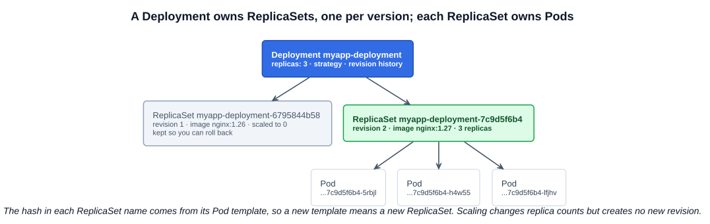
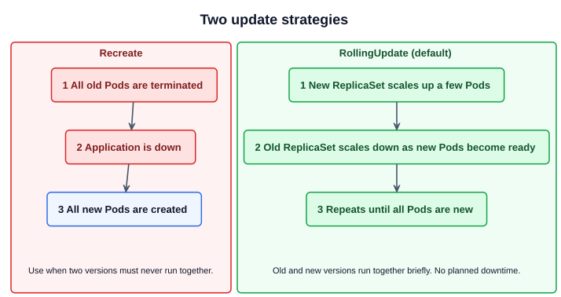
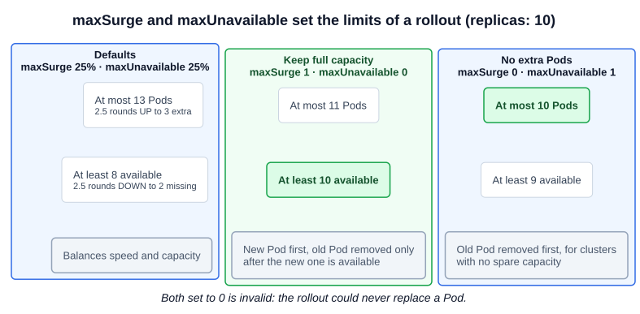

# 13 — Deployments

A **Deployment** is the object you normally use to run a stateless application. It sits above ReplicaSets and adds what a ReplicaSet (chapter 12) lacks: a controlled way to change a running application.

---

## 1. Why Deployments

A ReplicaSet keeps the right number of Pods running, but production also needs:

| Need | What a Deployment provides |
|---|---|
| Release a new version with no planned downtime | **Rolling update**: replaces Pods a few at a time |
| A bad release | **Rollback**: returns to an earlier revision with one command |
| Several changes released as one | **Pause and resume** a rollout |
| A record of what ran | **Revision history**, kept as old ReplicaSets |
| More capacity | **Scaling**, the same as a ReplicaSet, even during a rollout |

---

## 2. Creating a Deployment

The manifest is the ReplicaSet manifest with `kind` changed. The strategy is optional and shown here with its default values:

```yaml
# deployment-definition.yaml
apiVersion: apps/v1
kind: Deployment
metadata:
  name: myapp-deployment
  labels:
    app: myapp
spec:
  replicas: 3
  selector:
    matchLabels:
      app: myapp
  strategy:
    type: RollingUpdate
    rollingUpdate:
      maxSurge: 25%
      maxUnavailable: 25%
  template:
    metadata:
      labels:
        app: myapp
    spec:
      containers:
        - name: nginx-container
          image: nginx:1.27
```

As with a ReplicaSet, `spec.selector` is required and must match the template's labels. On a Deployment it is also **immutable** after creation.

The file is in [`examples/deployments/`](../../examples/deployments/). On the exam, generate it instead of typing it:

```bash
kubectl create deployment myapp-deployment --image=nginx:1.27 --replicas=3 --dry-run=client -o yaml > deploy.yaml
kubectl apply -f deploy.yaml
kubectl create deployment myapp-deployment --image=nginx:1.27 --replicas=3   # or directly
```

### 2.1 What gets created

A Deployment creates a ReplicaSet, and the ReplicaSet creates the Pods. Each name extends its parent's:



```bash
kubectl get deployments
# NAME               READY   UP-TO-DATE   AVAILABLE   AGE
# myapp-deployment   3/3     3            3           21s
kubectl get replicaset
# NAME                          DESIRED   CURRENT   READY   AGE
# myapp-deployment-6795844b58   3         3         3       2m
kubectl get pods
# myapp-deployment-6795844b58-5rbjl ...
```

| Column | Meaning |
|---|---|
| `READY` | Ready Pods / desired Pods. The course's older output shows `DESIRED` and `CURRENT` here instead |
| `UP-TO-DATE` | Pods running the latest template |
| `AVAILABLE` | Pods available to users |

To see all three levels at once:

```bash
kubectl get all
# deployment.apps/myapp-deployment ...
# replicaset.apps/myapp-deployment-6795844b58 ...
# pod/myapp-deployment-6795844b58-5rbjl ...
```

`all` does not mean everything: it leaves out ConfigMaps, Secrets, Ingresses, PersistentVolumeClaims and others. Name those explicitly when you need them. The slide's `deploy/` and `po/` prefixes are from an older `kubectl`.

The Deployment controller adds a `pod-template-hash` label to each ReplicaSet and its Pods, computed from the Pod template. This keeps the ReplicaSets from overlapping. Do not change it.

---

## 3. Rollouts and revisions

**A rollout is triggered only when `spec.template` changes**, for example the image or the template labels. Changing `replicas` is not a rollout and creates no revision.

Each rollout creates a new ReplicaSet, scales it up and scales the old one down. The old ReplicaSet stays at 0 replicas; it holds that revision's configuration, which is what makes rollback possible.

```bash
kubectl set image deployment/myapp-deployment nginx-container=nginx:1.28   # container name=new image
kubectl edit deployment myapp-deployment                                  # or edit it live
kubectl apply -f deploy.yaml                                              # or change the file

kubectl rollout status deployment/myapp-deployment    # waits; exits non-zero on failure
kubectl get rs                                        # old ReplicaSet at 0, new one at 3
kubectl describe deployment myapp-deployment          # events show each scale up and down
```

---

## 4. Update strategies

`spec.strategy.type` is `RollingUpdate` (default) or `Recreate`.



### 4.1 `maxSurge` and `maxUnavailable`

These two fields control how a rolling update proceeds. Each takes an **absolute number** (`5`) or a **percentage of the desired Pods** (`10%`), and each defaults to **25%**.

| Field | Limits | Percentage rounds | Default |
|---|---|---|---|
| `spec.strategy.rollingUpdate.maxSurge` | Pods that may exist **above** `replicas` | **Up** | 25% |
| `spec.strategy.rollingUpdate.maxUnavailable` | Pods that may be unavailable, counted **below** `replicas` | **Down** | 25% |

They cannot both be 0, because the rollout could then never replace a Pod.



The limits with default percentages, after rounding:

| `replicas` | `maxSurge` (up) | `maxUnavailable` (down) | Most Pods at once | Fewest available |
|---|---|---|---|---|
| 1 | 1 | 0 | 2 | 1 |
| 3 | 1 | 0 | 4 | 3 |
| 4 | 1 | 1 | 5 | 3 |
| 10 | 3 | 2 | 13 | 8 |

Rounding keeps small Deployments safe: with three replicas, `maxUnavailable` rounds down to 0, so a new Pod must become available before an old one goes.

```yaml
spec:
  strategy:
    type: RollingUpdate
    rollingUpdate:
      maxSurge: 1
      maxUnavailable: 0
```

To switch to `Recreate`, also remove the `rollingUpdate` block, because the API rejects it with that type:

```yaml
spec:
  strategy:
    type: Recreate
```

**Do not confuse with `minAvailable`.** That field belongs to a **PodDisruptionBudget**, which limits voluntary disruptions such as `kubectl drain`. Deployment rollouts are not limited by PodDisruptionBudgets; these two strategy fields control them instead.

### 4.2 Other fields that shape a rollout

| Field | Default | Purpose |
|---|---|---|
| `spec.minReadySeconds` | 0 | How long a new Pod must stay ready before it counts as available |
| `spec.progressDeadlineSeconds` | 600 | Time without progress before the rollout reports `ProgressDeadlineExceeded`. The controller keeps retrying |
| `spec.revisionHistoryLimit` | 10 | Old ReplicaSets kept. Once one is removed, you cannot roll back to it |

---

## 5. Rollback, pause and restart

```bash
kubectl rollout history deployment/myapp-deployment
kubectl rollout history deployment/myapp-deployment --revision=2   # that revision's template
kubectl rollout undo deployment/myapp-deployment                   # to the previous revision
kubectl rollout undo deployment/myapp-deployment --to-revision=1
kubectl rollout status deployment/myapp-deployment

kubectl rollout pause deployment/myapp-deployment                  # changes now queue up
kubectl set image deployment/myapp-deployment nginx-container=nginx:1.28
kubectl rollout resume deployment/myapp-deployment                 # released as one rollout

kubectl rollout restart deployment/myapp-deployment                # new Pods, same configuration

kubectl annotate deployment/myapp-deployment kubernetes.io/change-cause="image updated to 1.28"
                                                                    # shown as CHANGE-CAUSE in history
kubectl scale deployment/myapp-deployment --replicas=6
kubectl delete deployment myapp-deployment                          # also deletes its ReplicaSets and Pods
```

A rollback does not reuse the old revision number. The old template becomes a new, higher revision.

---

## Exam angle

- **Typical tasks:** create or scale a Deployment, update its image, roll it back, or set its strategy. Verify with `kubectl rollout status` and `kubectl get deployment`.
- **`set image` uses the container name, not the Deployment name.** Check it first: `kubectl get deployment <name> -o jsonpath='{.spec.template.spec.containers[*].name}'`.
- **Rollout stuck?** `kubectl rollout status` waits; `kubectl get rs` shows the new ReplicaSet not becoming ready, and `kubectl describe pod` on a new Pod gives the reason, often a bad image. With the defaults, old Pods keep serving, so `kubectl rollout undo` recovers quickly.
- **Strategy tasks:** set percentages or numbers under `spec.strategy.rollingUpdate`. For `Recreate`, remove that block or the API rejects the change. `kubectl explain deployment.spec.strategy.rollingUpdate` recalls the fields.
- **Trap:** fixing Pods directly does not last, because the ReplicaSet and Deployment recreate them from the template. Edit the Deployment.
- **Trap:** `kubectl scale` is not a rollout. It adds nothing to `rollout history`.

## References

- [Deployments](https://kubernetes.io/docs/concepts/workloads/controllers/deployment/) — "Creating a Deployment" has a manifest to copy; "Strategy" has `maxSurge` and `maxUnavailable` with YAML examples; "Rolling Back a Deployment" has the history and undo commands
- [Disruptions](https://kubernetes.io/docs/concepts/workloads/pods/disruptions/) — PodDisruptionBudgets, and why they do not limit rolling updates
- [kubectl rollout](https://kubernetes.io/docs/reference/kubectl/generated/kubectl_rollout/) — `status`, `history`, `undo`, `pause`, `resume`, `restart`

## Related notes

- CKAD: [Deployments](https://github.com/caseythecoder90/ckad-exam-prep/blob/main/notes/01-core-concepts/06-deployments.md) and [Updates and rollbacks](https://github.com/caseythecoder90/ckad-exam-prep/blob/main/notes/05-pod-design/02-deployment-updates-rollbacks.md) — the developer's view
- KCNA: [Deployments and ReplicaSets](https://github.com/caseythecoder90/kcna-study-guide/blob/main/notes/04-kubernetes-fundamentals/05-deployments-and-replicasets.md) — the ownership chain and revisions
- KCNA: [PodDisruptionBudgets](https://github.com/caseythecoder90/kcna-study-guide/blob/main/notes/05-kubernetes-deep-dive/13-pod-disruption-budgets.md) — `minAvailable` versus `maxUnavailable` in a budget
