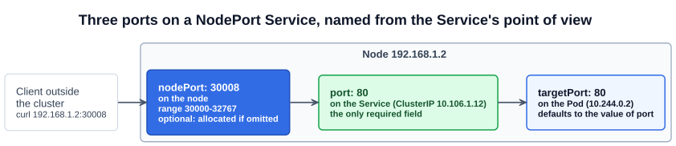
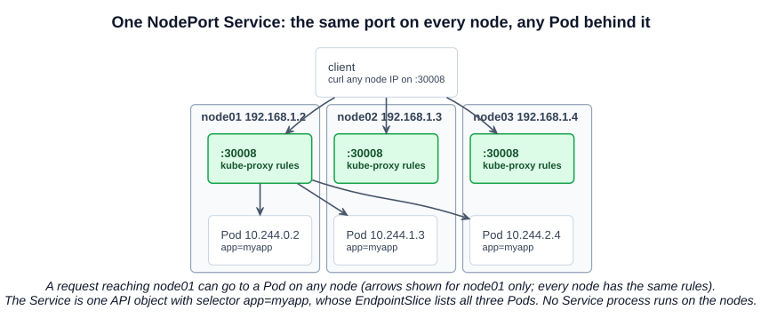
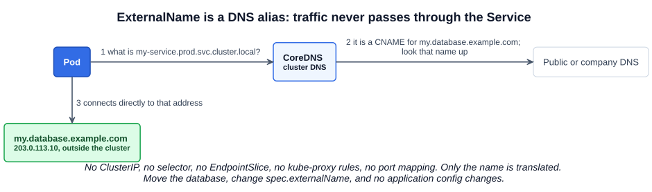

# 14 — Services

Pods get IP addresses from the Pod network, but those addresses change whenever a Pod is replaced, and they cannot be reached from outside the cluster. A **Service** is the object that solves both: it gives a group of Pods one stable way in, and it connects applications to each other and to users. Front-end Pods reach back-end Pods through a Service, users reach the front end through a Service, and the back end reaches an external database through a Service. Because no one depends on individual Pod addresses, the parts of the application stay **loosely coupled**.

Chapter 09 explains how a Service works underneath: it is an API object, and kube-proxy on every node writes the rules that make it reachable.

---

## 1. The problem

A web Pod runs at `10.244.0.2` on a node whose address is `192.168.1.2`. Your laptop is on the `192.168.1.x` network.

- From the laptop, `curl http://10.244.0.2` fails, because the Pod network is internal to the cluster.
- If you SSH to the node, `curl http://10.244.0.2` works. But users cannot SSH into a node to use an application.

You need something that listens on the node and forwards to the Pod. That is a NodePort Service: `curl http://192.168.1.2:30008`.

---

## 2. Service types

| `spec.type` | What it gives you | Reached from |
|---|---|---|
| **ClusterIP** (default) | A stable virtual IP inside the cluster | Inside the cluster only |
| **NodePort** | ClusterIP, plus the same port opened on every node | Outside, via `<any-node-IP>:<nodePort>` |
| **LoadBalancer** | NodePort, plus a load balancer from a supported cloud provider | Outside, via the load balancer's address |
| **ExternalName** | A DNS alias to a name outside the Service | Used by clients inside the cluster; see section 6 |

ClusterIP, NodePort and LoadBalancer build on each other. ExternalName is different in kind: it does not forward traffic at all.

---

## 3. NodePort

### 3.1 Three ports

All three names are from the Service's point of view:



| Field | Where it is | Required? | If you omit it |
|---|---|---|---|
| `targetPort` | On the Pod, where the application listens | No | Same value as `port` |
| `port` | On the Service itself | **Yes** | — |
| `nodePort` | On every node | No | Allocated from `30000-32767` |

The range comes from `--service-node-port-range` on the kube-apiserver. If you choose a `nodePort` that is outside the range or already in use, the API request fails.

`ports` is a list because one Service can expose several ports. When it does, each entry needs a `name`.

### 3.2 The manifest

```yaml
# nodeport-service.yaml
apiVersion: v1
kind: Service
metadata:
  name: myapp-service
spec:
  type: NodePort
  selector:
    app: myapp
  ports:
    - port: 80
      targetPort: 80
      nodePort: 30008
```

`selector` connects the Service to Pods by their labels, the same idea as a ReplicaSet (chapter 12). It uses the plain `key: value` form, without `matchLabels`.

```bash
kubectl apply -f nodeport-service.yaml
kubectl get service
# NAME            TYPE       CLUSTER-IP       EXTERNAL-IP   PORT(S)        AGE
# kubernetes      ClusterIP  10.96.0.1        <none>        443/TCP        16d
# myapp-service   NodePort   10.106.127.123   <none>        80:30008/TCP   5m
curl http://192.168.1.2:30008
```

`PORT(S)` reads `port:nodePort`. The `kubernetes` Service always exists; it is how Pods reach the API server.

The file is in [`examples/services/`](../../examples/services/) and selects the Pods from the Deployment example in chapter 13.

### 3.3 Many Pods and many nodes

You do not have to configure anything for either of these:

- **Several Pods match:** all of them become the Service's backends, and requests are distributed among them. The Service is a built-in load balancer. kube-proxy's default iptables mode picks a backend at random, per connection. `sessionAffinity: ClientIP` keeps a client on one Pod.
- **Pods on several nodes:** the Service spans the cluster. The `nodePort` opens on **every** node, so any node's IP works, and a request arriving on one node can be sent to a Pod on another.



The Service needs no changes when Pods come and go. It follows the selector, and only Pods that are **Ready** receive traffic.

---

## 4. Endpoints and EndpointSlices

The Pods behind a Service are its **endpoints**. Kubernetes records them in a separate object, which a controller keeps up to date as matching Pods change.

| | Endpoints | EndpointSlice |
|---|---|---|
| Status | **Deprecated since v1.33** | Current; stable since v1.21 |
| `apiVersion` | `v1` | `discovery.k8s.io/v1` |
| Structure | One object holding every backend | Several objects, 100 endpoints each by default |
| Why it changed | Every change rewrites one large object sent to every node | A change only touches one slice. Also supports dual-stack |

kube-proxy reads EndpointSlices. Each one is labelled with the Service it belongs to:

```bash
kubectl get endpointslices -l kubernetes.io/service-name=myapp-service
kubectl describe service myapp-service | grep -i endpoints
kubectl get endpoints myapp-service     # still works, with a deprecation warning
```

---

## 5. Creating a Service without YAML

| Command | Selector comes from | Can set `nodePort`? |
|---|---|---|
| `kubectl expose deployment myapp --port=80 --type=NodePort --name=myapp-service` | **The Deployment**, so it always matches | No: allocated, or edit afterwards |
| `kubectl create service nodeport myapp-service --tcp=80:80 --node-port=30008` | **The Service's name**: `app=myapp-service` | Yes |

The second form is a trap: unless your Pods happen to have the label `app=myapp-service`, the Service has no endpoints. Generate the YAML and correct the selector:

```bash
kubectl expose deployment myapp --port=80 --target-port=8080 --type=NodePort --name=myapp-service \
  --dry-run=client -o yaml > svc.yaml      # add nodePort: 30008, then apply

kubectl create service nodeport myapp-service --tcp=80:8080 --node-port=30008 \
  --dry-run=client -o yaml > svc.yaml      # fix selector, then apply
```

`--tcp` is `port:targetPort`. `kubectl expose` also works on a Pod that has labels, a ReplicaSet, or another Service.

---

## 6. ExternalName

**An ExternalName Service is a DNS alias.** It gives something outside the Service a name inside the cluster, and it does nothing else.

Say your application runs in the cluster but its database is `my.database.example.com`, outside the cluster. You could put that address into every application's configuration. Instead, you can create an internal name:

```yaml
# externalname-service.yaml
apiVersion: v1
kind: Service
metadata:
  name: my-service
  namespace: prod
spec:
  type: ExternalName
  externalName: my.database.example.com
```

Applications connect to `my-service.prod.svc.cluster.local`, or to `my-service` from within the `prod` namespace. Here is what happens:



1. The Pod asks cluster DNS for `my-service.prod.svc.cluster.local`.
2. CoreDNS replies with a **CNAME** record, which says that name is another name for `my.database.example.com`.
3. That name is resolved like any other DNS name, and the Pod **connects directly** to the resulting address.

It is like saving a contact in your phone: "Database" points to a number. Calling "Database" dials that number; the contact does not sit on the call. Change the contact and every future call goes to the new number.

### 6.1 Compared with a normal Service

| | ClusterIP or NodePort | ExternalName |
|---|---|---|
| Has a ClusterIP | Yes | **No** |
| Selector and EndpointSlices | Yes | **No** |
| kube-proxy rules | Yes | **No** |
| Traffic passes through | kube-proxy's rules | **Nothing**: the client connects directly |
| Redirection happens at | The network level | **The DNS level** |
| Port mapping | `port` to `targetPort` | **None**: the client uses the real port |

### 6.2 Why use it

- **One place to change.** If the database moves, change `externalName`; applications keep the same name.
- **A later migration into the cluster.** Start the Pods, add a selector, and change the Service's `type`. Applications still use the same name.
- **A short name across namespaces.** `externalName: db.prod.svc.cluster.local` lets Pods in another namespace call it simply `db`.

### 6.3 Limits

- **It takes a DNS name, not an IP address.** A value like `203.0.113.10` is treated as a name made of digits and will not resolve. To map a Service to an IP, use a headless Service.
- **HTTP and HTTPS can break.** The client still uses the alias as its hostname. An HTTP server receives a `Host:` header it does not recognize, and a TLS server cannot present a certificate matching the alias.

To see it from inside the cluster:

```bash
kubectl run tmp --image=busybox --rm -it --restart=Never -- nslookup my-service.prod
# Shows the canonical name my.database.example.com
```

---

## Exam angle

- **Typical task:** expose a Deployment on a given `port`, `targetPort` and `nodePort`. Generate with `kubectl expose ... --dry-run=client -o yaml`, add `nodePort`, apply, then test with `curl <node-IP>:<nodePort>` and check the endpoints.
- **Service not working? Check in this order:**
  1. `kubectl get endpointslices -l kubernetes.io/service-name=<svc>`. **No endpoints** means the selector does not match the Pod labels (`kubectl get pods --show-labels`), the Pods are in another namespace, or they are not Ready.
  2. Endpoints exist but connections fail: `targetPort` probably does not match the port the application listens on.
  3. Both are right: look at kube-proxy and the CNI plugin (chapter 09).
- **Trap:** `kubectl create service` sets the selector from the Service's name. `kubectl expose` copies the right one.
- **Trap:** `kubectl expose` has no `--node-port` flag.
- **Field order is easy to mix up:** `--tcp=80:8080` is `port:targetPort`, while the `PORT(S)` column's `80:30008` is `port:nodePort`.
- **ExternalName:** no selector, no ClusterIP, no proxying. `kubectl get svc` shows the external name in the `EXTERNAL-IP` column.

## References

- [Service](https://kubernetes.io/docs/concepts/services-networking/service/) — "Defining a Service" has a manifest; "type: NodePort" has the `nodePort` YAML; "type: ExternalName" has the example and its cautions
- [EndpointSlices](https://kubernetes.io/docs/concepts/services-networking/endpoint-slices/) — the API, labels and slice size
- [DNS for Services and Pods](https://kubernetes.io/docs/concepts/services-networking/dns-pod-service/) — Service DNS names and record types
- [kubectl expose](https://kubernetes.io/docs/reference/kubectl/generated/kubectl_expose/) — flags and supported resources

## Related notes

- CKAD: [Services — NodePort](https://github.com/caseythecoder90/ckad-exam-prep/blob/main/notes/01-core-concepts/08-services-nodeport.md) — the same type from the developer's view
- KCNA: [Services](https://github.com/caseythecoder90/kcna-study-guide/blob/main/notes/04-kubernetes-fundamentals/08-services.md) — all the types, including ExternalName and headless Services, with a DNS experiment
