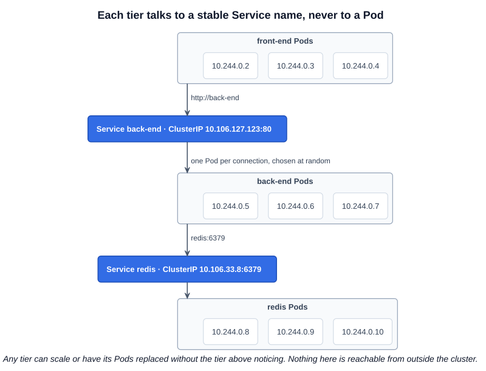
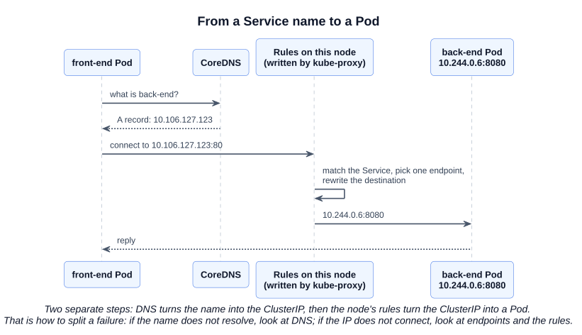

# 15 — ClusterIP Services

A full-stack application has tiers: front-end Pods, back-end Pods, and a data store such as Redis. The tiers must talk to each other, but connecting to Pod IPs does not work: IPs change whenever a Pod is replaced, and with several Pods, something has to choose one.

A **ClusterIP Service** groups the Pods of a tier behind one stable virtual IP and DNS name. It is reachable **only from inside the cluster**, and it is the default Service type.



Each tier can now scale or have its Pods replaced without affecting communication between tiers. The requests are forwarded to one of the Pods at random (chapter 09 shows the rules that do this). Chapter 14 covers the other Service types and the Service fields in general.

---

## 1. The manifest

```yaml
# clusterip-service.yaml
apiVersion: v1
kind: Service
metadata:
  name: back-end
spec:
  type: ClusterIP       # the default: this line can be left out
  selector:
    app: myapp
    type: back-end
  ports:
    - port: 80          # the port on the Service; required
      targetPort: 8080  # the port the Pods listen on; defaults to port
```

The two uses of "type" above are unrelated: `spec.type` is the Service type, and `selector.type` is a label key that belongs to the Pods. Every selector entry must match, so a Pod needs both labels.

The file is in [`examples/services/`](../../examples/services/).

```bash
kubectl apply -f clusterip-service.yaml
kubectl get services
# NAME         TYPE        CLUSTER-IP       EXTERNAL-IP   PORT(S)   AGE
# kubernetes   ClusterIP   10.96.0.1        <none>        443/TCP   16d
# back-end     ClusterIP   10.106.127.123   <none>        80/TCP    2m
```

Generate it instead of typing it:

```bash
kubectl expose deployment back-end --port=80 --target-port=8080 --dry-run=client -o yaml > svc.yaml
kubectl create service clusterip back-end --tcp=80:8080 --dry-run=client -o yaml > svc.yaml
```

`kubectl expose` copies the selector from the Deployment and defaults to ClusterIP. `kubectl create service` sets the selector to `app=<service-name>`, so check it against your Pods' labels.

---

## 2. Where the IP comes from

The API server allocates the ClusterIP from `--service-cluster-ip-range` (kubeadm default `10.96.0.0/12`). This range does not overlap the Pod network. The IP is virtual: no interface has it and nothing listens on it, as chapter 09 explains. It stays the same for the life of the Service.

The `kubernetes` Service, usually `10.96.0.1`, is created automatically and is how Pods reach the API server.

---

## 3. Reaching a Service by name

Applications should use the Service's **name**. Cluster DNS (CoreDNS) gives every Service a record:

| From | Name to use |
|---|---|
| The same namespace | `back-end` |
| Another namespace | `back-end.prod` |
| Anywhere, fully qualified | `back-end.prod.svc.cluster.local` |

A name with no namespace is looked up **only in the Pod's own namespace**. A Pod in `test` calling `back-end` will not find a Service in `prod`.

Getting from a name to a Pod takes two separate steps:



```bash
kubectl run tmp --image=busybox --rm -it --restart=Never -- nslookup back-end
kubectl run tmp --image=busybox --rm -it --restart=Never -- wget -qO- -T 3 http://back-end:80
```

Test with a request to the Service's port rather than `ping`. The rules match TCP or UDP ports, so a ClusterIP generally does not answer ping.

### 3.1 Headless: a ClusterIP Service with no IP

Set `clusterIP: None` and you get a **headless** Service. No IP is allocated and kube-proxy does not handle it. DNS returns the **Pod IPs** instead, so the client chooses. StatefulSets use this to give each Pod its own DNS name.

```yaml
spec:
  clusterIP: None
  selector:
    app: db
  ports:
    - port: 5432
```

---

## Exam angle

- **Typical task:** expose a Deployment internally on a given port and `targetPort`, then prove it works from a temporary Pod. `kubectl expose` with `--dry-run=client -o yaml` is the fastest start.
- **Split the failure into two steps:**
  1. **Name does not resolve:** wrong namespace in the name, or a CoreDNS problem. Check `kubectl -n kube-system get pods -l k8s-app=kube-dns`.
  2. **Name resolves but the connection fails:** run `kubectl get endpointslices -l kubernetes.io/service-name=<svc>`. Empty means a selector or readiness problem. If there are endpoints, check `targetPort`.
- **Trap:** a ClusterIP cannot be reached from your workstation or by end users. Test from a Pod. Testing from a node works too, because nodes have the rules.
- **Trap:** leaving out `type` gives ClusterIP. A task asking for external access needs `type: NodePort` or `LoadBalancer`.
- **Trap:** `selector.type` is a label, not the Service type. Copying a selector without checking Pod labels leaves the Service with no endpoints.

## References

- [Service](https://kubernetes.io/docs/concepts/services-networking/service/) — "Defining a Service" has a manifest; "type: ClusterIP" and "Headless Services" cover both forms
- [DNS for Services and Pods](https://kubernetes.io/docs/concepts/services-networking/dns-pod-service/) — record names, and "Namespaces of Services" for lookups across namespaces
- [Debug Services](https://kubernetes.io/docs/tasks/debug/debug-application/debug-service/) — a step-by-step check from DNS to endpoints to kube-proxy

## Related notes

- CKAD: [Services — ClusterIP](https://github.com/caseythecoder90/ckad-exam-prep/blob/main/notes/01-core-concepts/09-services-clusterip.md) — the developer's view
- CKAD: [Headless Services](https://github.com/caseythecoder90/ckad-exam-prep/blob/main/notes/08-state-persistance/07-headless-services.md) — how StatefulSets use them
- KCNA: [Services](https://github.com/caseythecoder90/kcna-study-guide/blob/main/notes/04-kubernetes-fundamentals/08-services.md) — all types, EndpointSlices and cluster DNS
