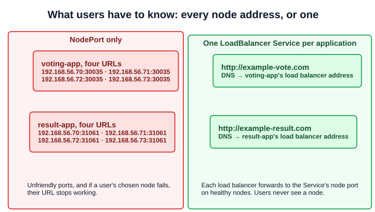
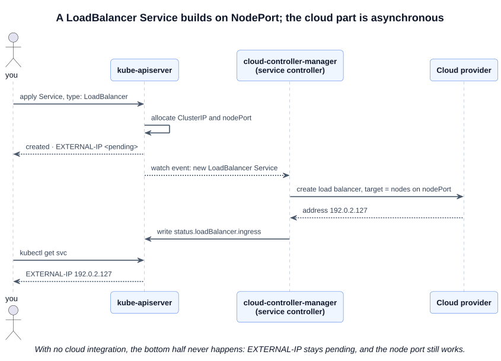

# 16 — LoadBalancer Services

A NodePort Service (chapter 14) makes an application reachable from outside the cluster, but not in a way you would give to users. A **LoadBalancer** Service adds a single external address in front of it.

---

## 1. The problem with NodePort alone

The example is a voting application on a four-node cluster, with two parts users reach directly: `voting-app` on node port 30035 and `result-app` on node port 31061. Because a node port opens on every node, each application has four valid URLs:



That is true even if a Deployment's Pods run on only some of the nodes. Users want one name, such as `http://example-vote.com`, on a normal port, and they should not depend on one node staying up.

---

## 2. Two ways to get a single address

| Approach | How | Trade-off |
|---|---|---|
| **Run your own** | Create a VM, install HAProxy or NGINX, configure it to forward to the nodes on the node port, and keep it updated as nodes change | Works anywhere, but it is tedious to set up and maintain |
| **Use the cloud provider's** | Set `type: LoadBalancer`, and Kubernetes has the provider create and configure its native load balancer | Almost no work, on platforms with the integration, such as Google Cloud, AWS and Azure |

---

## 3. The manifest

Change `type`. Everything else is the NodePort Service:

```yaml
# loadbalancer-service.yaml
apiVersion: v1
kind: Service
metadata:
  name: myapp-service
spec:
  type: LoadBalancer
  selector:
    app: myapp
  ports:
    - port: 80
      targetPort: 80
```

The course's slide leaves out `selector`. A Service without one has no Pods to send traffic to, so keep it. `nodePort` can also be left out and allocated automatically, as in chapter 14.

The file is in [`examples/services/`](../../examples/services/). To generate one:

```bash
kubectl expose deployment myapp --port=80 --type=LoadBalancer --name=myapp-service --dry-run=client -o yaml > svc.yaml
kubectl create service loadbalancer myapp-service --tcp=80:80 --dry-run=client -o yaml > svc.yaml   # selector is app=myapp-service: check it
```

---

## 4. What happens when you create one

A LoadBalancer Service is a NodePort Service, which is itself a ClusterIP Service, plus an external load balancer:



The **cloud-controller-manager** (chapter 01) does the cloud part: its service controller calls the provider's API and writes the address to `.status.loadBalancer`. This happens asynchronously, so the address appears some time after the Service is created.

```bash
kubectl get service myapp-service
# NAME            TYPE           CLUSTER-IP      EXTERNAL-IP   PORT(S)        AGE
# myapp-service   LoadBalancer   10.106.1.12     <pending>     80:31234/TCP   5s
# myapp-service   LoadBalancer   10.106.1.12     192.0.2.127   80:31234/TCP   90s

kubectl get service myapp-service -o jsonpath='{.status.loadBalancer.ingress[0].ip}{"\n"}'
```

Some providers publish a `hostname` instead of an `ip`. Pointing `example-vote.com` at that address is a separate DNS step that you, or a tool such as ExternalDNS, must do.

### 4.1 Without cloud integration

On a cluster with no cloud controller, such as kubeadm on VirtualBox VMs, nothing fulfils the request:

- `EXTERNAL-IP` stays **`<pending>`** indefinitely. That is expected, not a fault.
- The Service still has its ClusterIP and node port, so it **works like a NodePort Service**.

Bare-metal clusters can add this function with a project such as [MetalLB](https://metallb.io/).

---

## 5. One load balancer per Service

The course's slides draw one load balancer in front of both applications, serving both hostnames. **A `type: LoadBalancer` Service does not do that.** Each one gets its own load balancer and address, with no routing by hostname or URL. Two applications means two load balancers, which on a cloud usually means two bills.

To route several hostnames or paths through a single entry point, use **Ingress** or the **Gateway API**, both covered in Section 9.

| Need | Use |
|---|---|
| Internal traffic between tiers | ClusterIP |
| Quick external access by node and port; labs | NodePort |
| One external address for one Service, TCP or UDP | LoadBalancer |
| Many HTTP hostnames or paths behind one address | Ingress or Gateway API |

---

## Exam angle

- **`EXTERNAL-IP <pending>` is normal without cloud integration**, which is typical of kubeadm clusters. Do not spend time fixing it. If a task only asks for the Service, verify its type and test through the node port: `curl <node-IP>:<nodePort>`.
- **Find the node port** in `PORT(S)` (`80:31234/TCP`) or with `kubectl get svc <name> -o jsonpath='{.spec.ports[0].nodePort}'`.
- **No traffic reaching Pods?** Debug it like any other Service: check the EndpointSlices first, then `targetPort` (chapter 14).
- **Trap:** several applications behind one hostname or address is an Ingress or Gateway API task, not a LoadBalancer one.
- **Distractor:** "Kubernetes includes a load balancer implementation for this type." It only asks a cloud integration to create one.

## References

- [Service](https://kubernetes.io/docs/concepts/services-networking/service/) — "type: LoadBalancer" has the manifest, the status fields, and options such as `allocateLoadBalancerNodePorts` and `loadBalancerClass`
- [Create an External Load Balancer](https://kubernetes.io/docs/tasks/access-application-cluster/create-external-load-balancer/) — creating one and finding its address
- [Cloud Controller Manager](https://kubernetes.io/docs/concepts/architecture/cloud-controller/) — "Service controller" explains who provisions it
- [Ingress](https://kubernetes.io/docs/concepts/services-networking/ingress/) — "Simple fanout" for several Services behind one address

## Related notes

- CKAD: [Services — NodePort](https://github.com/caseythecoder90/ckad-exam-prep/blob/main/notes/01-core-concepts/08-services-nodeport.md) and [Ingress](https://github.com/caseythecoder90/ckad-exam-prep/blob/main/notes/07-services-and-networking/03-ingress.md) — the types around this one, from the developer's view
- KCNA: [Services](https://github.com/caseythecoder90/kcna-study-guide/blob/main/notes/04-kubernetes-fundamentals/08-services.md) and [Ingress](https://github.com/caseythecoder90/kcna-study-guide/blob/main/notes/05-kubernetes-deep-dive/11-ingress.md) — all Service types, and hostname routing
