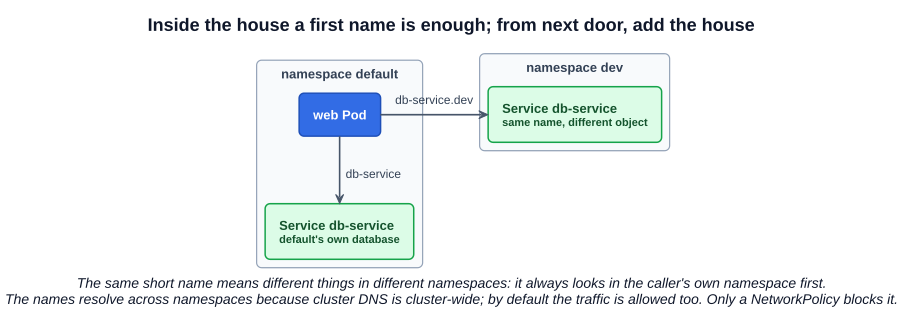
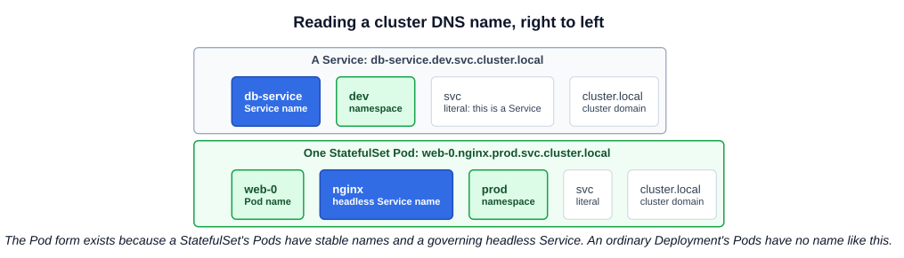

# 17 — Namespaces

A **namespace** isolates a group of resources within one cluster. Names must be unique within a namespace, but not across namespaces, so `dev` and `prod` can each have a Service called `db-service`.

Everything so far in this guide has happened inside a namespace called `default`.

---

## 1. Houses and names

Two boys are both named Mark. To tell them apart, people use their last names: Mark Smith and Mark Williams. Inside the Smith house, the family just says "Mark". To talk about the Mark next door, they use the full name, as does anyone outside either house. Each house also has its own rules and its own budget.

| In the analogy | In Kubernetes |
|---|---|
| House | Namespace |
| First name, used inside the house | Short name of a Service: `db-service` |
| Full name, used from anywhere | Name with namespace: `db-service.dev` |
| House rules about who does what | RBAC policies (Section 7) |
| Household budget | ResourceQuota |

---

## 2. The initial namespaces

Kubernetes starts with four:

| Namespace | Purpose |
|---|---|
| `default` | Where objects go when you do not name a namespace |
| `kube-system` | Objects created by Kubernetes itself: control plane Pods, CoreDNS, kube-proxy, the CNI plugin. Kept apart so they are not changed by accident |
| `kube-public` | Readable by all clients, including unauthenticated ones. Mostly reserved for cluster use. Being public is a convention, not an enforced property |
| `kube-node-lease` | One heartbeat `Lease` per node (chapter 08). The course's slides do not show this one |

Create your own for teams or environments such as `dev` and `prod`. Avoid names starting with `kube-`, which is reserved. Small clusters can run happily in `default`.

### 2.1 Not everything is in a namespace

Nodes, PersistentVolumes, StorageClasses, ClusterRoles and Namespaces themselves are **cluster-scoped**.

```bash
kubectl api-resources --namespaced=true     # Pods, Services, Deployments, Secrets, ...
kubectl api-resources --namespaced=false    # Nodes, PersistentVolumes, Namespaces, ...
```

---

## 3. Working with namespaces

### 3.1 Create one

```bash
kubectl create namespace dev                # short name: ns
kubectl get namespaces
```

```yaml
# namespace-dev.yaml
apiVersion: v1
kind: Namespace
metadata:
  name: dev
```

### 3.2 Create objects in one

```bash
kubectl apply -f pod-definition.yaml --namespace=dev     # or -n dev
```

Or put it in the manifest, so it cannot be forgotten:

```yaml
metadata:
  name: myapp-pod
  namespace: dev
```

If the file and the flag name different namespaces, `kubectl` refuses with an error.

### 3.3 See into one

`kubectl` shows only one namespace at a time:

```bash
kubectl get pods                            # the current namespace, default unless changed
kubectl get pods --namespace=kube-system    # or -n kube-system
kubectl get pods --all-namespaces           # or -A
```

### 3.4 Change the current namespace

```bash
kubectl config set-context --current --namespace=dev
kubectl get pods                            # now lists dev
kubectl get pods -n default                 # other namespaces still need the flag
kubectl config view --minify | grep namespace
```

The course shows the longer form, `kubectl config set-context $(kubectl config current-context) --namespace=dev`, which does the same thing.

### 3.5 Deleting one

`kubectl delete namespace dev` deletes **everything in it**.

---

## 4. Reaching things across namespaces

Applications reach each other through **Services**, and the Service's name is what you address. A plain Pod does not get a name of its own in DNS.



| Caller is in | Use | Notes |
|---|---|---|
| The same namespace | `db-service` | Short name |
| Another namespace | `db-service.dev` | Adds the namespace |
| Anywhere | `db-service.dev.svc.cluster.local` | Fully qualified name |

**The longer forms also work from the same namespace.** Writing `db-service.dev.svc.cluster.local` from inside `dev` is valid, just unnecessary. It can still be a good choice in configuration that is shared across namespaces, since it means the same thing wherever it runs.



### 4.1 Why the short name works

The kubelet writes a `search` list into each Pod's `/etc/resolv.conf`:

```bash
kubectl exec <pod> -- cat /etc/resolv.conf
# nameserver 10.96.0.10
# search dev.svc.cluster.local svc.cluster.local cluster.local
# options ndots:5
```

The resolver tries a short name with each suffix in turn. From a Pod in `dev`:

| You write | First suffix that resolves | Result |
|---|---|---|
| `db-service` | `dev.svc.cluster.local` | `db-service.dev.svc.cluster.local` |
| `db-service.prod` | `svc.cluster.local` | `db-service.prod.svc.cluster.local` |

This is also why a short name from the wrong namespace fails: the search list only covers the caller's own namespace.

### 4.2 Addressing one StatefulSet Pod

Sometimes a request must reach one *specific* Pod, not any Pod behind a Service. A **StatefulSet** provides this: its Pods have stable names (`web-0`, `web-1`), and its governing **headless Service** gives each a DNS name:

```
<pod-name>.<headless-service>.<namespace>.svc.<cluster-domain>
web-0.nginx.prod.svc.cluster.local
```

The search list applies here too: `web-0.nginx` works from within `prod`, and `web-0.nginx.prod` works from elsewhere. The StatefulSets page in the references covers the object itself.

Ordinary Deployment Pods have replaceable names, so nothing should depend on them. Cluster DNS can also serve IP-based records such as `172-17-0-3.default.pod.cluster.local`, but those change with the Pod's IP.

### 4.3 Namespaces do not block traffic

A namespace separates **names and policies**, not the network. By default, a Pod in `dev` can connect to a Pod in `prod`. To restrict that, use a **NetworkPolicy** (Section 7).

---

## 5. ResourceQuota

Namespaces share the cluster's nodes. A **ResourceQuota** caps what one namespace may use in total, so `dev` cannot use up capacity that `prod` needs.

```yaml
# compute-quota.yaml
apiVersion: v1
kind: ResourceQuota
metadata:
  name: compute-quota
  namespace: dev
spec:
  hard:
    pods: "10"
    requests.cpu: "4"
    requests.memory: 5Gi
    limits.cpu: "10"
    limits.memory: 10Gi
```

```bash
kubectl apply -f compute-quota.yaml
kubectl create quota compute-quota -n dev \
  --hard=pods=10,requests.cpu=4,requests.memory=5Gi,limits.cpu=10,limits.memory=10Gi   # same thing
kubectl describe quota -n dev                # Used versus Hard
```

| Behavior | Detail |
|---|---|
| Exceeding the quota | The API rejects the request with `403 Forbidden` and a message naming the limit |
| Quota set on CPU or memory | New Pods **must declare** requests or limits for that resource, or they may be rejected. A LimitRange can supply defaults |
| Existing objects | Not affected when a quota is added; it applies to new requests |

The manifests are in [`examples/namespaces/`](../../examples/namespaces/).

---

## Exam angle

- **Wrong namespace is the classic lost-points mistake.** Read the task for a namespace, use `-n <ns>` or set it in the manifest, and verify with `kubectl get ... -n <ns>`. Reset with `kubectl config set-context --current --namespace=default` if you changed it.
- **Finding something:** `kubectl get pods -A | grep <name>`. Control plane Pods and CoreDNS are in `kube-system`.
- **Connection between namespaces fails with a name error?** The short name only searches the caller's namespace. Use `<service>.<namespace>`. Test: `kubectl run tmp --image=busybox --rm -it --restart=Never -n <ns> -- nslookup <service>.<other-ns>`.
- **Pods rejected after a quota was added?** `kubectl describe quota -n <ns>`, then add requests and limits to the Pod or Deployment. A Deployment's failures appear in `kubectl describe rs`, not on any Pod.
- **Trap:** Services select Pods only in their own namespace, and `kubectl delete namespace` cannot be undone.
- **Distractor:** "namespaces provide network isolation". They do not, without a NetworkPolicy.

## References

- [Namespaces](https://kubernetes.io/docs/concepts/overview/working-with-objects/namespaces/) — "Initial namespaces", "Not all objects are in a namespace", and setting the namespace preference
- [DNS for Services and Pods](https://kubernetes.io/docs/concepts/services-networking/dns-pod-service/) — "Namespaces of Services" has the `resolv.conf` search list
- [StatefulSets](https://kubernetes.io/docs/concepts/workloads/controllers/statefulset/) — "Stable Network ID" has the Pod DNS form
- [Resource Quotas](https://kubernetes.io/docs/concepts/policy/resource-quotas/) — the quota types and what happens when one is exceeded

## Related notes

- CKAD: [Namespaces](https://github.com/caseythecoder90/ckad-exam-prep/blob/main/notes/01-core-concepts/07-namespaces.md) — the developer's view
- CKAD: [Headless Services](https://github.com/caseythecoder90/ckad-exam-prep/blob/main/notes/08-state-persistance/07-headless-services.md) — per-Pod DNS for StatefulSets
- KCNA: [Namespaces](https://github.com/caseythecoder90/kcna-study-guide/blob/main/notes/04-kubernetes-fundamentals/04-namespaces.md) and [Resource quotas](https://github.com/caseythecoder90/kcna-study-guide/blob/main/notes/05-kubernetes-deep-dive/17-resource-quotas.md) — scoping, quotas and units
- KCNA: [StatefulSets](https://github.com/caseythecoder90/kcna-study-guide/blob/main/notes/05-kubernetes-deep-dive/09-statefulsets.md) — sticky identity and per-Pod DNS
