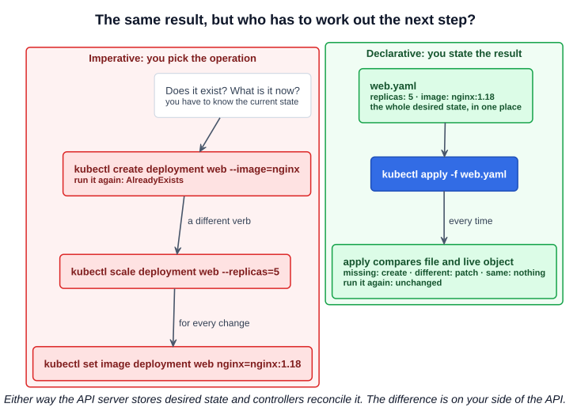
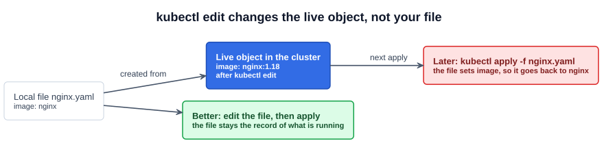

# 18 — Imperative vs Declarative

So far you have created objects two ways: with commands such as `kubectl run`, and from YAML files. These are two approaches to managing infrastructure, and the exam rewards using both.

---

## 1. The difference

Picture a taxi ride to a friend's house:

- **Imperative:** you give every step: "turn right onto Street B, left onto Street C, left, then right, and stop at the house." You specify **what to do and how**.
- **Declarative:** you say "go to Tom's house." You specify **the result**, and the driver works out the route.

Infrastructure as Code tools work the same way. An imperative script lists steps: provision the VM, install NGINX, edit its config, start it. If it stops halfway, or runs a second time, it is your job to handle that. A declarative tool such as Terraform takes a description of the end state (VM name, package version, port), checks what already exists, and does only what is missing.

---

## 2. What actually differs in Kubernetes

`kubectl create deployment web --image=nginx` and a YAML file containing the same thing store the same object. It can look as though the "imperative" command is really declarative too, and at one level it is:

**The Kubernetes API is declarative either way.** The API server stores desired state, and controllers reconcile it (chapter 06). Neither approach tells a controller how to start a container.

The difference is on your side of the API, in two things:

| | Imperative | Declarative |
|---|---|---|
| **Who picks the operation** | You: `create`, `scale`, `set image` or `delete`, depending on what exists now | `kubectl apply` compares your file with the live object and works out create or patch |
| **Where desired state lives** | Nowhere you can read back. The commands are in one person's shell history | In files you can review, reuse and keep in Git |



The quick test is to run it twice. `kubectl create` fails with `AlreadyExists` the second time, because it is an instruction to perform one operation. `kubectl apply` reports `unchanged`, because it describes a result that is already true.

---

## 3. Three techniques

The Kubernetes docs split it into three, not two:

| Technique | You specify | Example | Suits |
|---|---|---|---|
| **Imperative commands** | Operation and arguments | `kubectl run`, `create deployment`, `expose`, `scale`, `set image`, `edit` | One-off tasks and learning |
| **Imperative object configuration** | Operation and a **file** | `kubectl create -f`, `replace -f`, `delete -f` | Tracked files, one writer |
| **Declarative object configuration** | Only the **files or a directory** | `kubectl apply -f nginx.yaml`, `kubectl apply -f /path/to/config-files` | Tracked files, several writers, whole directories |

The middle row is why using a YAML file does not by itself make something declarative: `kubectl create -f` still has you choosing the operation.

### 3.1 Imperative commands

```bash
# Create
kubectl run nginx --image=nginx
kubectl create deployment nginx --image=nginx
kubectl expose deployment nginx --port=80

# Update
kubectl edit deployment nginx
kubectl scale deployment nginx --replicas=5
kubectl set image deployment nginx nginx=nginx:1.18
```

Fast, with no YAML to write. But they get long or impossible for advanced cases such as a multi-container Pod, and they leave no record of how the object was made.

### 3.2 Imperative object configuration

```bash
kubectl create -f nginx.yaml
kubectl replace -f nginx.yaml
kubectl replace --force -f nginx.yaml     # delete and recreate
kubectl delete -f nginx.yaml
```

You must know the current state, because the command fails otherwise: `create` gives `AlreadyExists` if the object exists, and `replace` fails if it does not. `replace` also overwrites the whole spec, so it drops any change that is not in your file.

### 3.3 Declarative object configuration

```bash
kubectl apply -f nginx.yaml               # creates it, or updates it
kubectl apply -f /path/to/config-files    # every file in the directory
kubectl delete -f nginx.yaml              # deleting is still explicit
```

A later chapter covers how `apply` compares the versions. The lecture says `apply` also handles deleting, but that needs care: removing an object from a file does not delete it. The docs recommend `kubectl delete -f`. The alternative, `kubectl apply -f <directory> --prune`, is still marked alpha in `kubectl apply --help` and can remove more than you intended.

---

## 4. Live edits and your file

`kubectl edit` changes the object in the cluster. It does not change the file you created it from:



| Next command | What happens to the live edit |
|---|---|
| `kubectl apply -f` | A field the **file sets** returns to the file's value. A field the file does not mention is kept |
| `kubectl replace -f` | Dropped, whether or not the file mentions the field |

The same applies to `kubectl scale` and `kubectl set image`. So if you intend to keep using a file, change the file and then apply it. The docs warn that mixing techniques on one object gives undefined behavior over the long term.

---

## 5. On the exam

There is no team and no long-term record to maintain, so the goal is the fastest correct result. Use whichever is quickest:

| Situation | Use |
|---|---|
| Simple object where flags cover everything | Imperative: `kubectl run`, `create`, `expose` |
| Quick change to one field | Imperative: `kubectl scale`, `set image`, `edit` |
| A field with no flag: volumes, probes, resources, a second container | Generate YAML, edit it, then `apply` |
| Something the task may need changed again | A file and `apply` |

Generate a file instead of writing one, using two options together:

| Option | Effect |
|---|---|
| `--dry-run=client` | Builds the object but does not create it, showing whether the command is right |
| `-o yaml` | Prints the object as YAML |

```bash
kubectl run nginx --image=nginx --dry-run=client -o yaml > pod.yaml
kubectl create deployment nginx --image=nginx --replicas=4 --dry-run=client -o yaml > deploy.yaml
kubectl expose pod nginx --port=80 --name=nginx-service --dry-run=client -o yaml > svc.yaml
```

[`commands/imperative.md`](../commands/imperative.md) lists the generators for each resource.

---

## Exam angle

- **Generate, edit, apply** is the default for anything beyond flags. Save the file, so that a mistake is one edit and one rerun away.
- **`AlreadyExists`** from `kubectl create` means the object is there. Use `apply`, `edit`, or `replace --force`, or delete it first.
- **Some Pod fields cannot change on a running Pod.** `kubectl edit` then refuses, and may leave your edit in a temporary file. Recreate it with `kubectl replace --force -f <that file>`.
- **Check the result after any imperative change.** A typo in `set image` still returns success; `kubectl rollout status` or `kubectl get pods` shows the failure.
- **Trap:** a later `apply` of an old file undoes earlier `scale`, `set image` or `edit` changes to fields the file sets.
- **Distractor:** "using a YAML file makes it declarative". `kubectl create -f` is imperative object configuration.

## References

- [Kubernetes Object Management](https://kubernetes.io/docs/concepts/overview/working-with-objects/object-management/) — the three techniques compared, with trade-offs
- [Declarative Management of Kubernetes Objects Using Configuration Files](https://kubernetes.io/docs/tasks/manage-kubernetes-objects/declarative-config/) — "How to delete objects" covers `delete -f` versus `--prune`
- [Imperative Management of Kubernetes Objects Using Configuration Files](https://kubernetes.io/docs/tasks/manage-kubernetes-objects/imperative-config/) — `create`, `replace` and `delete` with `-f`
- [Managing Kubernetes Objects Using Imperative Commands](https://kubernetes.io/docs/tasks/manage-kubernetes-objects/imperative-command/) — the command forms, and generating YAML with `--dry-run`

## Related notes

- CKAD: [Imperative commands](https://github.com/caseythecoder90/ckad-exam-prep/blob/main/notes/commands/imperative.md) and [Modifying resources](https://github.com/caseythecoder90/ckad-exam-prep/blob/main/notes/commands/modifying-resources.md) — generators, and `set` versus `patch` versus `edit`
- KCNA: [Pods](https://github.com/caseythecoder90/kcna-study-guide/blob/main/notes/04-kubernetes-fundamentals/02-pods.md) — imperative versus declarative as a concept
