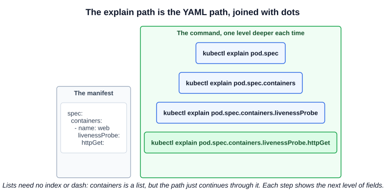

# 19 — kubectl explain

You do not need to memorize every field of every object. `kubectl` can tell you what a cluster serves, what fields an object has, and how a command is used, all from the terminal and faster than searching the docs.

| Question | Command |
|---|---|
| Which resources exist, and what are their short names and `apiVersion`? | `kubectl api-resources` |
| Which fields does this object have, and what do they mean? | `kubectl explain` |
| How do I use this command? | `kubectl <command> --help` |

These read from the cluster you are connected to, except `--help`, which is built into `kubectl`. So `api-resources` and `explain` need a working API server, and they reflect that cluster's version.

---

## 1. `kubectl api-resources`

```bash
kubectl api-resources
# NAME          SHORTNAMES   APIVERSION   NAMESPACED   KIND
# configmaps    cm           v1           true         ConfigMap
# namespaces    ns           v1           false        Namespace
# nodes         no           v1           false        Node
# deployments   deploy       apps/v1      true         Deployment
# ...
```

| Column | Use |
|---|---|
| `NAME` | The plural name, and the first part of an `explain` path |
| `SHORTNAMES` | Saves typing: `cm`, `deploy`, `ns`, `svc`, `rs`, `pvc` |
| `APIVERSION` | The value for a manifest's `apiVersion` |
| `NAMESPACED` | Whether the object lives in a namespace |
| `KIND` | The value for a manifest's `kind` |

```bash
kubectl api-resources | grep -i ingress
kubectl api-resources --namespaced=false              # cluster-scoped only
kubectl api-resources --api-group=apps                # one API group
kubectl api-resources -o wide                         # adds VERBS and CATEGORIES
kubectl api-resources --verbs=list                    # those supporting a verb
```

The course's slide has a garbled row, `ReplicaSetreplicationcontrollers`. The real entries are separate: `replicasets` (`rs`, `apps/v1`) and `replicationcontrollers` (`rc`, `v1`).

---

## 2. `kubectl explain`

`explain` describes the fields of an object, using the schema published by the API server.

```bash
kubectl explain pods
# KIND:       Pod
# VERSION:    v1
#
# FIELDS:
#   apiVersion  <string>
#   kind        <string>
#   metadata    <ObjectMeta>
#   spec        <PodSpec>
#   status      <PodStatus>
```

### 2.1 Drilling down

Add the path to the field with dots, exactly as it is nested in YAML:



```bash
kubectl explain pods.spec
kubectl explain pods.spec.containers
kubectl explain pods.spec.containers.livenessProbe.httpGet
```

The resource can be written in any accepted form: `pod`, `pods`, or a short name such as `deploy`. `kubectl explain deploy.spec.strategy.rollingUpdate` works.

### 2.2 Reading the output

The type in angle brackets tells you how to write the field in YAML (chapter 11):

| Shown as | YAML shape | Example |
|---|---|---|
| `<string>`, `<integer>`, `<boolean>` | A scalar | `image: nginx` |
| `<map[string]string>` | Your own key-value pairs | `labels:` |
| `<[]Container>` | A **list** of dictionaries, written with dashes | `containers:` |
| `<[]string>` | A list of strings | `command:` |
| `<PodSpec>`, `<ObjectMeta>` | A dictionary. Explain it further to see its fields | `spec:` |

Fields you must set are marked **`-required-`**, and each has a description. Sometimes the description is the fastest way to learn what a field does or which values it accepts.

### 2.3 Seeing or searching everything

`--recursive` prints every nested field name and type, with no descriptions. It is long, so search it:

```bash
kubectl explain pods --recursive | less
kubectl explain pods --recursive | grep -i toleration
kubectl explain pods.spec.containers --recursive | grep -A5 securityContext
kubectl explain pods --recursive --max-depth=2        # limit the depth
```

The output is indented like the YAML, so it also shows where a field belongs.

For an object in more than one API group or version:

```bash
kubectl explain deployments --api-version=apps/v1
```

---

## 3. `--help`

Every command and subcommand has built-in help. The **Examples** section is often all you need, and it can be copied:

```bash
kubectl create --help                  # lists what can be generated
kubectl create deployment --help       # examples and flags
kubectl create service nodeport --help
kubectl run --help
kubectl rollout undo --help
kubectl options                        # global flags that work with any command
```

| Use | For |
|---|---|
| `--help` | Commands and their flags: **what to type** |
| `explain` | Objects and their fields: **what goes in the YAML** |

---

## Exam angle

- **Fastest way to recall a field.** Need `tolerations`, `securityContext` or a probe? Use `kubectl explain pods --recursive | grep -i <word>` to find where it lives, then `kubectl explain` on that path to see its fields.
- **It gives structure, not a working example.** Use it to confirm names and types. If you want a full YAML example to copy, the Kubernetes docs are available during the exam.
- **`[]` means a list.** If `explain` shows `<[]...>`, the YAML needs a dash. This solves many `cannot unmarshal object into ... of type []` errors.
- **Check `apiVersion` instead of guessing:** `kubectl api-resources | grep -i <kind>`.
- **Trap:** `explain` shows what a field accepts, not what your object has. To see the live object, use `kubectl get <resource> <name> -o yaml`.

## References

- [kubectl explain](https://kubernetes.io/docs/reference/kubectl/generated/kubectl_explain/) — flags, including `--recursive` and `--api-version`
- [kubectl api-resources](https://kubernetes.io/docs/reference/kubectl/generated/kubectl_api-resources/) — filtering by group, scope and verbs
- [kubectl Quick Reference](https://kubernetes.io/docs/reference/kubectl/quick-reference/) — common commands to copy during the exam
- [Kubernetes API reference](https://kubernetes.io/docs/reference/kubernetes-api/) — the full field documentation that `explain` summarizes

## Related notes

- CKAD: [API resources and explain](https://github.com/caseythecoder90/ckad-exam-prep/blob/main/notes/01-core-concepts/10-api-resources-explain.md) — the same commands from the developer's view
- KCNA: [Pods](https://github.com/caseythecoder90/kcna-study-guide/blob/main/notes/04-kubernetes-fundamentals/02-pods.md) — `kubectl explain` in the Pod workflow
