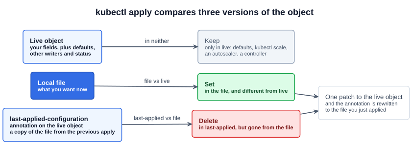
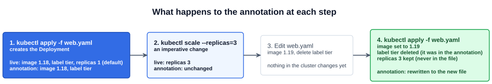

# 20 — kubectl apply

Chapter 18 introduced `kubectl apply` as the declarative command: you hand it a file and it works out whether to create or update. This chapter covers how it decides **what** to update, and why it needs a third copy of your configuration to do that.

---

## 1. Three versions of one object

When you run `kubectl apply -f nginx.yaml`, three versions of the object are involved:

| Version | Where it lives | What it contains |
|---|---|---|
| **Local file** | Your disk | What you want now |
| **Live object** | The cluster (etcd) | Everything: your fields, defaults the API server filled in, changes from other commands and controllers, and `status` |
| **Last-applied configuration** | An annotation on the live object, `kubectl.kubernetes.io/last-applied-configuration` | A JSON copy of the file from the **previous** `apply` |

The last-applied configuration is not stored anywhere separate. It is a field inside the live object's metadata, so it is visible with `kubectl get -o yaml`:

```yaml
apiVersion: v1
kind: Pod
metadata:
  name: myapp-pod
  annotations:
    kubectl.kubernetes.io/last-applied-configuration: |
      {"apiVersion":"v1","kind":"Pod","metadata":{"annotations":{},"labels":{"app":"myapp","type":"front-end-service"},"name":"myapp-pod","namespace":"default"},"spec":{"containers":[{"image":"nginx:1.18","name":"nginx-container"}]}}
  labels:
    app: myapp
    type: front-end-service
spec:
  containers:
  - name: nginx-container
    image: nginx:1.18
    # ... plus fields you never wrote: imagePullPolicy, resources, terminationMessagePath ...
  dnsPolicy: ClusterFirst            # defaulted by the API server
  nodeName: node01                   # set by the scheduler
status:
  phase: Running
```

On the first `apply`, the object does not exist, so `kubectl` creates it from the file and writes the file into the annotation at the same time.

The course's slides contain three mistakes. The annotation on the first slide lists a `run: myapp-pod` label that the file does not contain; it would contain the file's labels, `app` and `type`. The last slide writes `image: nginx: 1.19` with a space after the colon, which is invalid YAML. It also shows the live image as `nginx:1.18` after the apply, but the apply sets it to `nginx:1.19`.

---

## 2. Why a plain diff is not enough

A simple model of `apply` is "compare the file with the live object and apply the difference". That model works for **changing** and **adding** a field. It breaks for **removing** one.

Suppose the live object has the label `type: front-end-service`, and your file does not. There are two possible reasons:

1. You had the label in your file and deleted it, so it should be removed.
2. You never had it. Someone added it with `kubectl label`, or a controller or admission webhook set it, so it should be kept.

Comparing the file with the live object cannot tell these apart. The live object is full of fields that you never wrote, such as `dnsPolicy`, `nodeName`, `imagePullPolicy` and a scaled `replicas`. If `apply` removed everything missing from your file, it would wipe all of them.

The annotation tells `kubectl` what **your file set last time**. A field that was there and is now missing from the file is one you deleted. A field that was never there belongs to someone else.

---

## 3. How apply calculates the change



`kubectl` makes two comparisons, then sends one patch to the API server:

| Comparison | Finds | Result |
|---|---|---|
| **File vs live** | Fields in the file whose value differs from live, or are missing from live | **Set** them to the file's value |
| **Last-applied vs file** | Fields in the last-applied configuration that are no longer in the file | **Delete** them from live |
| *(neither)* | Fields only in live, never in your file | **Keep** them |

The same patch **rewrites the annotation** with the file you just applied. This is how the annotation stays up to date: every `apply` replaces it, so it always holds the file from the most recent `apply`.

The lecture says the three versions are compared. More precisely, the comparisons are made in pairs, as in the table above, and the work is done by **`kubectl` on your machine**. For an object that already exists, it reads the live object, computes the patch, and sends it, so the API server receives a patch, not your file. Server-side apply, in section 7, moves the calculation into the API server.

### 3.1 The merge tables

These tables, from the Kubernetes docs, say the same thing field by field. A `-` means that column does not affect the result.

**Primitive fields** (a string, number or boolean such as `image` or `replicas`) are replaced or cleared:

| In the file | In live | In last-applied | Action |
|---|---|---|---|
| Yes | Yes | - | Set live to the file's value |
| Yes | No | - | Set live to the file's value |
| No | - | Yes | **Clear it from live** (you removed it) |
| No | - | No | Do nothing, keep the live value (not yours) |

Read the first two rows together: when the file has the field, the file wins. The annotation is only checked when the file **does not** have the field. It answers one question: did you remove this field, or was it never yours?

**Map fields** (key-value maps such as `labels` and `annotations`, and nested objects) follow the same rules key by key. If both the file and live have a key, the comparison repeats one level down for that key's subfields.

**Lists** depend on the field:

| List type | Example | How it is merged |
|---|---|---|
| A list of primitives | `args`, `command` | Replaced as a whole by the file's list |
| A list of objects with a merge key | `containers`, merged by `name` | Each item is matched by its key, then merged with the rules above. Items you removed are deleted. Items only in live are kept |

So editing one container's `image` updates just that container, but changing one entry in `args` replaces the whole `args` list.

---

## 4. The annotation over time

The annotation is updated by `apply` and left alone by everything else. Run through a Deployment `web` whose file sets an image and a label, but not `replicas`:



| Step | Live object | Annotation |
|---|---|---|
| 1. `kubectl apply -f web.yaml` | Created: `image: nginx:1.18`, label `tier`, `replicas: 1` (the default) | Written: the file |
| 2. `kubectl scale deployment web --replicas=3` | `replicas: 3` | Unchanged |
| 3. Edit the file: image `nginx:1.19`, delete label `tier` | Unchanged | Unchanged |
| 4. `kubectl apply -f web.yaml` | Image set to `nginx:1.19`. Label `tier` deleted, because it is in the annotation and not the file. `replicas: 3` kept, because it was never in either | Rewritten: the new file |

Which commands write the annotation:

| Command | Annotation |
|---|---|
| `kubectl apply -f` | Created on the first run, rewritten on every run |
| `kubectl create -f`, `kubectl run`, `kubectl create deployment` | Not written |
| `kubectl create -f ... --save-config`, `kubectl replace -f ... --save-config` | Written from the file |
| `kubectl edit`, `scale`, `set image`, `label` | Unchanged. `kubectl edit --save-config` writes the edited object into it |
| `kubectl apply set-last-applied -f` | Set to the file, without changing anything else in the object |

### 4.1 Applying to an object that has no annotation

If the object was created with `kubectl create` or `kubectl run`, the first `apply` prints a warning that the last-applied-configuration annotation is missing and will be patched automatically. It is harmless: the apply works and adds the annotation. With no record of a previous file, that first apply cannot delete anything. Removals only work from the second apply onward.

---

## 5. Two traps

### 5.1 A field the file sets is taken back on every apply

If the file sets `replicas: 2` and someone runs `kubectl scale --replicas=5`, the next apply sets it back to 2. The same thing happens if a HorizontalPodAutoscaler (covered in Section 5) manages `replicas`. The file and the autoscaler keep overwriting each other.

### 5.2 Removing a field you want someone else to own

To hand `replicas` to `kubectl scale` or an autoscaler, deleting it from the file is not enough. It is still in the annotation, so the next apply treats it as a field you removed and **clears** it, and the API server defaults it back to 1. The docs give two steps:

```bash
# 1. Remove replicas from web.yaml
# 2. Remove it from the annotation without touching anything else
kubectl apply set-last-applied -f web.yaml        # annotation := the edited file
kubectl apply edit-last-applied deployment/web    # or edit the annotation directly
```

From then on, `apply` leaves `replicas` alone.

---

## 6. Inspecting and previewing

```bash
kubectl apply view-last-applied deployment/web            # the annotation as YAML
kubectl apply view-last-applied -f web.yaml -o json
kubectl get deploy web -o yaml                            # annotation and live, together
kubectl get deploy web \
  -o jsonpath='{.metadata.annotations.kubectl\.kubernetes\.io/last-applied-configuration}'

kubectl diff -f web.yaml       # what apply would change; exit 0 = none, 1 = changes
kubectl apply -f web.yaml --dry-run=server   # the API server validates without saving
```

`kubectl diff` is the safest way to check a change before you apply it.

---

## 7. Server-side apply

Everything above is **client-side apply**, still the default in `kubectl` (`--server-side=false` in `kubectl apply --help`). Kubernetes also has **server-side apply**, which works out the same merge in the API server:

```bash
kubectl apply --server-side -f web.yaml
kubectl apply --server-side --force-conflicts -f web.yaml
kubectl get deploy web -o yaml --show-managed-fields
```

| | Client-side apply | Server-side apply |
|---|---|---|
| Who computes the change | `kubectl` | The API server |
| Record of what you own | One annotation: your last file | `metadata.managedFields`: every field, with the **field manager** (the client or controller) that owns it |
| Another writer owns the field | Your value overwrites theirs | A **conflict** error, unless you add `--force-conflicts` to take ownership |

Two practical reasons to know it:

- **`metadata.annotations: Too long`.** All annotations on an object together are limited to 256 KiB. The last-applied annotation repeats the whole file, so a large object, such as a big CRD or ConfigMap, can fail on client-side apply. `kubectl apply --server-side` does not store the annotation, so it works.
- **`managedFields` appear in `kubectl get -o yaml` output only with `--show-managed-fields`.** They are hidden by default, but they are on every object, whichever way it was created.

---

## Exam angle

- **Change a file, then `kubectl apply -f` it.** Check first with `kubectl diff -f`, and confirm the result with `kubectl get` or `kubectl rollout status`.
- **A warning about a missing last-applied annotation is harmless.** It appears when an object made with `create` or `run` is applied for the first time, and the annotation is added.
- **Removing a line from the file removes the field only if the last apply included it.** For a field that someone else set, the live value stays. Use `kubectl edit` or `kubectl patch` for that field.
- **Trap:** a file that sets `replicas`, `image` or a label overwrites any `scale`, `set image` or `label` change on every apply. Make the change in the file, or take the field out of both the file and the annotation.
- **Trap:** `Too long: must have at most 262144 bytes` from `apply` means the annotation is too large. Use `kubectl apply --server-side -f` (or `kubectl create -f` for a new object).

## References

- [Declarative Management of Kubernetes Objects Using Configuration Files](https://kubernetes.io/docs/tasks/manage-kubernetes-objects/declarative-config/) — "How apply calculates differences and merges changes" holds the merge tables; "How to change ownership of a field" covers handing a field to `kubectl scale`
- [Server-Side Apply](https://kubernetes.io/docs/reference/using-api/server-side-apply/) — "Conflicts" for `--force-conflicts`, "Comparison with Client-Side Apply", and "Upgrading from client-side apply to server-side apply"
- [kubectl apply](https://kubernetes.io/docs/reference/kubectl/generated/kubectl_apply/) — flags, including `--server-side`, `--prune` and `--dry-run`, and the `view-last-applied`, `set-last-applied` and `edit-last-applied` subcommands
- [kubectl diff](https://kubernetes.io/docs/reference/kubectl/generated/kubectl_diff/) — previewing a change, and its exit codes

## Related notes

- CKAD: [Pod YAML](https://github.com/caseythecoder90/ckad-exam-prep/blob/main/notes/01-core-concepts/04-pod-yaml.md) — `create` versus `apply` versus `replace` when working with a manifest
- CKAD: [Modifying resources](https://github.com/caseythecoder90/ckad-exam-prep/blob/main/notes/commands/modifying-resources.md) — `edit`, `patch` and `set`, and cleaning exported YAML (including the annotation) before reuse
- KCNA: [Annotations](https://github.com/caseythecoder90/kcna-study-guide/blob/main/notes/04-kubernetes-fundamentals/13-annotations.md) — the last-applied-configuration annotation among the other built-in annotations
