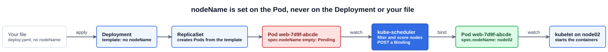
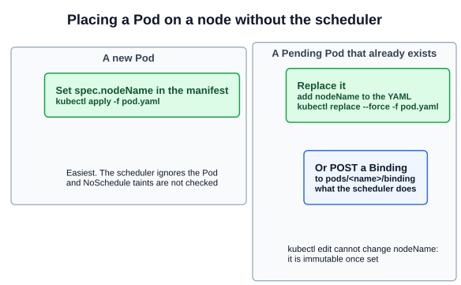

# 01 — Manual Scheduling

Scheduling means choosing the node a Pod runs on. Normally `kube-scheduler` does it (Section 2, [chapter 07](../02-core-concepts/07-kube-scheduler.md)). This chapter covers what the scheduler actually writes, what happens when no scheduler is running, and the two ways to place a Pod yourself.

---

## 1. What the scheduler writes

Every Pod has a field `spec.nodeName`. You normally leave it out, so a new Pod starts with it empty. The scheduler:

1. Watches for Pods with an empty `nodeName`. These are the candidates for scheduling.
2. Chooses a node: it filters out nodes that cannot run the Pod, then scores the rest.
3. **Binds** the Pod by sending a **Binding** object to the API server. The API server then sets `spec.nodeName` on the Pod.

The kubelet on that node sees a Pod with its own name in `nodeName` and starts the containers.



`nodeName` is written **only on the Pod object in the cluster**:

- **Not in your file.** Your YAML never changes. `kubectl get pod <name> -o yaml` shows the value.
- **Not on the Deployment, ReplicaSet, StatefulSet or Job.** Their Pod template has no `nodeName`. The controller creates Pods from the template, and the scheduler binds each Pod separately, so replicas can land on different nodes.
- **DaemonSets go through the scheduler too.** The DaemonSet controller does not set `nodeName`. It gives each Pod a node affinity that matches one node's name, and the scheduler binds it there.

You *can* put `nodeName` in a Pod template, but then every replica is pinned to that one node, without the scheduler checking anything.

---

## 2. When no scheduler is running

Without a scheduler, nothing sets `nodeName`, so new Pods stay **Pending** forever:

```bash
kubectl get pods -o wide
# NAME    READY   STATUS    RESTARTS   AGE   IP       NODE
# nginx   0/1     Pending   0          3m    <none>   <none>

kubectl describe pod nginx | grep -A3 Events
# Events:  <none>
```

The `Events: <none>` is the clue. A Pod that the scheduler cannot place shows a `FailedScheduling` event that explains why: not enough CPU, a taint, no matching node. **No events at all** means no scheduler looked at the Pod.

Confirm it:

```bash
kubectl get pods -n kube-system | grep scheduler     # nothing listed
ls /etc/kubernetes/manifests/                        # kube-scheduler.yaml missing or broken
```

Pods that are already running are unaffected. The scheduler only acts once, when a Pod is placed.

---

## 3. Placing a Pod yourself



### 3.1 A new Pod: set `nodeName`

```yaml
apiVersion: v1
kind: Pod
metadata:
  name: nginx
  labels:
    name: nginx
spec:
  nodeName: node02          # the exact node name from kubectl get nodes
  containers:
  - name: nginx
    image: nginx
    ports:
    - containerPort: 80
```

```bash
kubectl apply -f nginx.yaml
kubectl get pod nginx -o wide       # NODE: node02, Running
```

Field order in YAML does not matter: `nodeName` works above or below `containers`, as long as it is a direct child of `spec`. There is no flag for `nodeName` in `kubectl run`, so generate the YAML with `--dry-run=client -o yaml` and add the line. (The slide's YAML has `ports` without a colon, which is invalid YAML.)

### 3.2 An existing Pod: replace it

Once a Pod exists, `nodeName` cannot be changed with `kubectl edit`, `apply` or `patch`. The API server rejects the change, because a Pod spec only allows a few fields to change (mainly container images). The fastest fix is to delete the Pod and create it again with `nodeName` set:

```bash
kubectl get pod nginx -o yaml > nginx.yaml     # or use the original file
# add  nodeName: node01  under spec
kubectl replace --force -f nginx.yaml          # deletes, then recreates
kubectl get pod nginx -o wide
```

If you tried `kubectl edit` first, the rejected version was saved to a temporary file, and the error message gives its path. Run `kubectl replace --force -f` on that file.

### 3.3 An existing Pending Pod: create a Binding

This does what the scheduler does: it binds a Pod that has no node yet, without recreating it. A Binding names the Pod in `metadata.name` and the node in `target`:

```yaml
apiVersion: v1
kind: Binding
metadata:
  name: nginx              # the Pod's name
target:
  apiVersion: v1
  kind: Node
  name: node02
```

The API endpoint is `POST /api/v1/namespaces/<namespace>/pods/<pod>/binding`, with the Binding as the body, in **JSON**. The slide's `curl` to `http://$SERVER` would not work as shown: the API server speaks HTTPS on port 6443 and needs credentials. Let `kubectl` handle authentication:

```bash
cat > binding.json <<'EOF'
{"apiVersion":"v1","kind":"Binding","metadata":{"name":"nginx"},
 "target":{"apiVersion":"v1","kind":"Node","name":"node02"}}
EOF

# kubectl posts to the URI with your kubeconfig's credentials
kubectl create --raw /api/v1/namespaces/default/pods/nginx/binding -f binding.json

# or the slide's curl, through kubectl proxy (listens on 127.0.0.1:8001)
kubectl proxy &
curl -X POST -H "Content-Type: application/json" --data @binding.json \
  http://127.0.0.1:8001/api/v1/namespaces/default/pods/nginx/binding
```

A Binding only works on a Pod that has no node yet. Binding a Pod that already has one is rejected. On the exam, the replace in 3.2 is faster and harder to get wrong. A Binding is mainly useful for understanding what the scheduler does.

---

## 4. What `nodeName` skips

Setting `nodeName` bypasses the scheduler completely, so none of its checks run:

| Check | With `nodeName` |
|---|---|
| `nodeSelector`, node affinity | Ignored. `nodeName` overrides them |
| `NoSchedule` taints | Ignored. The Pod is placed even on a tainted control-plane node |
| `NoExecute` taints | Still enforced by the kubelet, which evicts the Pod unless it tolerates the taint |
| Enough CPU and memory | Not checked in advance. The kubelet rejects a Pod that does not fit, and the Pod fails with a reason such as `OutOfcpu` or `OutOfmemory` |
| The node exists | Not checked. The Pod never runs, and may be deleted automatically |

That is why the docs recommend `nodeSelector` or node affinity (later chapters in this section) for normal workloads. They pin a Pod to a node while still going through the scheduler.

Other reasons a Pod can stay Pending with no events are covered later in this section: a `schedulerName` that no running scheduler uses (multiple schedulers). Static Pods also bypass the scheduler, because the kubelet creates them itself.

---

## Exam angle

- **"The Pod is Pending, fix it"** with `Events: <none>` means no scheduler. Check `kubectl get pods -n kube-system` and `/etc/kubernetes/manifests/kube-scheduler.yaml`. If the task says to place the Pod manually, add `nodeName` and `kubectl replace --force -f`.
- **Copy the node name** from `kubectl get nodes`. A typo leaves the Pod stuck, and nothing reports an error.
- **Verify** with `kubectl get pod <name> -o wide`: the NODE column, and `Running`.
- **Trap:** `kubectl edit` on `nodeName` fails. Don't keep retrying. Use the temporary file the error message names with `replace --force`.
- **Trap:** `nodeName` skips taints and resource checks. If the task asks for the Pod on the control-plane node, `nodeName` works there without a toleration.

## References

- [Assigning Pods to Nodes](https://kubernetes.io/docs/concepts/scheduling-eviction/assign-pod-node/) — section "nodeName": the example Pod and its limitations
- [Taints and Tolerations](https://kubernetes.io/docs/concepts/scheduling-eviction/taint-and-toleration/) — the note that `nodeName` bypasses `NoSchedule` but not `NoExecute`
- [DaemonSet](https://kubernetes.io/docs/concepts/workloads/controllers/daemonset/) — "How Daemon Pods are scheduled": node affinity, then the default scheduler binds
- [Kubernetes Scheduler](https://kubernetes.io/docs/concepts/scheduling-eviction/kube-scheduler/) — filtering, scoring and binding

## Related notes

- CKAD: [Node selectors](https://github.com/caseythecoder90/ckad-exam-prep/blob/main/notes/02-configuration/11-node-selectors.md) — pinning a Pod to a node while keeping the scheduler
- KCNA: [kube-scheduler](https://github.com/caseythecoder90/kcna-study-guide/blob/main/notes/05-kubernetes-deep-dive/05-kube-scheduler.md) — the watch, the Binding and `spec.nodeName`
