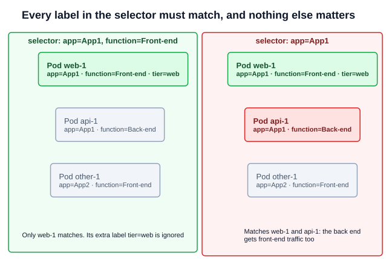

# 02 — Labels and Selectors

A cluster quickly holds hundreds of Pods, ReplicaSets, Deployments and Services. **Labels** are key-value pairs attached to objects so they can be grouped by any property: application, tier, environment, team. A **selector** is a query that picks out the objects with given labels. Kubernetes uses them to connect objects to each other, and you use them to filter `kubectl` output.

---

## 1. Labels

Labels go under `metadata.labels`, on any object:

```yaml
apiVersion: v1
kind: Pod
metadata:
  name: simple-webapp
  labels:
    app: App1
    function: Front-end
spec:
  containers:
  - name: simple-webapp
    image: simple-webapp
    ports:
    - containerPort: 8080
```

| Part | Rule |
|---|---|
| Key | Optional prefix and a name: `app`, or `app.kubernetes.io/name`. Name up to 63 characters, starting and ending with a letter or digit; `-`, `_` and `.` allowed in between |
| Value | Up to 63 characters, same characters as a key name, can be empty. Numbers and booleans must be quoted: `version: "2"` |
| Case | Keys and values are **case-sensitive**. `function` and `Function` are different keys |

The course's slides use `Function: Front-end` on the Pod and `function: Front-end` on the ReplicaSet. These are different keys, so a selector on one does not match the other.

---

## 2. Selectors

### 2.1 Filtering with kubectl

```bash
kubectl get pods --selector app=App1
kubectl get pods -l app=App1,function=Front-end      # comma = AND
kubectl get pods -l 'env in (prod,dev)'              # set-based
kubectl get pods -l 'app!=App1'                      # not equal
kubectl get pods -l '!function'                      # label not set at all
kubectl get all -l env=prod                          # across resource types
kubectl get pods -l env=prod --no-headers | wc -l    # count them
```

Every condition must hold: a comma means AND, and there is no OR. To get either of two values of one key, use `in (a,b)`.

### 2.2 How objects use them

Controllers and Services find their Pods with a selector, not by name:

```yaml
apiVersion: apps/v1
kind: ReplicaSet
metadata:
  name: simple-webapp
  labels:                 # the ReplicaSet's own labels: only for finding the ReplicaSet
    app: App1
    function: Front-end
spec:
  replicas: 3
  selector:
    matchLabels:          # which Pods this ReplicaSet owns
      app: App1
  template:
    metadata:
      labels:             # labels each new Pod gets; must satisfy the selector
        app: App1
        function: Front-end
    spec:
      containers:
      - name: simple-webapp
        image: simple-webapp
```

A ReplicaSet has three sets of labels, and they do different jobs:

| Field | Used for |
|---|---|
| `metadata.labels` | Labels on the ReplicaSet itself. Nothing links to Pods through them |
| `spec.selector` | Which Pods the ReplicaSet counts and manages |
| `spec.template.metadata.labels` | Labels stamped on the Pods it creates. If they do not satisfy the selector, the API server rejects the ReplicaSet with a `selector does not match template labels` error |

A Service selects Pods the same way, but its `selector` is a plain map with no `matchLabels`:

```yaml
apiVersion: v1
kind: Service
metadata:
  name: my-service
spec:
  selector:
    app: App1
  ports:
  - protocol: TCP
    port: 80
    targetPort: 9376
```

| Object | Selector form |
|---|---|
| Service, ReplicationController | `selector:` a map, equality only |
| ReplicaSet, Deployment, DaemonSet, StatefulSet, Job | `selector.matchLabels` and/or `selector.matchExpressions` (`In`, `NotIn`, `Exists`, `DoesNotExist`) |

On a Deployment, `spec.selector` cannot be changed after creation.

### 2.3 One label is enough, but it must be specific

A selector only needs one label, and the Pods may carry any number of extra labels. But it matches **every** Pod in the namespace with that label, including ones you did not mean:



- A Service sends traffic to every matching Pod, so an over-broad selector sends requests to the wrong application.
- A ReplicaSet adopts every matching Pod that has no owner, so it can take over and delete Pods you created by hand.
- Two controllers with overlapping selectors in one namespace both try to own the same Pods. The docs warn that the controllers can then fail to work out how many replicas should exist.

Use as many labels as it takes to make the selector unique, typically `app` plus a tier or component.

---

## 3. Changing labels

```bash
kubectl label pod simple-webapp env=prod
kubectl label pod simple-webapp env=dev --overwrite     # change an existing value
kubectl label pod simple-webapp env-                     # remove the label
kubectl get pods --show-labels
kubectl get pods -L app,function                         # labels as columns
```

Relabelling a Pod so it no longer matches its ReplicaSet's selector takes it out of the set. The ReplicaSet creates a replacement, and the relabelled Pod keeps running on its own. This is a way to take a Pod aside for debugging.

---

## 4. Annotations

Annotations sit beside labels under `metadata.annotations`. They hold information that tools and people read, but **cannot be selected on**: build versions, contact details, tool settings. `kubectl.kubernetes.io/last-applied-configuration` (Section 2, [chapter 20](../02-core-concepts/20-kubectl-apply.md)) is one example.

```yaml
metadata:
  name: simple-webapp
  labels:
    app: App1
  annotations:
    buildversion: "1.34"
```

```bash
kubectl annotate pod simple-webapp buildversion=1.34
kubectl annotate pod simple-webapp buildversion-
```

---

## Exam angle

- **"How many Pods are in the prod environment?"** `kubectl get pods -l env=prod --no-headers | wc -l`. If the question says objects rather than Pods, use `get all`.
- **"Find the Pod with env=prod, bu=finance and tier=frontend"**: list all three in one `-l`, separated by commas.
- **ReplicaSet or Deployment rejected?** Check that the template labels satisfy `spec.selector`, including case.
- **Service with no endpoints?** Compare `kubectl describe svc <name>` (Selector) with `kubectl get pods --show-labels`. One typo or wrong case is enough to break it.
- **Trap:** `kubectl get all` does not list every resource type. It skips ConfigMaps, Secrets, Ingresses and others, so a count of "all objects" from it can be incomplete.

## References

- [Labels and Selectors](https://kubernetes.io/docs/concepts/overview/working-with-objects/labels/) — "Syntax and character set", "Label selectors" (equality-based and set-based), and "Resources that support set-based requirements" for `matchExpressions`
- [Annotations](https://kubernetes.io/docs/concepts/overview/working-with-objects/annotations/) — labels versus annotations
- [Recommended Labels](https://kubernetes.io/docs/concepts/overview/working-with-objects/common-labels/) — the `app.kubernetes.io/*` keys

## Related notes

- CKAD: [Labels, selectors and annotations](https://github.com/caseythecoder90/ckad-exam-prep/blob/main/notes/05-pod-design/01-labels-selectors-annotations.md) — the developer's view, with more selector examples
- KCNA: [Labels and selectors](https://github.com/caseythecoder90/kcna-study-guide/blob/main/notes/04-kubernetes-fundamentals/12-labels-and-selectors.md) and [Annotations](https://github.com/caseythecoder90/kcna-study-guide/blob/main/notes/04-kubernetes-fundamentals/13-annotations.md)
