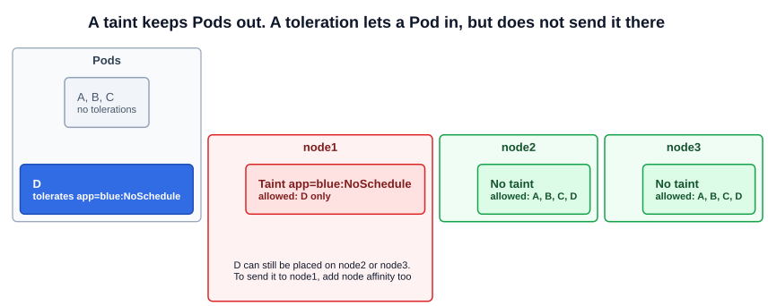

# 03 — Taints and Tolerations

Taints and tolerations control **which Pods are allowed on which nodes**. A **taint** goes on a node and keeps Pods away. A **toleration** goes on a Pod and lets it onto a node with a matching taint.

Picture a person sprayed with insect repellent. Most insects stay away; one species tolerates that repellent and lands anyway. The node is the person, the taint is the repellent, and a Pod with a toleration is the tolerant insect.

---

## 1. Taints are filters, not destinations

A taint only restricts. It never pulls a Pod toward a node:



Pod D's toleration adds node1 to the nodes it is **allowed** on. The scheduler still picks among node1, node2 and node3 as usual, so D may well land on node2.

| Goal | Use |
|---|---|
| Keep other Pods **off** a node | Taint on the node, toleration on the Pods allowed there |
| Send a Pod **to** a node | `nodeSelector` or node affinity on the Pod (later chapters in this section) |
| Dedicate a node to some Pods | Both: the taint keeps others out, affinity sends these Pods there |

---

## 2. Tainting a node

```bash
kubectl taint nodes <node> <key>=<value>:<effect>
kubectl taint nodes node1 app=blue:NoSchedule
kubectl taint nodes node1 gpu:NoSchedule              # value is optional
```

Remove a taint by repeating it with a trailing `-`:

```bash
kubectl taint nodes node1 app=blue:NoSchedule-        # this taint
kubectl taint nodes node1 app:NoSchedule-             # key app, effect NoSchedule
kubectl taint nodes node1 app-                        # every taint with key app
```

See what a node has:

```bash
kubectl describe node node1 | grep -A3 Taints
kubectl get nodes -o custom-columns=NAME:.metadata.name,TAINTS:.spec.taints
```

### 2.1 The three effects

The effect decides what happens to Pods that **do not** tolerate the taint:

| Effect | New Pods without a toleration | Pods already running there |
|---|---|---|
| `NoSchedule` | Not scheduled on this node | Unaffected |
| `PreferNoSchedule` | Scheduler tries to avoid the node, but uses it if nothing else fits | Unaffected |
| `NoExecute` | Not scheduled on this node | **Evicted** right away, unless they tolerate it |

Only `NoExecute` touches running Pods. Evicted Pods owned by a ReplicaSet or Deployment are recreated on another node; a bare Pod is simply gone.

---

## 3. Tolerating a taint

Tolerations go in the Pod spec, at the same level as `containers`:

```yaml
apiVersion: v1
kind: Pod
metadata:
  name: myapp-pod
spec:
  containers:
  - name: nginx-container
    image: nginx
  tolerations:
  - key: "app"
    operator: "Equal"
    value: "blue"
    effect: "NoSchedule"
```

For a Deployment, the same block goes under `spec.template.spec`. There is no `kubectl run` flag for tolerations: generate the YAML with `--dry-run=client -o yaml` and add the block.

The quotes are optional for these fields. A value only needs quotes when YAML would read it as a number or boolean, such as `value: "1"` or `value: "true"`.

The course's slides have two mistakes:
- The Pod's `spec:` is indented under `metadata:`, which makes it a metadata field and leaves the Pod without a spec. `spec` must sit at the top level.
- The slides taint the node with `app=myapp`, but the Pod tolerates `app=blue`. Those do not match, so the Pod would not be allowed on the node. The key, value and effect must all line up.

### 3.1 How a toleration matches

| Field | Meaning |
|---|---|
| `key` | Must equal the taint's key |
| `operator` | `Equal` (the default): key and value must both match. `Exists`: key only, so leave out `value` |
| `value` | Must equal the taint's value when `operator` is `Equal` |
| `effect` | Must equal the taint's effect. **Leave it empty to match every effect** for that key |
| `tolerationSeconds` | `NoExecute` only: how long the Pod may stay after the taint appears, then it is evicted |

Two special cases:

```yaml
tolerations:
- operator: "Exists"            # no key: tolerates every taint
- key: "app"
  operator: "Exists"            # any value of app, any effect
```

There are also `Gt` and `Lt` operators that compare integer values. They have been alpha and disabled by default since v1.35 (feature gate `TaintTolerationComparisonOperators`), so they won't come up on the exam.

### 3.2 Several taints on one node

A Pod is checked against **every** taint on the node. Kubernetes ignores the taints the Pod tolerates and applies the effects of whatever is left:

- At least one remaining `NoSchedule` → the Pod is not scheduled there.
- Only `PreferNoSchedule` left → the scheduler avoids the node if it can.
- At least one remaining `NoExecute` → the Pod is not scheduled there, and is evicted if already running.

One missing toleration is enough to keep a Pod off the node.

---

## 4. Taints you will find on a cluster

### 4.1 The control-plane node

kubeadm taints control-plane nodes so ordinary Pods stay off them:

```bash
kubectl describe node controlplane | grep Taints
# Taints:  node-role.kubernetes.io/control-plane:NoSchedule
```

The course shows the old key `node-role.kubernetes.io/master`, which is deprecated. Current kubeadm uses `node-role.kubernetes.io/control-plane`. The control-plane components still run there because they are static Pods ([chapter 09](09-static-pods.md)), which the kubelet starts itself, without going through the scheduler.

To allow ordinary Pods on the control plane, for example on a single-node practice cluster:

```bash
kubectl taint nodes controlplane node-role.kubernetes.io/control-plane:NoSchedule-
```

### 4.2 Taints Kubernetes adds itself

The node controller taints a node when its condition changes, so the Pods on it can be evicted and placed elsewhere:

| Taint | When |
|---|---|
| `node.kubernetes.io/not-ready` | Node `Ready` condition is `False` |
| `node.kubernetes.io/unreachable` | Node `Ready` is `Unknown`: the node stopped reporting |
| `node.kubernetes.io/memory-pressure`, `disk-pressure`, `pid-pressure` | The kubelet reports resource pressure |
| `node.kubernetes.io/network-unavailable` | The node's network is not configured |
| `node.kubernetes.io/unschedulable` | The node is cordoned (`kubectl cordon`, Section 6) |
| `node.cloudprovider.kubernetes.io/uninitialized` | Set at kubelet start with an external cloud provider, until the cloud-controller-manager initializes the node |

`not-ready` and `unreachable` use the `NoExecute` effect. Every Pod automatically gets tolerations for both with `tolerationSeconds: 300`, unless it sets its own. That is why Pods leave a failed node after about five minutes, as covered in Section 2, [chapter 06](../02-core-concepts/06-kube-controller-manager.md). DaemonSet Pods tolerate these taints without a time limit, so they are never evicted for them.

### 4.3 nodeName skips all of this

A Pod with `spec.nodeName` set bypasses the scheduler, so `NoSchedule` taints are never checked. `NoExecute` is still enforced, because the kubelet evicts Pods that do not tolerate it ([chapter 01](01-manual-scheduling.md)).

---

## 5. Diagnosing

A Pod kept off a node by a taint stays `Pending`, with a `FailedScheduling` event that names the taint:

```bash
kubectl describe pod mosquito | grep -A5 Events
# ... 0/3 nodes are available: 1 node(s) had untolerated taint {node-role.kubernetes.io/control-plane: },
#     2 node(s) had untolerated taint {spray: mortein}. ...
```

Then compare the node's taints with the Pod's tolerations:

```bash
kubectl describe node node01 | grep -A3 Taints
kubectl get pod mosquito -o jsonpath='{.spec.tolerations}{"\n"}'
```

Every Pod lists the two automatic tolerations for `not-ready` and `unreachable`, so you will see those in its `Tolerations` even if you added none yourself.

---

## Exam angle

- **"Taint node01 with key=value:effect"**: `kubectl taint nodes node01 spray=mortein:NoSchedule`, then check with `kubectl describe node node01 | grep -A3 Taints`.
- **"Create a Pod that tolerates it"**: generate the YAML with `--dry-run=client -o yaml`, add `tolerations` under `spec` (not under `containers`), and check where the Pod lands with `kubectl get pod -o wide`.
- **Pending Pod**: the `FailedScheduling` event names the untolerated taint. Remove the taint or add the toleration, whichever the task asks for.
- **Removing a taint** needs the trailing `-`. Copy the key and effect exactly as `describe` shows them, including the `node-role.kubernetes.io/` prefix.
- **Trap:** a toleration does not send a Pod to a node. If the task says the Pod must run *on* a node, the toleration alone is not enough: add a node selector or affinity, or `nodeName`.
- **Trap:** the effect must match too. A `NoExecute` toleration does not cover a `NoSchedule` taint with the same key. Leave `effect` out to tolerate all effects.

## References

- [Taints and Tolerations](https://kubernetes.io/docs/concepts/scheduling-eviction/taint-and-toleration/) — "Concepts" for the toleration YAML and the two special cases, "Taint based Evictions" for the built-in taints and the 300-second default
- [Well-Known Labels, Annotations and Taints](https://kubernetes.io/docs/reference/labels-annotations-taints/) — `node-role.kubernetes.io/control-plane` and the `node.kubernetes.io/*` taints
- [kubectl taint](https://kubernetes.io/docs/reference/kubectl/generated/kubectl_taint/) — adding, overwriting and removing taints

## Related notes

- CKAD: [Taints and tolerations](https://github.com/caseythecoder90/ckad-exam-prep/blob/main/notes/02-configuration/10-taints-and-tolerations.md) and [Affinity vs taints and tolerations](https://github.com/caseythecoder90/ckad-exam-prep/blob/main/notes/02-configuration/13-affinity-vs-taints-tolerations.md) — the developer's view, and dedicating a node with both
- KCNA: [Taints and tolerations](https://github.com/caseythecoder90/kcna-study-guide/blob/main/notes/05-kubernetes-deep-dive/06-taints-and-tolerations.md) — the concept
