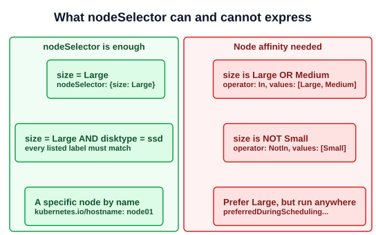

# 04 — Node Selectors

By default, the scheduler can place any Pod on any node that has room. Sometimes a Pod should only run on certain nodes: a data-processing job that needs the one large node, or a workload that needs an SSD or a GPU. **`nodeSelector`** is the simplest way to say so. You label the nodes, then the Pod lists the labels a node must have.

---

## 1. Label the node

Nodes carry labels like any other object (chapter [02](02-labels-and-selectors.md)):

```bash
kubectl label nodes <node-name> <label-key>=<label-value>
kubectl label nodes node01 size=Large
kubectl get nodes --show-labels
kubectl get nodes -L size                      # the size label as a column
```

## 2. Add `nodeSelector` to the Pod

```yaml
apiVersion: v1
kind: Pod
metadata:
  name: myapp-pod
spec:
  containers:
  - name: data-processor
    image: data-processor
  nodeSelector:
    size: Large
```

`nodeSelector` goes under `spec`, at the same level as `containers`. In a Deployment it goes under `spec.template.spec`. There is no `kubectl run` or `create` flag for it, so generate the YAML and add the two lines. (The course's slide leaves `apiVersion:` blank; for a Pod it is `v1`.)

```bash
kubectl apply -f pod.yaml
kubectl get pod myapp-pod -o wide              # NODE column: node01
```

Rules:

- **Every** label listed must be on the node: several entries are ANDed.
- Matching is exact and case-sensitive. `size: large` does not match a node labelled `size=Large`.
- The node may have any number of other labels.

### 2.1 Labels every node already has

The kubelet sets some labels itself, so you can select on them without labelling anything:

| Label | Example |
|---|---|
| `kubernetes.io/hostname` | `node01`. Selects one node, but still through the scheduler, unlike `nodeName` ([chapter 01](01-manual-scheduling.md)) |
| `kubernetes.io/os` | `linux`, `windows` |
| `kubernetes.io/arch` | `amd64`, `arm64` |
| `node.kubernetes.io/instance-type` | `m3.medium`, set when a cloud provider is configured |
| `topology.kubernetes.io/zone`, `topology.kubernetes.io/region` | Cloud zone and region |

---

## 3. When no node matches

The Pod stays **Pending**. Its `FailedScheduling` event says that the nodes did not match its node affinity or selector:

```bash
kubectl describe pod myapp-pod | grep -A5 Events
kubectl get nodes -L size                      # does any node carry the label?
```

Fix it by labelling a node, or by correcting the selector.

Labels are only checked when the Pod is scheduled. If you remove `size=Large` from node01 later, a Pod already running there **keeps running**. The docs call this "IgnoredDuringExecution".

---

## 4. Limitations



`nodeSelector` can only say "this label has exactly this value". It cannot say:

- `size` is Large **or** Medium
- `size` is **not** Small
- **prefer** a large node, but run anywhere if none is free

Node affinity (the next chapter) handles all three. If a Pod has both `nodeSelector` and node affinity, a node must satisfy both.

`nodeSelector` also only pulls a Pod **toward** nodes. It does not keep other Pods **off** them: anything without a selector can still land on node01. To reserve a node, combine it with a taint ([chapter 03](03-taints-and-tolerations.md)).

### 4.1 Labels a node cannot set for itself

Each kubelet can edit its own Node object, including most labels. If labels are used to keep sensitive workloads on trusted nodes, a compromised node could add the label to itself and attract them. The `NodeRestriction` admission plugin (enabled by kubeadm) stops kubelets from setting labels with the prefix `node-restriction.kubernetes.io/`. Use that prefix for labels that matter for isolation, for example `example.com.node-restriction.kubernetes.io/fips=true`.

---

## Exam angle

- **"Run this Pod on the node labelled X"**: check the label with `kubectl get nodes --show-labels | grep X`, add `nodeSelector` under `spec`, and confirm with `kubectl get pod -o wide`.
- **"Label node01 and schedule a Deployment there"**: use `kubectl label nodes node01 key=value`, and put `nodeSelector` under `spec.template.spec`, not the Deployment's top-level `spec`.
- **Pending after adding a selector**: compare the key, the value and the case with the node's labels.
- **Trap:** `nodeSelector` (a field on the Pod) is not the same as `nodeName`. `nodeName` skips the scheduler, along with its taint and resource checks.
- **Trap:** removing a label does not move running Pods. Delete them, or roll the Deployment, to reschedule.

## References

- [Assigning Pods to Nodes](https://kubernetes.io/docs/concepts/scheduling-eviction/assign-pod-node/) — "nodeSelector" for the YAML, "Node isolation/restriction" for the `node-restriction.kubernetes.io/` prefix
- [Assign Pods to Nodes](https://kubernetes.io/docs/tasks/configure-pod-container/assign-pods-nodes/) — the task: label a node, then create a Pod that selects it
- [Well-Known Labels, Annotations and Taints](https://kubernetes.io/docs/reference/labels-annotations-taints/) — `kubernetes.io/hostname`, `kubernetes.io/os` and the other built-in node labels

## Related notes

- CKAD: [Node selectors](https://github.com/caseythecoder90/ckad-exam-prep/blob/main/notes/02-configuration/11-node-selectors.md) — the developer's view
- KCNA: [kube-scheduler](https://github.com/caseythecoder90/kcna-study-guide/blob/main/notes/05-kubernetes-deep-dive/05-kube-scheduler.md) — `nodeSelector` as an exact match on node labels
