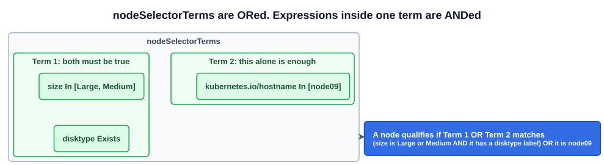

# 05 — Node Affinity

Node affinity does the same job as `nodeSelector` ([chapter 04](04-node-selectors.md)): it limits a Pod to nodes with certain labels. It adds what `nodeSelector` lacks: **OR**, **NOT**, "the label exists", and soft preferences. The cost is longer YAML.

---

## 1. The same rule, written both ways

```text
# nodeSelector                         # node affinity
spec:                                  spec:
  nodeSelector:                          affinity:
    size: Large                            nodeAffinity:
                                             requiredDuringSchedulingIgnoredDuringExecution:
                                               nodeSelectorTerms:
                                               - matchExpressions:
                                                 - key: size
                                                   operator: In
                                                   values:
                                                   - Large
```

Both place the Pod only on nodes labelled `size=Large`. The full Pod:

```yaml
apiVersion: v1
kind: Pod
metadata:
  name: myapp-pod
spec:
  containers:
  - name: data-processor
    image: data-processor
  affinity:
    nodeAffinity:
      requiredDuringSchedulingIgnoredDuringExecution:
        nodeSelectorTerms:
        - matchExpressions:
          - key: size
            operator: In
            values:
            - Large
            - Medium
```

`affinity` sits under `spec`, at the same level as `containers`. In a Deployment it goes under `spec.template.spec`. (As in the last chapter, the course's slides leave `apiVersion:` blank; it is `v1`.)

---

## 2. Reading the long field name

The type name is a sentence in two halves:

| Part | Values | Meaning |
|---|---|---|
| `...DuringScheduling` | `required` | The scheduler places the Pod **only** on a matching node. If none matches, the Pod stays Pending |
| | `preferred` | The scheduler **tries** to use a matching node. If none is available, it places the Pod anywhere |
| `...DuringExecution` | `Ignored` | A Pod that is already running is left alone, even if the node's labels change and no longer match |

So there are two types:

| Type | When scheduling | Once running |
|---|---|---|
| `requiredDuringSchedulingIgnoredDuringExecution` | Must match | Ignored |
| `preferredDuringSchedulingIgnoredDuringExecution` | Should match | Ignored |

### 2.1 `requiredDuringSchedulingRequiredDuringExecution` does not exist

The course lists it as "planned", as older versions of the docs did. **It was never implemented.** The Pod API in v1.37 still has only the two fields above. Its description says that if a node stops matching while the Pod runs, Kubernetes "may or may not" evict the Pod eventually, and in practice it does not.

If you remember Pods being evicted from a node because of a node property, that was probably a **`NoExecute` taint** ([chapter 03](03-taints-and-tolerations.md)). A `NoExecute` taint evicts running Pods that do not tolerate it, which is the closest thing to "required during execution" that Kubernetes has. The other option is the [descheduler](https://github.com/kubernetes-sigs/descheduler), a separate add-on project. Its `RemovePodsViolatingNodeAffinity` strategy evicts Pods whose node no longer matches their required affinity, so the scheduler places them again.

---

## 3. Operators

| Operator | A node matches when | `values` |
|---|---|---|
| `In` | The label's value is one of `values` | One or more |
| `NotIn` | The label's value is not in `values`, **or the node does not have the label** | One or more |
| `Exists` | The node has the label, with any value | Must be left out |
| `DoesNotExist` | The node does not have the label | Must be left out |
| `Gt` | The label's value, read as an integer, is greater than the single value | Exactly one integer |
| `Lt` | The label's value, read as an integer, is less than the single value | Exactly one integer |

```yaml
- key: size
  operator: NotIn            # not Small; nodes with no size label also match
  values: ["Small"]
- key: gpu
  operator: Exists           # any node labelled gpu=<anything>
- key: cpu-generation
  operator: Gt               # label cpu-generation=5 matches; quote the number
  values: ["4"]
```

- `NotIn` and `DoesNotExist` give **node anti-affinity**: they keep a Pod off nodes. A taint does the same from the node's side.
- `Gt` and `Lt` work only in node affinity, not in Pod affinity. If the node's label is not an integer, that node does not match.
- The API server rejects the Pod if `values` is wrong for the operator, for example `Exists` with `values`, or `In` without them.

---

## 4. Combining rules



| Structure | Logic |
|---|---|
| Several entries in `nodeSelectorTerms` | **OR**: a node needs to match any one term |
| Several expressions in one term's `matchExpressions` | **AND**: a node must match all of them |
| `nodeSelector` and `nodeAffinity` on the same Pod | **AND**: both must be satisfied |

```yaml
nodeSelectorTerms:
- matchExpressions:            # term 1: Large or Medium, AND has a disktype label
  - key: size
    operator: In
    values: ["Large", "Medium"]
  - key: disktype
    operator: Exists
- matchExpressions:            # term 2: OR the node named node09
  - key: kubernetes.io/hostname
    operator: In
    values: ["node09"]
```

The indentation decides which: a new `- matchExpressions:` starts a new term (OR), while another `- key:` under the same `matchExpressions` adds to the term (AND). A term can also use `matchFields` instead of labels. It only supports `metadata.name`, the node's name.

---

## 5. Preferred rules and weights

A preferred rule has a different shape. It is a list of `weight` and `preference` pairs, and `preference` holds one term directly, without `nodeSelectorTerms`:

```yaml
affinity:
  nodeAffinity:
    preferredDuringSchedulingIgnoredDuringExecution:
    - weight: 80                     # 1-100
      preference:
        matchExpressions:
        - key: size
          operator: In
          values: ["Large"]
    - weight: 20
      preference:
        matchExpressions:
        - key: disktype
          operator: In
          values: ["ssd"]
```

For each node that passes all required rules, the scheduler adds the weights of the preferences it matches to that node's score. A Large node with an SSD gets 100, a Large node without one 80. The highest score usually wins, but other scoring factors still count. A preferred rule never makes a Pod Pending.

A Pod can have both types: the required rule decides which nodes are allowed, and the preferred rules rank them.

---

## 6. Affinity with taints

Node affinity pulls a Pod toward nodes; it does not keep other Pods off them. A taint keeps others off; it does not pull the right Pod in ([chapter 03](03-taints-and-tolerations.md)). To dedicate nodes to a team or workload, use both:

1. Taint the nodes, and give the team's Pods a matching toleration, so no other Pods land there.
2. Label the nodes, and give the team's Pods required node affinity, so they don't land anywhere else.

---

## 7. Diagnosing

```bash
kubectl describe pod myapp-pod | grep -A5 Events
# FailedScheduling ... didn't match Pod's node affinity/selector
kubectl get nodes --show-labels
kubectl get nodes -L size,disktype
kubectl get pod myapp-pod -o yaml | grep -A15 affinity:
```

Check the key, the values and the operator, then the indentation, which may have turned an AND into an OR or the reverse.

---

## Exam angle

- **Don't type the YAML from memory.** Copy it from the Pod example on the "Assign Pods to Nodes using Node Affinity" docs page, or recall the fields with `kubectl explain pod.spec.affinity.nodeAffinity --recursive`.
- **"Schedule on nodes labelled color=blue"** (in a Deployment): put the affinity under `spec.template.spec`, then confirm with `kubectl get pods -o wide` that every replica landed on a labelled node.
- **"Must not run on X"**: use `NotIn` or `DoesNotExist`. Remember that `NotIn` also matches nodes that do not have the label at all.
- **Trap:** a preferred rule does not guarantee placement. If the task says "must" or "only", use `required...`.
- **Trap:** changing a node's labels does not move running Pods. Recreate them, for example with `kubectl rollout restart deployment <name>`.
- **Trap:** for an AND, put both expressions in one `matchExpressions`. Putting them in two separate terms makes an OR.

## References

- [Assigning Pods to Nodes](https://kubernetes.io/docs/concepts/scheduling-eviction/assign-pod-node/) — "Node affinity" for the two types and the AND/OR rules, "Node affinity weight", and "Operators" for the operator table
- [Assign Pods to Nodes using Node Affinity](https://kubernetes.io/docs/tasks/configure-pod-container/assign-pods-nodes-using-node-affinity/) — complete required and preferred Pod examples to copy
- [Taints and Tolerations](https://kubernetes.io/docs/concepts/scheduling-eviction/taint-and-toleration/) — `NoExecute`, for evicting running Pods

## Related notes

- CKAD: [Node affinity](https://github.com/caseythecoder90/ckad-exam-prep/blob/main/notes/02-configuration/12-node-affinity.md) and [Affinity vs taints and tolerations](https://github.com/caseythecoder90/ckad-exam-prep/blob/main/notes/02-configuration/13-affinity-vs-taints-tolerations.md) — the developer's view, and combining both
- KCNA: [Affinity and anti-affinity](https://github.com/caseythecoder90/kcna-study-guide/blob/main/notes/05-kubernetes-deep-dive/07-affinity-and-anti-affinity.md) — node affinity alongside Pod affinity
