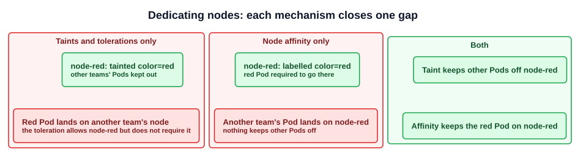

# 06 — Node Affinity vs Taints and Tolerations

Taints ([chapter 03](03-taints-and-tolerations.md)) and node affinity ([chapter 05](05-node-affinity.md)) each control placement from one side, and each leaves a gap. To **dedicate** nodes to particular Pods, you need both.

---

## 1. The scenario

Your team has three nodes, `node-blue`, `node-red` and `node-green`, and three Pods of the same colours. Other teams share the cluster, with their own Pods and nodes. You want:

1. Each of your Pods on the node of its colour, and never on another team's node.
2. No other team's Pod on your nodes.



| Approach | Requirement 1: your Pods stay on your nodes | Requirement 2: other Pods stay off |
|---|---|---|
| Taints and tolerations only | **No.** A toleration allows a node but does not require it, so the red Pod can land on an untainted node belonging to another team | Yes |
| Node affinity only | Yes | **No.** Nothing stops a Pod with no affinity from landing on `node-red` |
| Both | Yes | Yes |

The two mechanisms work from opposite sides:

| | Taints and tolerations | Node affinity |
|---|---|---|
| Set on | Taint on the node, toleration on the Pod | Label on the node, rule on the Pod |
| Effect | Keeps Pods **out** of a node | Keeps a Pod **on** certain nodes |
| Who is constrained | Every Pod without the toleration | Only the Pod that has the rule |

---

## 2. Dedicating a node, step by step

```bash
# 1. Keep everyone else off: taint the node
kubectl taint nodes node-red color=red:NoSchedule

# 2. Give the node a label for affinity to match
kubectl label nodes node-red color=red
```

The taint and the label can use the same key and value, but they are separate things. `kubectl taint` does not add a label, and `kubectl label` does not add a taint.

```yaml
# 3. The Pod tolerates the taint AND requires the label
apiVersion: v1
kind: Pod
metadata:
  name: red
spec:
  containers:
  - name: app
    image: nginx
  tolerations:                       # allowed onto node-red
  - key: color
    operator: Equal
    value: red
    effect: NoSchedule
  affinity:                          # and only onto node-red
    nodeAffinity:
      requiredDuringSchedulingIgnoredDuringExecution:
        nodeSelectorTerms:
        - matchExpressions:
          - key: color
            operator: In
            values: ["red"]
```

`nodeSelector: {color: red}` works in place of the affinity block when a single exact match is all you need ([chapter 04](04-node-selectors.md)).

Verify:

```bash
kubectl get pods -o wide                            # red on node-red, nothing else there
kubectl get pods -A -o wide --field-selector spec.nodeName=node-red
```

The second command lists every Pod on `node-red`, in all namespaces. Expect to see DaemonSet Pods such as `kube-proxy` and the CNI plugin there. DaemonSets tolerate many taints, and their Pods are meant to run on every node.

---

## 3. What can still get onto a dedicated node

- **DaemonSet Pods**, if they tolerate the taint. Check a DaemonSet's tolerations before assuming the node is empty.
- **Pods with a broad toleration**, such as `operator: Exists` with no key, which tolerates every taint.
- **Pods with `nodeName` set**, which bypass the scheduler and `NoSchedule` taints ([chapter 01](01-manual-scheduling.md)).
- **Pods already running** when the taint was added, because `NoSchedule` does not evict. Use `NoExecute` to clear the node as well.

---

## Exam angle

- **"Only Pods of team X may run on node01, and team X's Pods must run only there"**: taint node01 and label it, then add both a toleration and a required node affinity (or `nodeSelector`) to the Pod or Deployment template.
- **Read the wording.** "Must not run anywhere else" calls for affinity, while "no other Pods may run here" calls for a taint. A task may ask for only one of them.
- **Verify both directions** with `kubectl get pods -o wide`. Your Pods should be on the dedicated node. A test Pod with no toleration should land elsewhere, or stay Pending if every other node is tainted.
- **Trap:** a taint is not a label. Affinity matches node **labels**, so tainting `color=red` and then writing affinity for `color=red` leaves the Pod Pending until the node is also labelled.

## References

- [Taints and Tolerations](https://kubernetes.io/docs/concepts/scheduling-eviction/taint-and-toleration/) — "Example Use Cases", "Dedicated Nodes": the taint plus label pattern
- [Assigning Pods to Nodes](https://kubernetes.io/docs/concepts/scheduling-eviction/assign-pod-node/) — "Node affinity"
- [Assign Pods to Nodes using Node Affinity](https://kubernetes.io/docs/tasks/configure-pod-container/assign-pods-nodes-using-node-affinity/) — a required-affinity Pod to copy

## Related notes

- CKAD: [Affinity vs taints and tolerations](https://github.com/caseythecoder90/ckad-exam-prep/blob/main/notes/02-configuration/13-affinity-vs-taints-tolerations.md) — the same comparison from the developer's view
- KCNA: [Taints and tolerations](https://github.com/caseythecoder90/kcna-study-guide/blob/main/notes/05-kubernetes-deep-dive/06-taints-and-tolerations.md) and [Affinity and anti-affinity](https://github.com/caseythecoder90/kcna-study-guide/blob/main/notes/05-kubernetes-deep-dive/07-affinity-and-anti-affinity.md)
