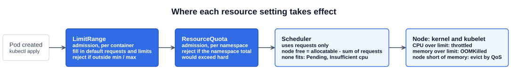

# 07 — Resource Requirements and Limits

Every node has a fixed amount of CPU and memory, and every Pod uses some of it. Two settings per container tell Kubernetes how much a container needs and the most it may use. Two namespace objects set defaults and totals. Units such as `500m` and `256Mi` are explained in [Resource units](../resource-units.md).



---

## 1. Requests and limits

```yaml
apiVersion: v1
kind: Pod
metadata:
  name: simple-webapp-color
spec:
  containers:
  - name: simple-webapp-color
    image: simple-webapp-color
    resources:
      requests:
        cpu: 500m
        memory: 1Gi
      limits:
        cpu: "1"
        memory: 2Gi
```

| | `requests` | `limits` |
|---|---|---|
| Meaning | The amount the container is **guaranteed** | The **most** the container may use |
| Used by | The **scheduler**, to choose a node | The **node** (kernel and kubelet), while the container runs |
| CPU | Its share when containers compete | Above it, the container is **throttled**: slowed, not stopped |
| Memory | Counted when the node runs short | Above it, the container is **OOMKilled** (out of memory) and restarted |

Resources are set **per container**. A Pod's request is the sum of its containers' requests.

### 1.1 How the scheduler uses requests

The scheduler compares the Pod's requests with each node's **allocatable** capacity minus the requests of the Pods already on it. It ignores actual usage. If no node has enough left, the Pod stays Pending:

```bash
kubectl describe pod nginx | grep -A5 Events
# Warning  FailedScheduling  ... 0/3 nodes are available: 3 Insufficient cpu. ...
```

The course's slide shows an older wording ("No nodes are available that match all of the following predicates"). Current versions say `0/N nodes are available` and name each reason.

See how full a node is:

```bash
kubectl describe node node01 | grep -A8 "Allocated resources"
#   Resource  Requests     Limits
#   cpu       1250m (62%)  2 (100%)
#   memory    1088Mi (28%) 2Gi (54%)
kubectl top node                       # actual usage (needs metrics-server)
kubectl top pod
```

Limits can add up to more than 100% of a node. Requests cannot, because the scheduler will not place a Pod whose requests do not fit.

### 1.2 What happens above the limit

| Resource | Over the limit | How it shows |
|---|---|---|
| CPU | The kernel throttles the container to its limit | Slow responses, no restarts |
| Memory | The kernel kills the container | `kubectl describe pod`: `Last State: Terminated, Reason: OOMKilled`, exit code 137. Repeated kills lead to `CrashLoopBackOff` |

CPU can be taken back from a process, so it is throttled. Memory cannot, so the only way to reclaim it is to kill the process.

---

## 2. Default behavior: the four combinations

By default Kubernetes sets **no** requests or limits. The lecture walks through each combination, here for two Pods sharing a node:

| Requests | Limits | CPU | Memory |
|---|---|---|---|
| No | No | Either Pod can use all the node's CPU and starve the other | Either Pod can use all the memory. The other may be killed, or be unable to start |
| No | Yes | **Requests are set equal to the limits.** Each Pod is guaranteed its limit and can use no more | Same: guaranteed the limit, killed above it |
| Yes | Yes | Guaranteed the request, can burst up to the limit | Guaranteed the request, can grow up to the limit |
| Yes | No | Guaranteed the request, and can use **any idle CPU**. The lecture calls this the best option for CPU | Guaranteed the request, and can grow beyond it. When another Pod needs memory back, the only remedy is to **kill** this one |

The second row is easy to miss: setting only `limits` gives you requests too. The docs say Kubernetes copies the limit into the request unless a LimitRange (section 4) has already provided a default request.

### 2.1 QoS classes

From these settings Kubernetes assigns each Pod a **Quality of Service (QoS) class**. The kubelet uses it to choose which Pods to evict when a node runs short of memory:

| Class | Rule | Evicted |
|---|---|---|
| `Guaranteed` | Every container has CPU and memory requests **equal to** its limits | Last |
| `Burstable` | At least one container has a request or limit, but the Pod is not Guaranteed | In between |
| `BestEffort` | No container has any request or limit | **First** |

```bash
kubectl get pod simple-webapp-color -o jsonpath='{.status.qosClass}{"\n"}'
```

---

## 3. Setting resources quickly

`kubectl run` has no resource flags. Generate YAML and add the block, or set resources on an existing workload:

```bash
kubectl set resources deployment web --requests=cpu=100m,memory=128Mi --limits=cpu=500m,memory=256Mi
kubectl set resources deployment web -c nginx --limits=memory=512Mi     # one container
kubectl set resources -f pod.yaml --limits=cpu=200m --local -o yaml      # edit a file offline
```

On a Deployment, this changes the Pod template and starts a rollout. On a bare Pod, resources could not be changed until in-place resize became stable in v1.35. It goes through the `resize` subresource:

```bash
kubectl patch pod web --subresource resize \
  --patch '{"spec":{"containers":[{"name":"web","resources":{"requests":{"cpu":"800m"},"limits":{"cpu":"800m"}}}]}}'
```

Deleting and recreating the Pod (`kubectl replace --force -f`) still works too.

---

## 4. LimitRange: defaults and bounds per container

A **LimitRange** is a namespaced object that sets default requests and limits for containers that do not set their own, and minimum and maximum values for those that do.

```yaml
apiVersion: v1
kind: LimitRange
metadata:
  name: cpu-resource-constraint
  namespace: dev
spec:
  limits:
  - type: Container
    default:              # default LIMIT
      cpu: 500m
    defaultRequest:       # default REQUEST
      cpu: 500m
    max:                  # the highest limit allowed
      cpu: "1"
    min:                  # the lowest request allowed
      cpu: 100m
```

| Field | Applies to | Effect |
|---|---|---|
| `default` | Limit | Filled in when a container has no limit |
| `defaultRequest` | Request | Filled in when a container has no request |
| `max` | Limit | A container whose limit is higher is rejected. If `default` is left out, the default limit is `max` |
| `min` | Request | A container whose request is lower is rejected |
| `maxLimitRequestRatio` | Both | The limit may be at most this many times the request |

`type` can be `Container`, `Pod` (totals over all its containers) or `PersistentVolumeClaim` (storage size).

How it behaves:

- **It only acts when a Pod is created.** The LimitRanger admission plugin fills in defaults and checks bounds at that moment. **Pods that already exist are not changed**, even if they break the new rules. Recreate them to apply it.
- A container that sets a limit but no request gets a request **equal to its own limit**, not the LimitRange's `defaultRequest`.
- A Pod outside `min` or `max` is rejected with `403 Forbidden`, and the message names the rule. For a Deployment, the error appears in the ReplicaSet's events, not the Deployment's: run `kubectl describe rs`.

```bash
kubectl get limitrange -n dev
kubectl describe limitrange cpu-resource-constraint -n dev
kubectl get pod web -n dev -o yaml | grep -A6 resources:   # see the defaults that were filled in
```

There is no `kubectl create` generator for a LimitRange. Copy the YAML from the docs.

---

## 5. ResourceQuota: totals per namespace

A **ResourceQuota** caps the **total** a namespace may use, summed over all its Pods, plus counts of objects. Namespaces introduced it ([02-17](../02-core-concepts/17-namespaces.md)); here it is from the resource side.

```yaml
apiVersion: v1
kind: ResourceQuota
metadata:
  name: my-resource-quota
  namespace: dev
spec:
  hard:
    requests.cpu: "4"
    requests.memory: 4Gi
    limits.cpu: "10"
    limits.memory: 10Gi
    pods: "10"
```

```bash
kubectl create quota my-resource-quota -n dev \
  --hard=requests.cpu=4,requests.memory=4Gi,limits.cpu=10,limits.memory=10Gi,pods=10
kubectl describe quota -n dev                  # Used versus Hard
```

| Behavior | Detail |
|---|---|
| Over the quota | The new Pod is rejected with `403 Forbidden ... exceeded quota`. A Deployment then has fewer Pods than requested; the ReplicaSet's events show why |
| Quota on `requests.cpu` or `limits.memory`, etc. | **Every new Pod must set that value**, or it is rejected (`must specify ...`). A LimitRange with defaults fills them in automatically, which is why the two are often used together |
| Existing Pods | Not affected when a quota is added or lowered. It applies to new objects |
| Object counts | `pods`, `services`, `configmaps`, `secrets`, `persistentvolumeclaims`, or `count/<resource>.<group>`, such as `count/deployments.apps` |

### 5.1 LimitRange vs ResourceQuota

| | LimitRange | ResourceQuota |
|---|---|---|
| Scope | Each container (or Pod, or PVC) | The whole namespace, summed |
| Sets defaults | Yes | No |
| Typical question | "No container may use more than 1 CPU" | "This team may use 10 CPUs in total" |
| Acts on | New Pods, at creation | New objects, at creation |

---

## Exam angle

- **"Set requests and limits on deployment X"**: `kubectl set resources deployment X --requests=... --limits=...`, then `kubectl get deploy X -o yaml | grep -A6 resources`.
- **A Pending Pod with `Insufficient cpu/memory`**: compare its requests with `kubectl describe node` (Allocatable and Allocated resources). Lower the request, or free up capacity.
- **A Pod restarting with `OOMKilled`**: raise the memory limit (Deployment: `set resources` or edit the template), then verify that the restarts stop.
- **A Deployment with 0 of 3 Pods and no Pod events**: run `kubectl describe rs`. A quota or LimitRange rejection appears there.
- **Trap:** a new LimitRange or quota does not touch running Pods. If the task expects the new defaults, recreate the Pods.
- **Trap:** units. `400m` of memory is 0.4 bytes, `1K` is invalid, and `0.1` CPU is `100m`. See [Resource units](../resource-units.md).

## References

- [Resource Management for Pods and Containers](https://kubernetes.io/docs/concepts/configuration/manage-resources-containers/) — "Requests and limits", "Resource units in Kubernetes", "Troubleshooting" (Pending and terminated containers)
- [Limit Ranges](https://kubernetes.io/docs/concepts/policy/limit-range/) — the LimitRange YAML; the "Configure Default Memory Requests and Limits for a Namespace" task covers the limit-only case
- [Resource Quotas](https://kubernetes.io/docs/concepts/policy/resource-quotas/) — the quota resource names and object counts
- [Pod Quality of Service Classes](https://kubernetes.io/docs/concepts/workloads/pods/pod-qos/) — the three classes and eviction order

## Related notes

- CKAD: [Resource requirements](https://github.com/caseythecoder90/ckad-exam-prep/blob/main/notes/02-configuration/08-resource-requirements.md) and the [bytes and CPU units reference](https://github.com/caseythecoder90/ckad-exam-prep/blob/main/notes/02-configuration/diagrams/bytes-and-cpu-units-reference.md) — the developer's view
- KCNA: [Resource quotas](https://github.com/caseythecoder90/kcna-study-guide/blob/main/notes/05-kubernetes-deep-dive/17-resource-quotas.md) — quotas and memory units as concepts
