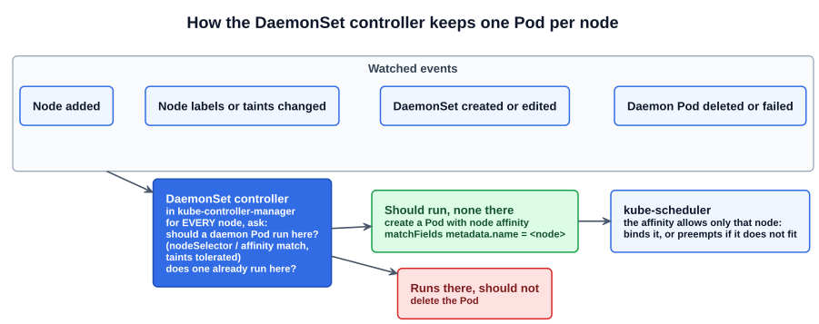

# 08 — DaemonSets

A **DaemonSet** runs **one copy of a Pod on every node**, or on every node that matches a selector. When a node joins the cluster, the DaemonSet adds a Pod to it. When a node is removed, its Pod goes with it. You never set a replica count: the number of nodes decides it.

---

## 1. What runs as a DaemonSet

Anything that must be present on every node:

| Use | Examples |
|---|---|
| Node networking | `kube-proxy` (Section 2, [chapter 09](../02-core-concepts/09-kube-proxy.md)), CNI plugins such as Calico, Flannel, Cilium |
| Log collection | Fluent Bit, Fluentd: read each node's container logs |
| Monitoring agents | Prometheus node-exporter, vendor agents |
| Storage | CSI node plugins |

On a kubeadm cluster:

```bash
kubectl get daemonsets -A
# NAMESPACE     NAME         DESIRED   CURRENT   READY   UP-TO-DATE   AVAILABLE   NODE SELECTOR            AGE
# kube-system   kube-proxy   3         3         3       3            3           kubernetes.io/os=linux   5d
```

`DESIRED` is the number of nodes that should run the Pod. It is not a count you set.

---

## 2. The manifest

A DaemonSet looks like a ReplicaSet without `replicas`:

```yaml
apiVersion: apps/v1
kind: DaemonSet
metadata:
  name: monitoring-daemon
spec:
  selector:
    matchLabels:
      app: monitoring-agent
  template:
    metadata:
      labels:
        app: monitoring-agent     # must match the selector
    spec:
      containers:
      - name: monitoring-agent
        image: monitoring-agent
```

There is **no `kubectl create daemonset`**. Generate a Deployment and convert it:

```bash
kubectl create deployment monitoring-daemon --image=monitoring-agent --dry-run=client -o yaml > ds.yaml
# in ds.yaml: kind: Deployment -> kind: DaemonSet
#             delete replicas, strategy: {} and status: {}
kubectl apply -f ds.yaml
kubectl get ds monitoring-daemon
kubectl get pods -l app=monitoring-daemon -o wide   # one per node
```

The label in the generated file is `app: monitoring-daemon`, from the name.

On the course's `describe` slide, the selector (`name=monitoring-daemon`) does not match the template labels (`app=monitoring-agent`). The API server would reject that DaemonSet. They must match, as for a ReplicaSet.

---

## 3. How it puts a Pod on every node

### 3.1 A per-node state, not a count

A ReplicaSet and a DaemonSet are both controllers that compare desired with actual state, but they compare different things:

| | ReplicaSet | DaemonSet |
|---|---|---|
| Desired state | A **number**: `replicas: 3` | **For each node:** should a daemon Pod run here? |
| Watches | ReplicaSets and Pods | DaemonSets, Pods **and Nodes** |
| Who picks the node | The scheduler, freely. The ReplicaSet only creates Pods | The controller decides the node. The scheduler only binds the Pod there |

A ReplicaSet never looks at nodes. It creates N Pods without a node, and the scheduler places each one wherever it fits. The DaemonSet controller has to reason about nodes, so it watches them.

### 3.2 The controller loop



The DaemonSet controller runs in `kube-controller-manager` ([chapter 02-06](../02-core-concepts/06-kube-controller-manager.md)). It watches three kinds of object, and any of these events starts a check:

- A **Node is added**, or an existing node's **labels or taints change**. Other node changes, such as heartbeats, are ignored.
- A **DaemonSet** is created or edited.
- A **daemon Pod** is deleted or fails.

A check goes through **every node** and answers two questions:

1. **Should a daemon Pod run here?** Yes if the node matches the template's `nodeSelector` and node affinity, and the Pod tolerates the node's taints.
2. **Is one running here already?**

| Should run | Already runs | Action |
|---|---|---|
| Yes | No | Create a Pod for this node |
| No | Yes | Delete the Pod |
| Yes | Yes, or No and No | Nothing |

So a new node gets its Pod because the node's arrival is an event the controller is watching. It does not need to know any count in advance.

### 3.3 How the Pod reaches that node: node affinity

The controller does not set `nodeName`. It creates the Pod with a required node affinity that matches **only that node's name**:

```yaml
# added by the DaemonSet controller to each Pod it creates
affinity:
  nodeAffinity:
    requiredDuringSchedulingIgnoredDuringExecution:
      nodeSelectorTerms:
      - matchFields:
        - key: metadata.name
          operator: In
          values:
          - node02
```

`matchFields` on `metadata.name` is the `matchFields` form from [chapter 05](05-node-affinity.md). The default scheduler sees a Pod that can go to exactly one node, checks that it fits, and binds it. If the node is full, the scheduler can **preempt** (evict) lower-priority Pods to make room. That is why critical DaemonSets use `priorityClassName: system-node-critical` (PriorityClasses are a later chapter).

```bash
kubectl get pod <daemon-pod> -o yaml | grep -A8 nodeAffinity
```

The lecture's slide reverses the history. **Before v1.12**, the DaemonSet controller set `nodeName` itself, bypassing the scheduler. **Since v1.12** (stable in v1.17), it uses node affinity and the default scheduler. The change gave daemon Pods normal scheduling: resource checks, preemption and scheduling events.

### 3.4 When a node is removed

A deleted node's Pods are removed by the **Pod garbage collector**, another controller in `kube-controller-manager`, which deletes Pods bound to nodes that no longer exist. The DaemonSet's `DESIRED` count drops by one.

---

## 4. Running on only some nodes

Put a `nodeSelector` or node affinity in the Pod **template**:

```yaml
spec:
  template:
    spec:
      nodeSelector:
        disktype: ssd
```

Unlike a normal Pod, where `IgnoredDuringExecution` means label changes are ignored ([chapter 04](04-node-selectors.md)), a DaemonSet reacts to them. When node labels change, it **adds Pods to newly matching nodes and deletes them from nodes that no longer match**. This follows from the loop in 3.2, which reruns whenever a node's labels change.

---

## 5. Taints and DaemonSets

Daemon Pods still need to tolerate a node's taints ([chapter 03](03-taints-and-tolerations.md)). The controller adds these tolerations to every daemon Pod automatically:

| Toleration | Effect | Result |
|---|---|---|
| `node.kubernetes.io/not-ready`, `unreachable` | `NoExecute` | Never evicted from an unhealthy node (no 300 s limit) |
| `node.kubernetes.io/disk-pressure`, `memory-pressure`, `pid-pressure` | `NoSchedule` | Placed even on nodes under pressure |
| `node.kubernetes.io/unschedulable` | `NoSchedule` | Placed even on cordoned nodes |
| `node.kubernetes.io/network-unavailable` | `NoSchedule` | Only for `hostNetwork: true` Pods |

The **control-plane taint is not in this list**. A DaemonSet you create does not run on a kubeadm control-plane node unless you add the toleration:

```yaml
spec:
  template:
    spec:
      tolerations:
      - key: node-role.kubernetes.io/control-plane
        operator: Exists
        effect: NoSchedule
```

`kube-proxy` runs on the control plane because its template tolerates every taint (`operator: Exists` with no key).

---

## 6. Updating a DaemonSet

| `spec.updateStrategy.type` | After a template change |
|---|---|
| `RollingUpdate` (default) | Old Pods are replaced node by node. `maxUnavailable` defaults to 1 and `maxSurge` to 0, so a node's old Pod is stopped before its new one starts |
| `OnDelete` | Nothing happens until you delete an old Pod yourself; its replacement uses the new template |

The rollout commands work as they do for Deployments:

```bash
kubectl set image ds/monitoring-daemon monitoring-agent=monitoring-agent:v2
kubectl rollout status ds/monitoring-daemon
kubectl rollout history ds/monitoring-daemon
kubectl rollout undo ds/monitoring-daemon
```

`kubectl scale` does not apply: there are no replicas to scale.

---

## Exam angle

- **"Create a DaemonSet"**: generate a Deployment with `--dry-run=client -o yaml`, change the `kind`, and delete `replicas`, `strategy` and `status`. Verify with `kubectl get ds` (DESIRED = number of eligible nodes) and `kubectl get pods -o wide`.
- **"It must also run on the control-plane node"**: add the `node-role.kubernetes.io/control-plane` toleration to the template.
- **"How many DaemonSets are in the cluster" / "on how many nodes does X run"**: use `kubectl get ds -A`, and read the DESIRED and NODE SELECTOR columns.
- **A DaemonSet Pod missing from one node**: check that node's taints, and the template's `nodeSelector` against the node's labels.
- **Trap:** copying a ReplicaSet or Deployment manifest and leaving `replicas` in. With `kubectl`'s default strict validation, the apply fails with `unknown field "spec.replicas"`, because a DaemonSet has no `replicas`.

## References

- [DaemonSet](https://kubernetes.io/docs/concepts/workloads/controllers/daemonset/) — the example manifest, "How Daemon Pods are scheduled" (the `matchFields` affinity), and the tolerations table
- [Perform a Rolling Update on a DaemonSet](https://kubernetes.io/docs/tasks/manage-daemon/update-daemon-set/) — `updateStrategy`, `maxUnavailable` and `maxSurge` defaults
- [Assigning Pods to Nodes](https://kubernetes.io/docs/concepts/scheduling-eviction/assign-pod-node/) — node affinity, used by daemon Pods

## Related notes

- KCNA: [DaemonSets](https://github.com/caseythecoder90/kcna-study-guide/blob/main/notes/04-kubernetes-fundamentals/06-daemonsets.md) — the concept and common uses
