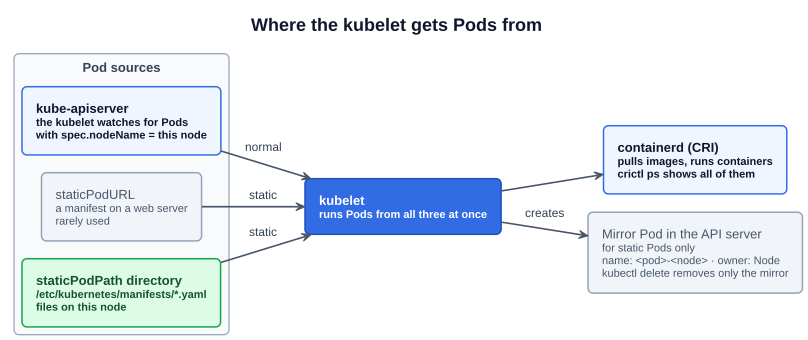
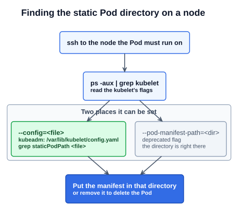

# 09 — Static Pods

A **static Pod** is a Pod that the **kubelet** creates by itself from a manifest file on its own node, with no API server, scheduler or controller involved. The kubelet keeps it running and restarts it if it fails. This is how kubeadm runs the control plane: `kube-apiserver`, `etcd`, `kube-scheduler` and `kube-controller-manager` are static Pods on the control plane node.

The kubelet is a **node** component, not a control-plane component: it runs on every node, control plane nodes included ([chapter 02-08](../02-core-concepts/08-kubelet.md)). The lecture calls it a control-plane component.

---

## 1. Where the kubelet gets Pods from

The kubelet accepts Pods from three sources and runs all of them at the same time:



| Source | Set by | Kind of Pod |
|---|---|---|
| A directory on the node | `staticPodPath` in the kubelet config file | Static |
| A URL the kubelet downloads | `staticPodURL` in the kubelet config file (rarely used) | Static |
| The API server | Always on in a cluster | Normal: Pods the scheduler bound to this node |

The lecture says the API server sends Pods to the kubelet through an HTTP endpoint. It works the other way round: the **kubelet opens a watch** on the API server for Pods whose `spec.nodeName` is its own node. The kubelet's own HTTPS port (10250) serves `kubectl logs` and `exec`, not Pod creation.

The kubelet only understands **Pods**. A Deployment, ReplicaSet or Service manifest in the directory does nothing, because those need controllers in `kube-controller-manager`.

---

## 2. The manifest directory

### 2.1 Finding the path

Never assume `/etc/kubernetes/manifests`. A task can configure a different directory, so read it from the kubelet on the node where the Pod should run:



```bash
ssh node01
ps -aux | grep [k]ubelet | grep -o -- '--pod-manifest-path=[^ ]*\|--config=[^ ]*'
# --config=/var/lib/kubelet/config.yaml
grep staticPodPath /var/lib/kubelet/config.yaml
# staticPodPath: /etc/kubernetes/manifests
```

| Setting | Where | Status |
|---|---|---|
| `staticPodPath: <dir>` | The kubelet config file (`KubeletConfiguration`), passed with `--config`. kubeadm: `/var/lib/kubelet/config.yaml` | Current |
| `--pod-manifest-path=<dir>` | A kubelet flag, in the systemd unit or drop-in | Deprecated, but you may still meet it |

On the slide, the `--config` file is named `kubeconfig.yaml`. That is misleading: the file is a `KubeletConfiguration`, and the kubelet's kubeconfig (API server address and credentials) is the separate `--kubeconfig` flag on the next line. The slide's `--container-runtime=remote` and `--network-plugin=cni` flags no longer exist in current kubelets.

`staticPodPath` is empty by default, so a kubelet without it runs no static Pods. A node set up by kubeadm has it set on **every** node, workers included, even though only the control plane node has manifests in it.

Changing `staticPodPath` needs a kubelet restart: `systemctl restart kubelet`.

### 2.2 What the kubelet does with the files

| You do this on the node | The kubelet does this |
|---|---|
| Add a manifest | Creates the Pod |
| Edit a manifest | Deletes the Pod and creates it again from the new file |
| Remove the manifest | Deletes the Pod |
| Stop or kill the container (`crictl stop`) | Restarts it, like any Pod |

The kubelet watches the directory and also rescans it every 20 s (`fileCheckFrequency`), so changes take effect within seconds. A control-plane Pod can take a minute to come back while it starts.

The kubelet reads **every file not starting with a dot**, whatever its extension. A backup such as `kube-apiserver.yaml.bak` left in the directory is read as a second manifest for the same Pod, and the result is undefined. Keep backups outside the directory, for example in `/etc/kubernetes/backup/` or your home directory.

---

## 3. Mirror Pods: how `kubectl` sees them

When the node is part of a cluster, the kubelet creates a **mirror Pod** in the API server for each static Pod, so `kubectl get pods` lists it like any other Pod. The mirror is read-only in effect: the file on the node is the only source of truth.

| What you see | Why |
|---|---|
| Name `<pod-name>-<node-name>`, e.g. `static-web-node01`, `kube-apiserver-controlplane` | The kubelet appends its node name |
| Namespace from the manifest, `default` if none is set | Control-plane manifests set `kube-system` |
| `ownerReferences` kind `Node`; `describe` shows `Controlled By: Node/node01` | Mirror Pods are owned by their node |
| Annotation `kubernetes.io/config.mirror`, and `kubernetes.io/config.source: file` | Marks it as a mirror of a static Pod |
| `spec.nodeName` already set | The kubelet sets its own node name; the scheduler never sees the Pod |

```bash
kubectl get pods -A -o wide                       # name ends in the node name; NODE column
kubectl get pod static-web-node01 -o jsonpath='{.metadata.ownerReferences[0].kind}{"\n"}'
# Node
kubectl get pods -A -o custom-columns=NS:.metadata.namespace,NAME:.metadata.name,OWNER:.metadata.ownerReferences[0].kind | grep Node
```

The owner kind tells static Pods apart from other system Pods: `kube-proxy-xxxxx` is owned by a `DaemonSet`, `coredns-...` by a `ReplicaSet`, and the control-plane Pods by a `Node`.

**`kubectl delete pod` does not stop a static Pod.** It deletes the mirror, the container keeps running, and the kubelet creates the mirror again. Editing the mirror with `kubectl edit` does not change what runs either. To change or delete a static Pod, change or delete the **file on its node**.

---

## 4. Creating and deleting a static Pod

**Create** one on `node01`. Generate the manifest where `kubectl` works (usually the control plane node), then put it in the directory on the target node:

```bash
kubectl run static-busybox --image=busybox --dry-run=client -o yaml \
  --command -- sleep 1000 > static-busybox.yaml
scp static-busybox.yaml node01:/tmp/
ssh node01
grep staticPodPath /var/lib/kubelet/config.yaml   # confirm the directory first
sudo mv /tmp/static-busybox.yaml /etc/kubernetes/manifests/
exit
kubectl get pod static-busybox-node01 -o wide
```

For a static Pod on the control plane node itself, write the file straight into the directory:

```bash
kubectl run static-busybox --image=busybox --dry-run=client -o yaml \
  --command -- sleep 1000 > /etc/kubernetes/manifests/static-busybox.yaml
```

**Delete** one: find its node from the name or the `NODE` column, find that node's directory, remove the file:

```bash
kubectl get pod static-greenbox-node01 -o wide    # NODE: node01
ssh node01
ps -aux | grep [k]ubelet | grep -o -- '--config=[^ ]*'
grep staticPodPath /var/lib/kubelet/config.yaml   # may not be the default directory
sudo rm <staticPodPath>/greenbox.yaml             # the file name need not match the Pod name
exit
kubectl get pods                                  # gone within seconds
```

The file name does not have to match the Pod name. If `ls` does not show an obvious file, search for it: `grep -l 'name: static-greenbox' <staticPodPath>/*`.

A static Pod's spec **cannot refer to other API objects**: no ServiceAccount, ConfigMap or Secret. It also cannot have ephemeral containers, so `kubectl debug -it <pod>` cannot attach a debug container to it.

---

## 5. When the API server is down

Because the kubelet runs static Pods without the API server, it can start the API server itself. That is the bootstrap order on a kubeadm control plane node: systemd starts the kubelet and containerd, the kubelet reads `/etc/kubernetes/manifests`, and the control plane comes up as Pods.

When the API server is down, `kubectl` cannot help. Look at the containers on the node with **`crictl`**, which works with any CRI runtime (containerd or CRI-O):

```bash
crictl ps -a | grep kube-apiserver                # Exited? count the restarts
crictl logs <container-id>                        # why it failed
journalctl -u kubelet | tail                      # the kubelet's view
```

The lecture uses `docker ps`, which only works on old Docker-based nodes, and pairs `nerdctl` with containerd. `nerdctl` is a separate, optional containerd CLI. On exam nodes, use `crictl`. The image name in that output, `k8s.gcr.io/pause`, is also from the old registry; images now come from `registry.k8s.io`.

---

## 6. Static Pods vs DaemonSets

| | Static Pods | DaemonSets ([chapter 08](08-daemonsets.md)) |
|---|---|---|
| Created by | The kubelet, from a file on one node | The DaemonSet controller, through the API server |
| Needs a running control plane | No: it starts before the API server | Yes |
| Scheduled by | Nobody: `nodeName` is set by the kubelet | The default scheduler, pinned with node affinity |
| Changed or removed with | The file on the node | `kubectl` |
| Rollouts, rollback | No | Yes |
| Typical use | Control-plane components | Node agents: networking, logging, monitoring |

The docs' advice: to run a Pod on every node of a cluster, use a DaemonSet. Static Pods are for what has to run before the control plane exists.

---

## Exam angle

- **"Create a static Pod named X on node01"**: SSH to the node, read `staticPodPath` from the kubelet's `--config` file, generate the manifest with `kubectl run ... --dry-run=client -o yaml` and place it there. Verify with `kubectl get pod X-node01`.
- **"Delete the static Pod Y"**: the node name is the suffix of the Pod name. SSH there, find the directory, remove the file. `kubectl delete pod` only removes the mirror.
- **"How many static Pods are there" / "which Pods are static"**: names ending in a node name, or `ownerReferences` kind `Node`.
- **Trap:** a lab can set `staticPodPath` to an unusual directory. Always read it from the kubelet config on that node instead of assuming `/etc/kubernetes/manifests`.
- **Trap:** fixing a control-plane component with `kubectl edit` does nothing lasting. Edit `/etc/kubernetes/manifests/<component>.yaml`, and keep any backup outside that directory.
- **Trap:** writing the manifest on the control plane node when the task names a worker. A static Pod runs on the node whose directory holds the file.

## References

- [Static Pods](https://kubernetes.io/docs/concepts/workloads/pods/static-pods/) — mirror Pods, limitations, and the comparison with DaemonSets
- [Create static Pods](https://kubernetes.io/docs/tasks/configure-pod-container/static-pod/) — "Filesystem-hosted static Pod manifest" has a manifest to copy, the dot-file and backup warning, and the `crictl` commands
- [Set Kubelet Parameters Via A Configuration File](https://kubernetes.io/docs/tasks/administer-cluster/kubelet-config-file/) — the `KubeletConfiguration` file that holds `staticPodPath`
- [Kubelet Configuration (v1beta1)](https://kubernetes.io/docs/reference/config-api/kubelet-config.v1beta1/) — `staticPodPath`, `staticPodURL` and `fileCheckFrequency` (default `20s`)

## Related notes

- KCNA: [Container orchestration and architecture](https://github.com/caseythecoder90/kcna-study-guide/blob/main/notes/04-kubernetes-fundamentals/01-container-orchestration-and-architecture.md) — how static Pods bootstrap the control plane
