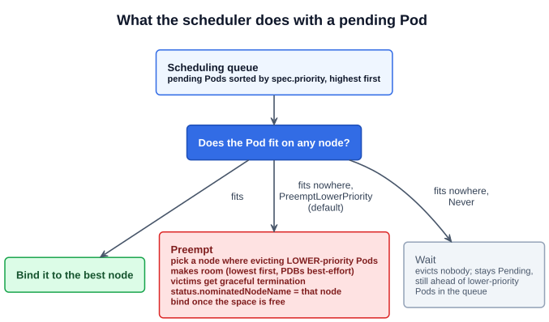

# 10 — PriorityClasses

A **PriorityClass** gives Pods a priority number. The scheduler uses it in two ways: higher-priority Pods are **taken from the scheduling queue first**, and when a higher-priority Pod does not fit anywhere, the scheduler can **preempt** (evict) lower-priority Pods to make room.

---

## 1. The object

```yaml
apiVersion: scheduling.k8s.io/v1
kind: PriorityClass
metadata:
  name: high-priority
value: 1000000000                     # required; higher = more important
description: "Mission-critical Pods"  # optional
globalDefault: false                  # optional; true = default for Pods without a class
preemptionPolicy: PreemptLowerPriority  # optional; or Never
```

Note that `value`, `description`, `globalDefault` and `preemptionPolicy` are **top-level fields**: a PriorityClass has no `spec`.

| Field | Rules |
|---|---|
| `metadata.name` | Cannot start with `system-` (reserved) |
| `value` | 32-bit integer from **-2,147,483,648 to 1,000,000,000**. Larger values are reserved for the built-in classes. **Immutable** |
| `globalDefault` | Only **one** PriorityClass in the cluster can have `true` |
| `preemptionPolicy` | `PreemptLowerPriority` (default) or `Never`. Case-sensitive. **Immutable** |

PriorityClasses are **cluster-scoped**: no namespace, usable by Pods in every namespace.

Create one imperatively:

```bash
kubectl create priorityclass high-priority --value=1000000000 \
  --description="Mission-critical Pods" --preemption-policy=Never
# also: --global-default=true
kubectl get priorityclass                     # short name: pc
```

The lecture's last slide writes `preemptionPolicy: never`. The API server rejects that with `Unsupported value: "never"`: the value is `Never`. `kubectl create --dry-run=client` does not catch it, because only the server validates the value.

### 1.1 The built-in classes

```bash
kubectl get pc
# NAME                      VALUE        GLOBAL-DEFAULT   AGE   PREEMPTIONPOLICY
# system-cluster-critical   2000000000   false            5d    PreemptLowerPriority
# system-node-critical      2000001000   false            5d    PreemptLowerPriority
```

| Class | Value | Used by (kubeadm) |
|---|---|---|
| `system-node-critical` | 2,000,001,000 | Pods a node cannot work without: the control-plane static Pods, `kube-proxy`, CNI agents |
| `system-cluster-critical` | 2,000,000,000 | Cluster add-ons such as CoreDNS |

```bash
kubectl get pods -A -o custom-columns=NAME:.metadata.name,CLASS:.spec.priorityClassName,PRIORITY:.spec.priority
```

---

## 2. Giving a Pod a priority

Set `priorityClassName` in the Pod spec, or in a Deployment's Pod template:

```yaml
apiVersion: v1
kind: Pod
metadata:
  name: nginx
spec:
  priorityClassName: high-priority
  containers:
  - name: nginx
    image: nginx
```

When the Pod is created, the **Priority admission plugin** looks up the class and writes its number into `spec.priority` (and its policy into `spec.preemptionPolicy`). The Pod carries the number from then on:

```bash
kubectl get pod nginx -o jsonpath='{.spec.priorityClassName}{" "}{.spec.priority}{"\n"}'
# high-priority 1000000000
```

| Situation | Pod's priority |
|---|---|
| `priorityClassName` set | That class's `value` |
| No class, and a class has `globalDefault: true` | The default class's `value` |
| No class, and no global default | **0** |
| `priorityClassName` names a class that does not exist | The Pod is **rejected** at creation |

Because the number is copied at creation, **changes do not reach existing Pods**:

- Adding a `globalDefault` class affects only Pods created afterwards.
- Deleting a PriorityClass leaves existing Pods unchanged, but new Pods that name it are rejected.
- `priorityClassName` on a running Pod cannot be edited ([02-11](../02-core-concepts/11-pods-with-yaml.md), section 3.3). Recreate the Pod with `kubectl replace --force`, or edit the Deployment's template so it rolls out new Pods.

---

## 3. What priority changes

### 3.1 Queue order and preemption



1. **Queue order.** Pending Pods are sorted by priority, so higher-priority Pods are scheduled first. This applies to every Pod, including those with `preemptionPolicy: Never`.
2. **Preemption.** If a Pod fits on no node, the scheduler looks for a node where evicting **lower-priority** Pods would make it fit. It prefers victims with the lowest priority and tries not to break PodDisruptionBudgets, but does not guarantee it. Victims get their normal graceful termination period.
3. While the victims shut down, the pending Pod's **`status.nominatedNodeName`** shows the node it plans to use. It is bound once the space is free, or placed elsewhere if another node frees up first.

A Pod only ever preempts Pods with a **lower** priority. Equal priority is not enough.

### 3.2 `preemptionPolicy: Never`

A Pod whose class has `preemptionPolicy: Never` still jumps the queue ahead of lower-priority Pods, but **never evicts anyone**. It waits until resources free up naturally. Pods with `Never` can still be preempted themselves by higher-priority Pods.

| | `PreemptLowerPriority` (default) | `Never` |
|---|---|---|
| Scheduled before lower-priority pending Pods | Yes | Yes |
| Evicts running lower-priority Pods to fit | Yes | No: waits |
| Can be evicted by higher-priority Pods | Yes | Yes |

The lecture's example: running `Jobs` Pods (priority 5) fill the nodes and a `High Priority Job` (6) arrives. With the default policy it evicts the 5s. With `Never` it waits at the front of the queue.

### 3.3 Priority on the node

The kubelet also uses priority when a node runs short of memory or disk (**node-pressure eviction**). It ranks Pods by whether their usage exceeds their requests, then by **priority**, then by usage relative to requests. QoS class ([03-07](07-resource-requirements.md)) is a rough guide to that order, but priority is one of the inputs. Preemption by the scheduler ignores QoS completely: it looks only at priority.

### 3.4 Who may use high priorities

Any user who can create Pods can name any PriorityClass, including the system ones. To stop a team from using a high class, put a **ResourceQuota with a `scopeSelector` on `PriorityClass`** in their namespace (the "Resource Quotas" page, sections "PriorityClass scope" and "Limiting PriorityClass consumption by default").

---

## Exam angle

- **"Create a PriorityClass X with value N"**: `kubectl create priorityclass X --value=N` (add `--description`, `--global-default`, `--preemption-policy=Never` as asked). Verify with `kubectl get pc X`.
- **"Give Pod or Deployment Y that priority"**: add `priorityClassName: X` at the Pod spec level, in a Deployment under `spec.template.spec`. A running Pod needs `kubectl replace --force`. Verify with `-o jsonpath='{.spec.priority}'`.
- **"Which class has the highest value" / "what priority does Pod Z have"**: `kubectl get pc` and `kubectl get pod Z -o jsonpath='{.spec.priority}'`.
- **A Pod that should preempt but stays Pending**: check that its priority is strictly higher than the Pods it should evict, and that its class is not `preemptionPolicy: Never`. `kubectl describe pod` shows the scheduler's events.
- **Trap:** writing `spec:` in a PriorityClass, or `preemptionPolicy: never`. Both are rejected. `kubectl explain priorityclass` lists the top-level fields.

## References

- [Pod Priority and Preemption](https://kubernetes.io/docs/concepts/scheduling-eviction/pod-priority-preemption/) — "PriorityClass" and "Example PriorityClass" have the YAML; "Non-preempting PriorityClass" covers `preemptionPolicy: Never`; "Preemption" covers `nominatedNodeName` and its limits
- [Node-pressure Eviction](https://kubernetes.io/docs/concepts/scheduling-eviction/node-pressure-eviction/) — "Pod selection for kubelet eviction": how priority ranks Pods on a node
- [kubectl create priorityclass](https://kubernetes.io/docs/reference/kubectl/generated/kubectl_create/kubectl_create_priorityclass/) — the flags
- [Resource Quotas](https://kubernetes.io/docs/concepts/policy/resource-quotas/) — "PriorityClass scope": limiting which namespaces can use a class
