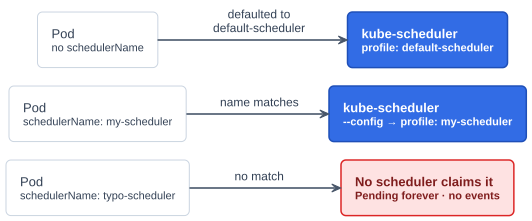

# 11 — Multiple Schedulers

A cluster can run more than one scheduler. Every Pod names the scheduler that should place it in **`spec.schedulerName`**. If the field is empty, it defaults to `default-scheduler`. Each scheduler only picks up Pods carrying its own name, so most Pods keep using the default scheduler and a few go to a custom one.



---

## 1. The scheduler's name lives in its config file

A scheduler's name is the `schedulerName` of a profile in its **KubeSchedulerConfiguration** file, which is passed with `--config`:

```yaml
# my-scheduler-config.yaml
apiVersion: kubescheduler.config.k8s.io/v1
kind: KubeSchedulerConfiguration
profiles:
- schedulerName: my-scheduler
leaderElection:
  leaderElect: false        # one replica: no election needed
```

- Without a config file, the scheduler's only profile is `default-scheduler`.
- An additional scheduler is usually the **same `kube-scheduler` binary and image** run with a different config file. A home-built scheduler works the same way, as long as it follows the name rule.
- **Leader election:** if `leaderElect: true`, also set `leaderElection.resourceName` (for example `my-scheduler`) and `resourceNamespace: kube-system`. The default lock name is `kube-scheduler`, which the default scheduler already holds. A second scheduler using the same lock waits for it forever and never schedules anything.

## 2. Deploying it as a Pod

The pieces it needs:

1. **The config**, in a ConfigMap mounted as a volume:
   ```bash
   kubectl -n kube-system create configmap my-scheduler-config --from-file=my-scheduler-config.yaml
   ```
2. **Permissions:**
   - a ServiceAccount, for example `my-scheduler` in `kube-system`;
   - ClusterRoleBindings to `system:kube-scheduler` and `system:volume-scheduler`.
   
   Labs usually create these for you. Check with `kubectl -n kube-system get sa`.
3. **The Pod or Deployment** in `kube-system`. Use the default scheduler's image, which you can read from the cluster:
   ```bash
   kubectl -n kube-system get pod -l component=kube-scheduler -o jsonpath='{..image}{"\n"}'
   ```

```yaml
apiVersion: v1
kind: Pod
metadata:
  name: my-scheduler
  namespace: kube-system
spec:
  serviceAccountName: my-scheduler
  containers:
  - name: my-scheduler
    image: registry.k8s.io/kube-scheduler:v1.34.0      # match the cluster
    command:
    - kube-scheduler
    - --config=/etc/kubernetes/my-scheduler/my-scheduler-config.yaml
    volumeMounts:
    - name: config-volume
      mountPath: /etc/kubernetes/my-scheduler
  volumes:
  - name: config-volume
    configMap:
      name: my-scheduler-config
```

The path in `--config` is the `mountPath` plus the ConfigMap **key** (the file name used with `--from-file`).

**Slide corrections:**
- The slide's `--address=127.0.0.1` flag no longer exists. kube-scheduler only has `--bind-address`.
- The image is `registry.k8s.io/kube-scheduler:<version>`, not `k8s.gcr.io/kube-scheduler-amd64`.
- The kubeadm control-plane scheduler is a static Pod ([09](09-static-pods.md)), not a Deployment.

## 3. Using it and checking it

```yaml
spec:
  schedulerName: my-scheduler     # Pod spec level; Deployment: spec.template.spec
  containers: ...
```

```bash
kubectl -n kube-system get pods                    # custom scheduler Running?
kubectl get events -o wide | grep Scheduled        # SOURCE column = scheduler name
kubectl get pod nginx -o jsonpath='{.spec.schedulerName}{"\n"}'
kubectl -n kube-system logs my-scheduler           # config errors, leader lease
```

**Troubleshooting a Pending Pod** that names a custom scheduler:

1. Check that the scheduler Pod is Running.
2. Check that the name in `spec.schedulerName` exactly matches the profile's `schedulerName`.
3. Read the scheduler's logs.

A Pod whose scheduler is missing gets **no events at all**: no scheduler has claimed it, so none reports `FailedScheduling`. `spec.schedulerName` cannot be changed on an existing Pod, so recreate it with `kubectl replace --force -f`.

---

## Exam angle

- **"Deploy a second scheduler named X"**: put `schedulerName: X` in a KubeSchedulerConfiguration, load it into a ConfigMap, then create the Pod with the default scheduler's image and `--config` pointing into the mounted volume. Verify with `kubectl -n kube-system get pod`, then read its logs.
- **"Create Pod Y using scheduler X"**: generate the Pod with `kubectl run Y --image=nginx $do > y.yaml`, add `schedulerName: X` under `spec`, and apply it. Verify in the `SOURCE` column of `kubectl get events -o wide`.
- **Pod stuck Pending with no events**: the scheduler name is wrong, or the scheduler is not running.
- **Traps:** a `--config` path that does not match the mount path and ConfigMap key; `leaderElect: true` with the default lock name; putting `schedulerName` in the Deployment's top-level `spec` instead of `spec.template.spec`.

## References

- [Configure Multiple Schedulers](https://kubernetes.io/docs/tasks/extend-kubernetes/configure-multiple-schedulers/) — "Define a Kubernetes Deployment for the scheduler" has the full ServiceAccount, RBAC, ConfigMap and Deployment YAML; "Enable leader election"; "Specify schedulers for pods"
- [Scheduler Configuration](https://kubernetes.io/docs/reference/scheduling/config/) — KubeSchedulerConfiguration and "Multiple profiles"
- [kube-scheduler](https://kubernetes.io/docs/reference/command-line-tools-reference/kube-scheduler/) — command-line flags
