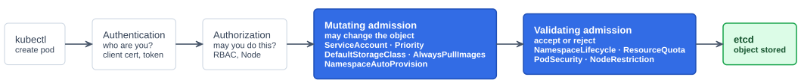

# 13 — Admission Controllers

Every write request to the API server passes three gates. **Authentication** checks who you are, **authorization** (RBAC) checks whether you may perform that verb on that resource, and **admission controllers** check, and can change, the object itself. RBAC cannot say "no `latest` tags", "no root containers" or "add a default StorageClass". Admission can.



- Admission runs **after authorization and before the object is saved to etcd**.
- It runs in two phases: **mutating** controllers first (they can change the object), then **validating** controllers (they accept or reject it). If any controller rejects, the whole request fails.
- Admission applies to create, update, delete and connect requests. It **never applies to reads** (`get`, `list`, `watch`).
- Admission controllers are plugins compiled into `kube-apiserver`, switched on and off with flags. Webhooks (`MutatingAdmissionWebhook`, `ValidatingAdmissionWebhook`) and `ValidatingAdmissionPolicy` let you add your own rules without rebuilding.

**Slide correction:** the slides label the user's box "kubelet". It should be **kubectl**: the client sending the request.

---

## 1. Useful plugins

| Plugin | Phase | Effect |
|---|---|---|
| `NamespaceLifecycle` (default) | Validating | Rejects objects in a namespace that doesn't exist or is being deleted. Blocks deleting `default`, `kube-system`, `kube-public` |
| `NamespaceAutoProvision` (off) | Mutating | Creates a missing namespace instead of rejecting the request |
| `ServiceAccount` (default) | Both | Sets the `default` ServiceAccount on Pods that name none, and mounts its token |
| `Priority` (default) | Both | Converts `priorityClassName` to `spec.priority` ([10](10-priority-classes.md)) |
| `LimitRanger`, `ResourceQuota` (default) | Both | Apply LimitRange defaults; enforce quotas ([02-17](../02-core-concepts/17-namespaces.md)) |
| `DefaultStorageClass` (default) | Mutating | Gives a PVC without a class the default StorageClass |
| `PodSecurity` (default) | Validating | Enforces Pod Security Standards per namespace |
| `NodeRestriction` (kubeadm turns it on) | Validating | Lets a kubelet modify only its own Node and the Pods bound to it |
| `AlwaysPullImages` (off) | Mutating | Forces `imagePullPolicy: Always` on every Pod |
| `EventRateLimit` (off) | Validating | Limits how fast Events can be created. Needs a config file |

The slide's "namespaces "blue" not found" error comes from `NamespaceLifecycle`, which is on by default. You do not need `NamespaceExists` for it.

## 2. See what is enabled

```bash
# what this cluster's API server was started with (kubeadm control plane node)
grep admission-plugins /etc/kubernetes/manifests/kube-apiserver.yaml
ps -ef | grep [k]ube-apiserver | grep -o -- '--[a-z-]*admission-plugins=[^ ]*'

# the defaults built into this version
kubectl -n kube-system exec kube-apiserver-controlplane -- kube-apiserver -h | grep enable-admission-plugins
```

The help text lists the plugins that are **on by default**. A plugin is active if it is on by default or listed in `--enable-admission-plugins`, and not listed in `--disable-admission-plugins`.

## 3. Turn plugins on and off

Edit the API server's static Pod manifest ([09](09-static-pods.md)):

```bash
cp /etc/kubernetes/manifests/kube-apiserver.yaml /root/kube-apiserver.yaml.bak   # back up OUTSIDE the manifests dir
vi /etc/kubernetes/manifests/kube-apiserver.yaml
#   - --enable-admission-plugins=NodeRestriction,NamespaceAutoProvision
#   - --disable-admission-plugins=DefaultStorageClass
```

- **Extend the existing comma-separated list.** Keep one `--enable-admission-plugins` line so the next reader sees the whole set.
- **Order in the list doesn't matter.**
- **`--enable-admission-plugins` adds to the defaults.** You don't need to list the default plugins.
- **The API server restarts after the edit, and `kubectl` fails until it is back** (30-60s). Watch it:
  ```bash
  watch crictl ps --name kube-apiserver
  kubectl -n kube-system get pod kube-apiserver-controlplane
  ```
- **If it doesn't come back:** check `crictl ps -a`, then `crictl logs <id>`, then `journalctl -u kubelet`. A misspelled plugin name stops the API server, and its container log names the bad plugin.

Other slide corrections: the systemd unit's `--enable-swagger-ui` flag no longer exists, and the image is `registry.k8s.io/kube-apiserver`, not `k8s.gcr.io/...-amd64`.

---

## Exam angle

- **"Which admission plugins are enabled / which is disabled?"**: grep `admission-plugins` in `/etc/kubernetes/manifests/kube-apiserver.yaml`. Use `kube-apiserver -h` inside the Pod only for the default list.
- **"Enable X" / "disable Y"**: edit the manifest flag, wait for the API server to return, then prove it. For example, after enabling `NamespaceAutoProvision`, `kubectl run nginx --image=nginx -n blue` creates namespace `blue`.
- **Traps:**
  - leaving the backup copy in `/etc/kubernetes/manifests/`, where the kubelet runs it too;
  - misspelling a plugin name, which keeps the API server down;
  - expecting admission to block reads;
  - mistaking a RBAC `Forbidden` error for an admission rejection. The admission error names the plugin or webhook.

## References

- [Admission Control in Kubernetes](https://kubernetes.io/docs/reference/access-authn-authz/admission-controllers/) — "How do I turn on an admission controller?", "Which plugins are enabled by default?", and one section per plugin
- [kube-apiserver](https://kubernetes.io/docs/reference/command-line-tools-reference/kube-apiserver/) — `--enable-admission-plugins` and `--disable-admission-plugins`

## Related notes

- CKAD: [Admission Controllers](https://github.com/caseythecoder90/ckad-exam-prep/blob/main/notes/09-security/08-admission-controllers.md) — the developer's view, including webhooks
- KCNA: [Pod Security Admission](https://github.com/caseythecoder90/kcna-study-guide/blob/main/notes/05-kubernetes-deep-dive/16-pod-security-admission.md) — the `PodSecurity` plugin in depth
