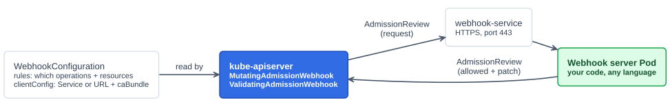

# 14 — Validating and Mutating Admission Webhooks

Admission controllers ([13](13-admission-controllers.md)) come in two kinds:

| Kind | Does | Example |
|---|---|---|
| **Mutating** | Changes the object before it is stored | `DefaultStorageClass` adds the default class to a PVC that names none. `kubectl get pvc -o yaml` then shows a `storageClassName` you never wrote |
| **Validating** | Allows or rejects the object, unchanged | `NamespaceLifecycle` rejects objects in a namespace that doesn't exist |

Some plugins do both. **Mutating plugins run first**, so validators check the final object. That is why `NamespaceAutoProvision` (mutating) can create the namespace before the namespace check (validating) runs.

---

## 1. Your own logic: admission webhooks

Two built-in plugins, `MutatingAdmissionWebhook` and `ValidatingAdmissionWebhook` (both on by default), call **your HTTPS server** during admission. You need:

1. A webhook server, usually a Deployment plus a Service in the cluster, though it can also run outside it.
2. A **MutatingWebhookConfiguration** or **ValidatingWebhookConfiguration** object telling the API server which requests to send where.



**The exchange:** the API server POSTs an `AdmissionReview` (`admission.k8s.io/v1`) containing the user, the operation and the object. The server answers with an `AdmissionReview` whose `response` has:
- `uid`: copied from the request;
- `allowed`: `true` or `false`;
- `status.message`: the reason, if rejected;
- for mutation, `patch` (a base64-encoded JSON Patch) and `patchType: JSONPatch`.

The server can be written in any language that serves HTTPS and JSON.

```yaml
apiVersion: admissionregistration.k8s.io/v1
kind: ValidatingWebhookConfiguration        # or MutatingWebhookConfiguration
metadata:
  name: pod-policy.example.com
webhooks:
- name: pod-policy.example.com
  clientConfig:
    service:                                # or url: "https://external-server.example.com"
      namespace: webhook-namespace
      name: webhook-service                 # port defaults to 443
      path: /validate
    caBundle: <base64 CA that signed the server's TLS cert>
  rules:
  - apiGroups: [""]
    apiVersions: ["v1"]
    operations: ["CREATE"]
    resources: ["pods"]
    scope: "Namespaced"
  admissionReviewVersions: ["v1"]           # required
  sideEffects: None                         # required
  failurePolicy: Fail                       # default; Ignore = let requests through if the webhook is down
```

**Slide corrections:**
- The slide's YAML omits `admissionReviewVersions` and `sideEffects`. The `v1` API rejects the object without them.
- The response field is `patchType`, not `patchtype`.
- The sample Go server uses `admission/v1beta1`. The current version is `admission.k8s.io/v1`.

## 2. The lab steps

```bash
kubectl create ns webhook-demo
kubectl -n webhook-demo create secret tls webhook-server-tls \
  --cert=/root/keys/webhook-server-tls.crt --key=/root/keys/webhook-server-tls.key
kubectl apply -f webhook-deployment.yaml -f webhook-service.yaml
kubectl apply -f webhook-configuration.yaml
kubectl get mutatingwebhookconfigurations,validatingwebhookconfigurations   # cluster-scoped
kubectl apply -f pod-with-defaults.yaml && kubectl get pod <pod> -o yaml     # see what was mutated
```

**Debugging:**
- **Every matching request fails with `failed calling webhook`:** the server is down or unreachable, and `failurePolicy: Fail` blocks everything it matches. Check the server's Pods, the Service endpoints, and that `caBundle` matches the server's certificate.
- **Locked out, including the webhook's own Pods:** delete the configuration with `kubectl delete validatingwebhookconfiguration <name>`. To avoid this, exclude system namespaces with `namespaceSelector`.

A webhook-free alternative for validation is **ValidatingAdmissionPolicy**: rules written in CEL that run inside the API server, with no server to deploy.

---

## Exam angle

- **Likely tasks:**
  - identify whether a plugin mutates or validates;
  - create the TLS secret and apply a provided webhook Deployment, Service and configuration;
  - inspect what a mutating webhook changed with `-o yaml`.
- Copy webhook configuration YAML from the "Dynamic Admission Control" page. It has `admissionReviewVersions` and `sideEffects`.
- **Traps:**
  - the TLS secret in the wrong namespace, or with a different name from the one the Deployment mounts;
  - forgetting that webhook configurations are cluster-scoped;
  - a down webhook with `failurePolicy: Fail` blocking unrelated Pods.

## References

- [Dynamic Admission Control](https://kubernetes.io/docs/reference/access-authn-authz/extensible-admission-controllers/) — "Configure admission webhooks on the fly" has the configuration YAML; "Webhook request and response" has the AdmissionReview and patch format; "Failure policy" and "Matching requests: namespaceSelector"
- [Validating Admission Policy](https://kubernetes.io/docs/reference/access-authn-authz/validating-admission-policy/) — CEL rules without a webhook
- [Admission Control in Kubernetes](https://kubernetes.io/docs/reference/access-authn-authz/admission-controllers/) — "MutatingAdmissionWebhook" and "ValidatingAdmissionWebhook"

## Related notes

- CKAD: [Admission Controllers](https://github.com/caseythecoder90/ckad-exam-prep/blob/main/notes/09-security/08-admission-controllers.md) — includes the webhook flow
