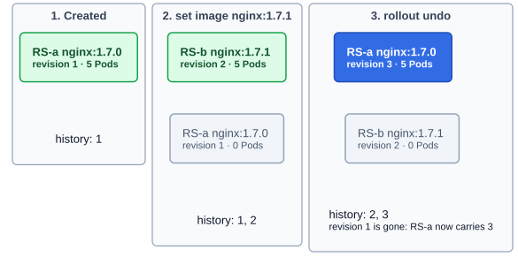

# 01 — Rolling Updates and Rollbacks

**Rollouts:**
- Every change to a Deployment's **Pod template** (`spec.template`) starts a **rollout**.
- The rollout creates a new **ReplicaSet** for the new template, scales it up and scales the old one down.
- Each ReplicaSet is one **revision**. Old ReplicaSets stay at 0 replicas, and that is what a rollback returns to.

Changing `replicas` is **not** a rollout and adds no revision. The lecture lists "updating the number of replicas" as an update that triggers one; it doesn't.

[02-13 Deployments](../02-core-concepts/13-deployments.md) covers the Deployment object, the strategy fields with worked numbers, and pause and resume. This chapter is the update and rollback cycle a task asks for.

---

## 1. Strategies

| `spec.strategy.type` | What happens | Downtime |
|---|---|---|
| `RollingUpdate` (default) | Replaces Pods in steps. With the defaults, `maxSurge: 25%` and `maxUnavailable: 25%`, the steps are about a quarter of the Pods each, not one at a time | None |
| `Recreate` | Scales the old ReplicaSet to 0, then the new one up | Yes, between the two |

`kubectl describe deploy` shows `StrategyType`, and its events show the pattern. Recreate shows one "scaled down to 0" followed by one "scaled up to 5". RollingUpdate shows the two ReplicaSets interleaved, scaling up and down in turn.

## 2. The update cycle

```bash
kubectl get deploy myapp -o jsonpath='{.spec.template.spec.containers[*].name}'   # container name for set image
kubectl set image deploy/myapp nginx=nginx:1.9.1      # or: kubectl edit deploy myapp, or apply -f
kubectl rollout status deploy/myapp                   # waits until done; non-zero exit on failure
kubectl get rs -l app=myapp                           # new RS up, old RS at 0
kubectl rollout history deploy/myapp
kubectl rollout history deploy/myapp --revision=2     # the template of revision 2
kubectl rollout undo deploy/myapp                     # back to the previous revision
kubectl rollout undo deploy/myapp --to-revision=1
```

**`set image` versus `apply`:** `set image` changes the live object only, so your YAML file is now out of date. A later `apply -f` of that file rolls the image back.

## 3. How revisions are numbered



- A rollback **reuses the old ReplicaSet** and gives it the next revision number. Revision 1 disappears from the history.
- Setting the image back by hand (`set image ... nginx:1.7.0`) does the same thing, because the controller finds the ReplicaSet whose template matches.
- `revisionHistoryLimit` (default 10) is how many old ReplicaSets are kept. Revisions older than that can no longer be rolled back to.

## 4. CHANGE-CAUSE

`rollout history` prints a CHANGE-CAUSE column. It comes from the `kubernetes.io/change-cause` annotation, copied onto each revision's ReplicaSet.

**Slide correction:** the slide fills it with `--record`. That flag is **deprecated**: kubectl prints a warning, and the flag will be removed. Set the annotation yourself, right after the change:

```bash
kubectl set image deploy/myapp nginx=nginx:1.9.1
kubectl annotate deploy/myapp kubernetes.io/change-cause="nginx 1.9.1"
```

Another slide error: the slide's YAML writes `image: nginx: 1.7.1`. The space after the second colon makes it invalid YAML. Write `image: nginx:1.7.1`.

---

## Exam angle

- **"Update Deployment X to image Y, then record the change / roll it back":**
  - run `set image` with the **container** name (look it up first), then `rollout status`;
  - add the change-cause annotation if the task asks for one;
  - `rollout undo` when told to roll back.
- **"Roll back to the revision that used image Z":** find it with `rollout history --revision=N`, then `undo --to-revision=N`. Verify with `kubectl get deploy X -o jsonpath='{..image}'`.
- **Stuck rollout (bad image):** `rollout status` hangs, the new ReplicaSet's Pods show `ImagePullBackOff`, and the old Pods keep serving. `rollout undo` fixes it.
- **Change the strategy:** `kubectl edit`, setting `spec.strategy`. For `Recreate`, delete the `rollingUpdate:` block or the API rejects it.
- **Trap:** expecting revision 1 to still exist after an undo. The numbers move forward.

## References

- [Deployments](https://kubernetes.io/docs/concepts/workloads/controllers/deployment/) — "Updating a Deployment", "Rolling Back a Deployment" (history, `--to-revision`, change-cause), "Strategy" (YAML for both types)
- [kubectl rollout](https://kubernetes.io/docs/reference/kubectl/generated/kubectl_rollout/) — `status`, `history`, `undo`, `restart`

## Related notes

- CKAD: [Updates and rollbacks](https://github.com/caseythecoder90/ckad-exam-prep/blob/main/notes/05-pod-design/02-deployment-updates-rollbacks.md) — the developer's view
